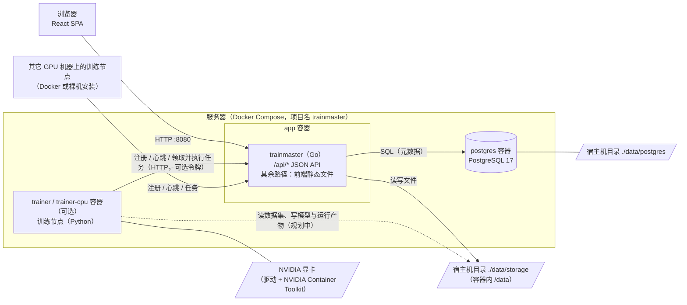

# 架构说明

本文描述 trainMaster 的整体结构与约定（平台框架 + 已实现的数据集、项目、标注、计算资源与模型仓库）。后续功能开发应遵循这里的约定；需要调整约定时，请同步更新本文。

## 1. 组件总览



- **单镜像**：Go 服务同时提供 `/api` 下的 JSON API 和前端构建产物（`/app/web`），部署只需 `app` 与 `postgres` 两个容器。
- **训练节点是独立的服务**：Python 训练节点（`trainer/`）运行在有显卡的机器上，主动向平台注册并上报心跳（见第 9 节）。同一台机器上由 compose 的 profile 启用（`gpu` → `trainer`，`cpu` → `trainer-cpu`，`make setup` 自动选择），也可以运行在其它机器上；训练节点还执行平台的任务（目前是模型仓库的 ONNX 转换，见第 9、10 节），没有训练节点时转换一直排队，平台的其它功能不受影响。
- **文件与元数据分离**：图片、模型权重等大文件以普通文件形式保存在宿主机目录；PostgreSQL 只保存元数据（记录、关系、状态）。两者都通过绑定挂载持久化。
- **内网友好**：前端不依赖任何外部 CDN、在线字体或第三方服务。

## 2. 后端模块

后端位于 `backend/`，Go module 为 `github.com/icaruszezen/trainmaster/backend`。依赖保持最少：chi（路由）、pgx（PostgreSQL），日志使用标准库 `log/slog`，不使用 ORM、配置库或迁移库。数据集导入额外使用纯 Go 的解压与图像库（`bodgit/sevenzip`、`nwaples/rardecode`、`ulikunitz/xz`、`xi2/xz`、`klauspost/compress`、`golang.org/x/image`、`golang.org/x/text`），不依赖系统命令，各平台行为一致。

| 包 | 职责 |
|---|---|
| `cmd/trainmaster` | 程序入口，按顺序组装各模块并处理优雅关闭 |
| `internal/buildinfo` | 版本号、提交号、构建时间（通过 `-ldflags -X` 注入） |
| `internal/config` | 读取并校验 `TM_*` 环境变量；非法值一次性全部报出并退出 |
| `internal/database` | pgxpool 连接池、启动时连接重试、内置迁移执行器 |
| `internal/storage` | 数据目录布局、启动时创建与可写检查、磁盘用量、安全路径解析 |
| `internal/dataset` | 数据集：命名规则、图片与 VOC 标注识别、压缩包解压、目录扫描、缩略图、导入任务执行器 |
| `internal/project` | 项目：项目的增删改、项目与数据集的多对多关系、按数据集合计的统计与标签分布、项目的模型数与最新版本 |
| `internal/model` | 模型仓库：分块上传与提交、项目内的版本分配、模型文件夹与 `model.json`、下载、删除；ONNX 转换的选项、缓存、任务队列（领取、租约、重试）与训练节点的任务接口；为平台训练预留的 `RegisterTrainedModel`（见第 10 节） |
| `internal/model/checkpoint` | 读取 Ultralytics `.pt` 的元数据：zip 中的 `data.pkl` 由只读的 pickle 解释器解析（不执行任何代码），得到任务、类别、输入尺寸、YOLO 版本、训练信息；纯函数，无数据库依赖 |
| `internal/compute` | 计算资源：训练节点的注册与心跳、上报数据的规范化与校验、在线状态判定、删除与重新检测、内存中的指标历史 |
| `internal/hostinfo` | 平台服务器自身的 CPU、内存、负载、cgroup 限制与 NVIDIA 显卡（读 `/proc`、`/sys`，根目录可替换以便测试）；后台每 5 秒采样一次 CPU 利用率 |
| `internal/httpapi` | chi 路由、中间件、统一 JSON 响应与错误信封、各 handler |
| `internal/web` | 前端静态文件服务：SPA 回退、缓存头、禁止目录列表与路径穿越 |

### 启动流程

1. 加载配置，初始化 slog（`TM_LOG_FORMAT=text|json`）。
2. 初始化存储目录：创建根目录和 6 个子目录（见第 5 节）并做可写探测，失败则退出并提示检查挂载目录权限 / PUID、PGID。
3. 连接数据库：指数退避重试，最长约 60 秒（数据库容器还在启动时会等待），仍失败则以非 0 退出。
4. `TM_DB_AUTO_MIGRATE=true`（默认）时执行待执行的迁移。
5. 恢复上次关闭时未完成的数据集导入任务，补齐图片的排序键（见第 6 节“图片顺序”），然后启动任务执行器（见第 6 节）；启动模型仓库的后台任务（见第 10 节“存储与版本号”）。
6. 启动 HTTP 服务；收到 SIGINT / SIGTERM 后停止接收新请求，等待进行中的请求完成（最长 15 秒）；超时后强制关闭剩余连接（取消其请求的 context），最后关闭数据库连接池。还在等待数据库或迁移锁时收到信号，则直接正常退出。收到信号时会立即取消正在执行的导入 / 扫描任务并记为失败（“服务重启，导入被中断”），排队中的任务保留到下次启动执行；HTTP 服务关闭后再等待任务执行器的 worker 退出。进程在写入结果前异常退出时，下次启动由恢复逻辑把任务标记为中断，并重新计算受影响数据集的统计数据。长连接 handler 应通过 `http.Server.RegisterOnShutdown` 在关闭开始时主动结束：训练节点领取任务的长轮询（最长 30 秒）就是这样立即返回 `{"task": null}` 的，以后的 SSE 推送（如训练日志）也应如此。

## 3. API 约定

### 基本规则

- 所有接口都在 `/api` 下，业务接口带版本前缀 `/api/v1`。
- 请求与响应均为 JSON，响应头 `Content-Type: application/json; charset=utf-8`，并带 `Cache-Control: no-store`。
- 成功时**直接返回资源对象**；列表统一为：

  ```json
  {"items": [], "total": 0}
  ```

  （Go 中使用 `httpapi.NewList(items, total)`，空列表编码为 `[]` 而不是 `null`。）
- 失败时统一返回错误信封，`code` 供程序判断，`message` 直接展示给用户（中文）：

  ```json
  {"error": {"code": "not_found", "message": "接口不存在"}}
  ```

- 每个请求都有 `X-Request-ID`：请求头中带了合法值（≤128 个可见 ASCII 字符）就沿用，否则自动生成；响应头会返回它，访问日志中也会记录，便于排查问题。
- `HEAD` 请求自动由对应的 `GET` 路由处理。

### 错误码

| HTTP 状态 | code | 场景 |
|---|---|---|
| 400 | `bad_request` | 请求格式不正确（如 JSON 无法解析、参数类型错误、列表的搜索参数 `q` 含无效的 UTF-8 或 NUL 字符（“参数 q 无效：搜索内容包含无效字符”）、训练节点的任务调用缺少 `X-Node-Key`） |
| 401 | `unauthorized` | 配置了 `TM_NODE_TOKEN`，但训练节点的 `/agent/*` 调用（注册、心跳、任务）没有带正确的 `Authorization: Bearer <令牌>`（“节点令牌不正确”） |
| 404 | `not_found` | 接口或资源不存在（未设置 `TM_WEB_DIR` 时，非 `/api` 路径也返回它） |
| 404 | `unknown_node` | 心跳或任务调用中的 `node_key`（`X-Node-Key`）尚未注册（或节点已被删除），训练节点收到后重新注册 |
| 405 | `method_not_allowed` | 路径存在但不支持该方法（响应头 `Allow` 列出支持的方法） |
| 409 | `conflict` | 与当前状态冲突（同名数据集、数据集正在导入、任务状态不允许该操作、类别列表已被他人修改、标注文件不能在平台中修改、删除在线的训练节点、重新检测离线的训练节点、删除有模型的项目、模型文件未上传完就提交、模型上传的临时文件已丢失、转换任务已不属于该训练节点等） |
| 409 | `annotation_conflict` | 保存 / 删除标注时，标注文件在 `base_version` 之后已被修改（他人在另一个窗口保存，或用其它工具改了文件）。客户端应重新读取图片详情，或带 `force: true` 覆盖 |
| 409 | `annotation_unpatchable` | 保存标注时，已有的标注文件无法在保留其中平台不编辑的内容的情况下修改（极少见）；带 `regenerate: true` 时按平台的格式重新生成整个文件（`force: true` 只跳过版本检查，不会重新生成） |
| 409 | `upload_offset_mismatch` | 分块上传（数据集压缩包、模型文件）的 `offset` 与服务端已接收的字节数不一致，客户端应重新获取任务或上传后从 `received_bytes` 续传 |
| 413 | `payload_too_large` | 请求体超过限制（单个分块 64 MiB，单次文件夹批量上传 256 MiB，训练节点的 JSON 请求 1 MiB、上传的转换结果 4 GiB，上传前的进度上报按同样的上限预检） |
| 422 | `validation_failed` | 字段校验失败，`message` 说明具体问题（如数据集名称不合法、ONNX 转换选项不允许） |
| 422 | `unsupported_image` | 无法为该图片生成缩略图（格式不支持、文件损坏或像素过大），前端回退为原图或占位图 |
| 422 | `invalid_model` | 提交的模型文件不是平台支持的 YOLO 模型（不是 PyTorch 文件、旧格式、损坏、不是 Ultralytics 检查点、原版 YOLOv5 仓库、RT-DETR、引用了安全加载不允许的对象等），`message` 说明原因；上传随之失败 |
| 422 | `yolo_version_mismatch` | 模型文件中识别出的 YOLO 版本与所选的不同；上传保留，带识别出的版本（上传的 `detected_yolo_version`）再次提交即可 |
| 500 | `internal_error` | 未预期的错误（handler panic 会被恢复并返回此错误） |
| 501 | `not_implemented` | 规划中的功能模块 |
| 507 | `insufficient_storage` | 存储空间不足，无法接收该上传（数据集与模型的上传、训练节点上传的转换结果及其预检） |

新增功能需要其它错误码时，在 `internal/httpapi/respond.go` 中集中定义，并补充到本表。

### 已有接口

| 方法与路径 | 说明 |
|---|---|
| `GET /api/healthz` | 存活探针，不依赖任何外部组件，返回 `{"status":"ok"}`。Docker HEALTHCHECK 使用它 |
| `GET /api/readyz` | 就绪探针：检查数据库与存储，全部正常 200，否则 503，失败项带 `error` |
| `GET /api/v1/system/info` | 版本、运行时间、数据库与存储信息（工作台和存储管理页使用）。数据库不可用时仍返回 200，`database.status` 为 `unavailable` |
| 数据集相关接口 | 见下方“数据集接口” |
| 项目相关接口 | 见下方“项目接口” |
| 模型仓库相关接口 | 见下方“模型仓库接口” |
| 计算资源相关接口（含训练节点的任务接口） | 见下方“计算资源接口” |
| `/api/v1/annotation/tasks`、`/api/v1/annotation/labels`、`/api/v1/training/jobs`、`/api/v1/evaluations` 及其子路径 | 预留给规划中的模块，任意方法均返回 `501 not_implemented` |

`/api/readyz` 示例：

```json
{
  "status": "ok",
  "checks": {
    "database": {"status": "ok", "latency_ms": 0.53},
    "storage": {"status": "ok"}
  }
}
```

`/api/v1/system/info` 示例（字段名是与前端 `frontend/src/features/system/api.ts` 的契约，不要随意改名）：

```json
{
  "name": "trainMaster",
  "version": "0.1.0-dev",
  "commit": "d62132f",
  "build_time": "2026-10-30T08:00:00Z",
  "go_version": "go1.24.13",
  "started_at": "2026-10-30T08:00:00Z",
  "uptime_seconds": 120,
  "database": {"status": "ok", "server_version": "17.6", "schema_version": 1},
  "storage": {
    "root": "/data",
    "total_bytes": 1000, "free_bytes": 400, "used_bytes": 600,
    "directories": [{"key": "datasets", "path": "/data/datasets", "writable": true}]
  }
}
```

`used_bytes = total_bytes - free_bytes`，`free_bytes` 为非特权进程可用空间。磁盘用量只在 Linux 上实现（部署环境），其它平台上这三个值为 0。

### 数据集接口

字段定义以前端 `frontend/src/features/datasets/api.ts` 中的类型为准（与后端 `internal/httpapi/datasets.go` 保持一致）。`{id}` 等路径参数必须是正整数，否则返回 404。

| 方法与路径 | 说明 |
|---|---|
| `GET /api/v1/datasets` | 数据集列表（`q` 按名称 / 描述筛选；`project_id=<项目ID>` 只列出该项目中的数据集，`project_id=none` 只列出未纳入任何项目的数据集，其它值返回 400），按更新时间倒序；每项带统计数据、封面图片（最多 4 张）、所属项目 `projects: [{id, name}]`（按名称排序）和进行中的导入任务 |
| `POST /api/v1/datasets` | `{name, description?}` 新建数据集并创建同名文件夹；带 `directory` 时把 `datasets/` 下已有的文件夹添加为数据集，并立即开始扫描 |
| `GET /api/v1/datasets/directories` | `datasets/` 下的全部一级文件夹（跳过隐藏目录和符号链接），标明是否已添加，附图片 / 标注文件数量（超过 5 万个条目或 2 秒时为估算值，`approximate: true`） |
| `GET /api/v1/datasets/{id}` | 数据集详情；`directory_missing` 表示文件夹已不在磁盘上 |
| `PATCH /api/v1/datasets/{id}` | 修改名称（只改显示名称，文件夹不变）和描述 |
| `PUT /api/v1/datasets/{id}/projects` | `{project_ids: [...]}` 设置数据集所属的项目（整体替换，`[]` 表示移出所有项目，缺少该字段时返回 422），返回更新后的数据集；所选项目不存在时返回 422，不做任何修改 |
| `DELETE /api/v1/datasets/{id}` | 删除数据集记录（同时移出所属的项目）；`?delete_files=true` 同时删除磁盘上的**整个**文件夹与缩略图缓存。成功返回 204；记录已删除但文件夹没能完全删除（如权限不足）时返回 200 `{"files_removed": false, "message": "…"}`，剩余文件恢复为原来的文件夹名，可以重新添加或手动清理。导入 / 扫描正在执行时返回 409 |
| `GET /api/v1/datasets/{id}/images` | 图片列表，固定按图片顺序排列（见“图片顺序”）：`offset`、`limit`（≤ 200）、`status`（`all` / `annotated` 有目标 / `empty` 空标注 / `invalid` 标注无效 / `unannotated` 无标注文件）、`label`、`q`（路径包含） |
| `GET /api/v1/datasets/{id}/images/{imageId}` | 单张图片详情：`objects` 等标注信息实时从 VOC 文件解析；文件无法解析或已不存在时 `annotation_error` 给出原因。`annotation_version` 是标注文件内容的版本（没有文件时为 `""`），保存时原样带回；`annotation_unsupported` 是文件中平台无法显示的目标数（如多边形，保存时原样保留）；`annotation_blocked` 不为空时说明这张图片不能在平台中保存标注的原因（如同名的 `.xml` 属于另一张图片，见第 6 节“标注”） |
| `GET /api/v1/datasets/{id}/images/{imageId}/neighbors` | 按图片顺序的上一张 / 下一张：`{prev, next, position, matches, total}`，筛选参数同图片列表（`status`、`label`、`q`）；当前图片不符合筛选条件时 `matches: false`，`prev` / `next` 仍是它前后最近的符合条件的图片 |
| `PUT /api/v1/datasets/{id}/images/{imageId}/annotation` | 保存标注：`{objects: [{name, xmin, ymin, xmax, ymax, difficult, truncated}], base_version, force?, regenerate?}`，写回数据集文件夹中的 VOC 文件并更新索引与计数，返回保存后的图片详情，其中 `annotation_version` 是本次写入内容的版本。`objects` 为 `[]` 时写入没有目标的文件（空标注 / 负样本）。坐标在裁剪到图片范围后大于 2147483647 时返回 422；图片不能在平台中保存标注（`annotation_blocked`），或重新扫描时会改用另一个标注文件、会把标注文件交给另一张图片（需要先重新扫描）时返回 409 `conflict`；文件无法在保留其它内容的情况下修改时返回 409 `annotation_unpatchable`（带 `regenerate: true` 时重新生成整个文件，仍然检查 `base_version`）。见第 6 节“标注” |
| `DELETE /api/v1/datasets/{id}/images/{imageId}/annotation?base_version=&force=` | 删除标注文件，返回图片详情；没有文件时也返回 200。图片通常恢复为“未标注”（`annotation_version` 为 `""`）；还有重新扫描时会配对的另一个标注文件时（如被图片旁的文件取代的 `Annotations/` 中的文件），图片改为与它配对，详情描述该文件。删除后重新扫描会把另一张图片的标注文件配对给这张图片，或配对给原本与这张图片争用被删文件的图片（如同一文件夹中的 `a.png`）时返回 409 `conflict`。见第 6 节“标注” |
| `GET /api/v1/datasets/{id}/classes` | 类别列表：`{items: [{name, color}], total, version}`，标注时可选的类别及顺序（`color` 为 `#rrggbb`，`""` 表示按名称自动配色）；`version` 是列表内容的版本（空列表也有），整体替换时作为 `base_version` 带回 |
| `PUT /api/v1/datasets/{id}/classes` | `{classes: [...], base_version?}` 整体替换类别列表（最多 1000 个，名称规则同 YOLO 类别，不能重复），返回新的列表（格式同 GET）。带 `base_version` 且与当前版本不同时返回 409 `conflict`（“类别列表已被其他人修改，请载入最新的列表后再保存”），列表不变；不带时直接替换。只修改列表，不改动任何标注文件 |
| `POST /api/v1/datasets/{id}/classes` | `{name, color?}` 在列表末尾追加一个类别（`color` 为 `""` 或 `#rrggbb`）；已有同名类别（去掉首尾空白后完全相同）时列表不变。校验同 PUT（超过 1000 个时返回 422），返回列表（格式同 GET）。读取与写入在同一事务中并锁定数据集行，并发追加不会互相覆盖 |
| `GET /api/v1/datasets/{id}/images/{imageId}/file` | 原图（支持 Range 与条件请求） |
| `GET /api/v1/datasets/{id}/images/{imageId}/thumbnail` | JPEG 缩略图，`size=sm`（320px）/ `lg`（1600px），生成后缓存在 `cache/` 下 |
| `GET /api/v1/datasets/{id}/labels` | 标签分布：每个标签的目标数与图片数 |
| `POST /api/v1/datasets/{id}/scan` | 重新扫描数据集文件夹，与磁盘同步（新增、变化、删除的图片与标注） |
| `GET /api/v1/datasets/{id}/imports` | 导入 / 扫描记录（新的在前）；可按 `annotation_format`、`status` 筛选，`limit` 默认 20 |
| `POST /api/v1/datasets/{id}/imports` | 创建导入任务：`{source: "archive" \| "folder", file_name, file_size, file_count?, on_conflict?: "skip" \| "overwrite", annotation_format?: "voc" \| "xanylabeling" \| "yolo", classes?: [...]}`（`yolo` 时 `classes` 必填，见“标注格式”） |
| `GET /api/v1/datasets/{id}/imports/{importId}` | 导入任务状态与进度（前端轮询） |
| `PUT /api/v1/datasets/{id}/imports/{importId}/archive?offset=N` | 上传压缩包的一个分块（原始字节，≤ 64 MiB），`offset` 必须等于已接收字节数，支持断点续传 |
| `POST /api/v1/datasets/{id}/imports/{importId}/files` | 上传文件夹中的一批文件（multipart，每个文件前带一个 `path` 字段给出相对路径，单次 ≤ 256 MiB） |
| `POST /api/v1/datasets/{id}/imports/{importId}/commit` | 上传完成，进入后台处理队列 |
| `POST /api/v1/datasets/{id}/imports/{importId}/cancel` | 取消上传或处理 |
| `POST /api/v1/datasets/{id}/exports` | 准备下载：`{format: "voc" \| "xanylabeling" \| "yolo", classes?: [...]}`（`yolo` 时必填），返回 201 `{url, file_name, expires_at}`；数据集没有图片或文件夹不存在时 409 |
| `GET /api/v1/datasets/{id}/exports/{token}` | 下载 zip（`Content-Disposition: attachment`，流式输出，无 Content-Length）；链接 1 小时内可重复使用，失效后 404 |

### 项目接口

项目按检测任务组织数据集；项目与数据集是多对多关系（表 `project_datasets`），一个数据集可以属于多个项目。字段定义以前端 `frontend/src/features/projects/api.ts` 中的类型为准（与后端 `internal/httpapi/projects.go` 保持一致）。`{id}` 等路径参数必须是正整数，否则返回 404。

| 方法与路径 | 说明 |
|---|---|
| `GET /api/v1/projects` | 项目列表（`q` 按名称 / 描述筛选），按更新时间倒序。每项带其中数据集的合计统计（`dataset_count`、`image_count`、`annotated_count`、`empty_count`、`invalid_count`、`object_count`、`total_bytes`）和封面图片（最多 4 张，轮流取自项目中最早纳入的几个数据集，每项带 `dataset_id`），以及模型数 `model_count` 与版本号最大的模型 `latest_model`（`{id, version, yolo_version, created_at}`，没有模型时为 null） |
| `POST /api/v1/projects` | `{name, description?, dataset_ids?}` 新建项目，可同时纳入数据集，返回 201。名称不区分大小写唯一（重名 409 `conflict`），最长 64 个字符，不能含控制字符；描述最长 500 个字符，除换行与制表符外不能含控制字符；不合规时返回 422。所选数据集不存在时返回 422，不创建项目 |
| `GET /api/v1/projects/{id}` | 项目详情（字段同列表项） |
| `PATCH /api/v1/projects/{id}` | 修改名称和描述（规则同上） |
| `DELETE /api/v1/projects/{id}` | 删除项目，返回 204。其中的数据集保留，只是不再属于该项目；进行中的模型上传随项目删除（临时文件由清理任务删除）。项目中有模型时返回 409 `conflict`（“项目中有 N 个模型，请先删除模型，或选择同时删除模型”）；`?delete_models=true` 时先逐个删除其模型（记录、转换与文件夹，同 `DELETE /api/v1/models/{modelID}`）再删除项目，有模型文件夹没能完全删除时返回 200 `{"files_removed": false, "message": "…"}`。`delete_models` 不是布尔值时返回 400 |
| `GET /api/v1/projects/{id}/datasets` | 项目中的数据集，格式同数据集列表。项目不存在时返回 404（`GET /api/v1/datasets?project_id=` 则返回空列表） |
| `POST /api/v1/projects/{id}/datasets` | `{dataset_ids: [...]}` 把数据集纳入项目（已在项目中的忽略），返回更新后的项目；`dataset_ids` 为空或有数据集不存在时返回 422，不做任何修改 |
| `DELETE /api/v1/projects/{id}/datasets/{datasetId}` | 把数据集移出项目，返回 204（数据集本身不受影响；本来就不在项目中也返回 204） |
| `GET /api/v1/projects/{id}/labels` | 项目中所有数据集合计的标签分布：每个标签的目标数、图片数与所在的数据集数；项目不存在时返回 404 |
| `GET /api/v1/projects/{id}/models` | 项目中的模型（格式同模型列表），按版本号倒序；项目不存在时返回 404 |

一次最多提交 1000 个 ID。增减数据集（包括删除其中的数据集）会更新项目的 `updated_at`；项目与数据集之间的写操作都按“先数据集、后项目，各自按 ID 顺序”加行锁，并发修改同一关系时不会死锁或丢失更新。删除数据集或项目时，关联记录随之级联删除。一个模型只属于一个项目（`models.project_id`，`ON DELETE RESTRICT`：数据库不会在模型文件夹还在时删掉模型记录）；删除项目时在事务中锁定项目行并检查其中的模型数，与分配模型版本号使用同一把行锁，正在提交的模型不会漏删。训练任务上线后也将归属到项目。

### 模型仓库接口

模型仓库（`internal/httpapi/models.go`，业务逻辑在 `internal/model`）的设计见第 10 节。字段定义以前端 `frontend/src/features/models/api.ts` 中的类型为准，与后端 `internal/model/types.go` 的 json tag 保持一致。`{modelID}`、`{uploadID}`、`{exportID}` 必须是正整数，否则返回 404。

| 方法与路径 | 说明 |
|---|---|
| `GET /api/v1/models` | 模型列表 `{items, total}`，新的在前（`created_at DESC, id DESC`）。筛选：`project_id`（正整数）、`yolo_version`、`source`（`upload` / `training`）、`q`（说明、原始文件名、项目名，不区分大小写），参数值非法时返回 400。每项带所属项目 `project: {id, name}`、版本号、来源与训练任务 `training_job_id`（上传的模型为 null）、YOLO 版本、任务、原始文件名、大小、SHA256、解析出的 `info`、`file_missing`（`model.pt` 已不在磁盘上）、`export_count`（成功的转换数）与 `download_url` |
| `GET /api/v1/models/{modelID}` | 模型详情（字段同列表项） |
| `PATCH /api/v1/models/{modelID}` | `{description}` 修改说明（规则同项目描述：最长 500 个字符，除换行与制表符外不能含控制字符） |
| `DELETE /api/v1/models/{modelID}` | 删除模型记录、转换记录与整个模型文件夹（含 ONNX 缓存），返回 204；正在执行的转换随之删除，训练节点之后的调用得到 404 而停止。记录已删除但文件夹没能完全删除时返回 200 `{"files_removed": false, "message": "…"}`（同数据集），剩余的文件留在原来的文件夹名下，版本号不会被复用 |
| `GET /api/v1/models/{modelID}/file` | 下载 `model.pt`（`Content-Disposition: attachment`，文件名 `<项目名>_v<版本>.pt`，`application/octet-stream`，支持 Range 与条件请求）；文件不在磁盘上时 404 `not_found`（“模型文件不存在…”） |
| `POST /api/v1/models/uploads` | `{project_id, yolo_version, file_name, file_size, description?}` 开始上传，返回 201 与上传 `ModelUpload`（`{id, project_id, yolo_version, description, file_name, file_size, received_bytes, status, detected_yolo_version, error, model_id, …}`）。`yolo_version` 见第 10 节；文件名须以 `.pt` 结尾（不区分大小写）、最长 255 个字符、不能含控制字符；大小 1 字节–8 GiB；项目不存在时返回 422；剩余空间不足文件大小 + 512 MiB 时返回 507 |
| `GET /api/v1/models/uploads/{uploadID}` | 上传状态：`uploading` → `completed` / `failed` / `canceled` |
| `PUT /api/v1/models/uploads/{uploadID}?offset=N` | 上传一个分块（原始字节，≤ 64 MiB，前端每块 8 MiB），`offset` 必须等于已接收的字节数（否则 409 `upload_offset_mismatch`），超出声明的大小时返回 400；失败的分块不留下数据，可以从 `received_bytes` 续传。服务器上的临时文件已丢失（如恢复了数据库但没有恢复 `tmp/`）时返回 409 `conflict`（“服务器上找不到这次上传已接收的数据（临时文件已丢失），请取消后重新上传”）。被拒绝的分块（404、409、507）平台先读完再回应，浏览器收到的是错误而不是连接被重置 |
| `POST /api/v1/models/uploads/{uploadID}/commit` | `{yolo_version?, description?}`（可选，覆盖开始上传时的值）提交上传：校验大小、计算 SHA256、解析文件、校验 YOLO 版本，然后作为项目的下一个版本保存（见第 10 节），返回 201 与模型。已完成的上传再次提交返回 200 与同一个模型（可以安全重试）。同时最多解析 2 个文件，其余的提交等待。还没传完或临时文件已丢失时返回 409；文件不是支持的模型时 422 `invalid_model`（上传置为 `failed`，删除临时文件）；版本不一致时 422 `yolo_version_mismatch`（上传保持 `uploading`，记下 `detected_yolo_version`，可以带新的 `yolo_version` 再次提交）；提交过程中项目被删除时返回 422 |
| `POST /api/v1/models/uploads/{uploadID}/cancel` | 取消上传并删除临时文件，返回上传；已结束的上传原样返回 |
| `GET /api/v1/models/{modelID}/exports` | 该模型的转换记录 `{items, total}`，新的在前 |
| `POST /api/v1/models/{modelID}/exports` | 请求转换：`{format: "onnx", imgsz?, dynamic?, postprocess?, opset?}`（选项见第 10 节“ONNX 转换”）。同样选项的转换已成功且文件还在 → 200 与该记录（缓存）；正在排队或转换 → 202 与该记录；失败过、或成功但文件已不在 → 重新排队（尝试次数与错误清零），202；新的选项 → 新记录，202。选项不合法或该模型不支持时返回 422（如动态尺寸与 `nms` 同时使用、没有检测框的模型选择 `nms` / `end2end`）；模型文件不在磁盘上时返回 409 |
| `GET /api/v1/models/{modelID}/exports/{exportID}` | 转换状态（前端每秒轮询）：`status`（`queued` → `running` → `succeeded` / `failed`）、`stage`（`downloading` / `converting` / `uploading`）、`attempts`、执行的节点 `node`、排队中时的 `queue_position`（从 1 起）、`workers_online`（最近 60 秒内领取过或正在执行转换任务的节点数，前端为 0 时提示没有可以执行转换的训练节点）、下载文件名 `file_name`、成功后的 `size_bytes`、`sha256`、`result`（节点上报的版本、opset、输入输出名称与形状、是否用 ONNX Runtime 验证过、耗时与节点名）与 `download_url`，失败时的 `error`（中文）与 `error_detail`（节点上的错误输出） |
| `GET /api/v1/models/{modelID}/exports/{exportID}/file` | 下载 ONNX（同 PT 下载），文件名如 `<项目名>_v<版本>_640_end2end.onnx`（见第 10 节）；还没成功时返回 409，文件不在磁盘上时返回 404 |
| `DELETE /api/v1/models/{modelID}/exports/{exportID}` | 删除转换记录与结果文件，返回 204；排队中或转换中的也可以删除，执行它的节点之后的调用得到 404 而停止 |

JSON 接口都带 `Cache-Control: no-store`；原图与缩略图带 `?v=<版本>` 请求时返回 `Cache-Control: private, max-age=31536000, immutable`（文件变化后版本号随之改变），否则为 `private, no-cache`。

### 计算资源接口

“计算资源”页面使用的接口与训练节点的注册 / 心跳（`/agent/*`）都在 `/api/v1/compute` 下（`internal/httpapi/compute.go`，业务逻辑在 `internal/compute`）。字段定义以前端 `frontend/src/features/training/` 中的类型为准，与后端 `internal/compute/types.go`、训练节点 `trainmaster_trainer` 保持一致。`{nodeID}` 必须是正整数，否则返回 404。

| 方法与路径 | 说明 |
|---|---|
| `GET /api/v1/compute/server` | 平台服务器自身：主机名（Docker 部署时为 compose 中 `hostname` 设置的宿主机主机名 `TM_HOST_HOSTNAME`）、系统与内核、是否在容器中、开机时长、CPU（型号、逻辑 / 物理核数、cgroup 限制、利用率）、内存、负载、NVIDIA 显卡（来自 `/proc/driver/nvidia` 或 PCI 设备，都没有时为 null），以及 `node_registration`（是否需要令牌、心跳间隔、离线判定时间，以及本机训练节点的模式 `local_trainer_mode`：`auto` / `gpu` / `cpu` / `off`，来自 compose 传给 app 的 `TM_TRAINER_MODE`，没有设置时为 null；页面据此在本机关闭了训练节点或选择了 CPU 模式时不提示“没有 GPU 训练节点”） |
| `GET /api/v1/compute/nodes` | 训练节点列表 `{items, total}`：在线在前，再按名称（不区分大小写）与 ID 排序。每项带在线状态、硬件、CUDA 环境（尚未完成第一次检测时为 null）、最新指标与最近的指标历史 |
| `GET /api/v1/compute/nodes/{nodeID}` | 单个节点；不存在时 404 `not_found` |
| `DELETE /api/v1/compute/nodes/{nodeID}` | 删除节点记录与指标历史，返回 204；节点在线时 409 `conflict`（需先停止该节点上的训练节点服务） |
| `POST /api/v1/compute/nodes/{nodeID}/probe` | 请求节点重新检测硬件与 CUDA 环境，返回 202 与 `probe_pending: true` 的节点；节点离线时 409 `conflict` |
| `POST /api/v1/compute/agent/register` | 节点注册：`{node_key, name, hostname?, agent_version?, hardware, environment?, metrics?}`，按 `node_key`（1–64 个 `A-Z a-z 0-9 . _ -` 字符）新建或更新，返回 `{node_id, heartbeat_interval_seconds, server_time}` |
| `POST /api/v1/compute/agent/heartbeat` | 节点心跳：`{node_key, metrics?, environment?, hardware?}`，返回 `{node_id, heartbeat_interval_seconds, probe_requested}`；`node_key` 未注册时 404 `unknown_node` |
| `POST /api/v1/compute/agent/tasks/claim` | 领取任务（长轮询）：`{node_key, kinds: ["model_export"], wait_seconds}`（`wait_seconds` 0–30，超出时 422），返回 `{"task": null \| Task}`。没有任务时最多等待 `wait_seconds`，期间有任务入队（或重新排队）立即返回；服务关闭时立即返回 `{"task": null}`。`node_key` 未注册时 404 `unknown_node`；`kinds` 中不认识的类型忽略 |
| `GET /api/v1/compute/agent/model-exports/{exportID}/input` | 下载要转换的 `model.pt`（支持 Range）；读取期间每 15 秒续租一次 |
| `POST /api/v1/compute/agent/model-exports/{exportID}/progress` | `{stage: "downloading" \| "converting" \| "uploading", message?, size_bytes?}` 上报进度并续租，返回 `{"lease_seconds": 60}`。`stage` 为 `uploading` 且 `size_bytes` > 0（即将上传的结果大小）时是上传前的预检，按上传的规则依次检查：转换已删除 404，不属于该节点或已结束 409，超过 4 GiB 413，剩余空间不足 507（“磁盘剩余空间不足：可用 X，至少需要 Y”）；`size_bytes` 为负数时 422，省略或为 0 时只续租 |
| `PUT /api/v1/compute/agent/model-exports/{exportID}/output` | 上传转换结果（ONNX 原始字节，≤ 4 GiB），必须带 `Content-Length` 与 `X-Content-Sha256`（十六进制）；暂存为 `tmp/model-exports/<exportID>/output.onnx.part`，大小或 SHA256 不一致时丢弃（大小不符 400，SHA256 不符 422），剩余空间不足时 507；成功返回 `{"received_bytes": N}` 并续租，再次上传会替换。因任务状态或磁盘被拒绝（404、409、507）时平台先读掉最多 64 MiB 的请求体再回应，更大的结果由上传前的预检得知会被拒绝（平台在读取之前就拒绝时，还在发送的客户端只能看到连接被重置） |
| `POST /api/v1/compute/agent/model-exports/{exportID}/complete` | `{result: {...}}`，要求已上传结果：把文件移入模型文件夹（`onnx/<exportID>.onnx`），转换成功，返回转换记录 |
| `POST /api/v1/compute/agent/model-exports/{exportID}/fail` | `{error, detail?, retryable?}` 报告失败：`retryable` 为 true 且领取次数少于 3 次时重新排队，否则转换失败（`error` 截断到 500 个字符、`detail` 截断到 8 KiB），返回转换记录 |

- 配置了 `TM_NODE_TOKEN` 时，`/agent/*` 必须带 `Authorization: Bearer <令牌>`，否则返回 401 `unauthorized`（常量时间比较）；浏览器使用的其它接口不需要令牌（平台目前没有登录）。
- `model-exports/{exportID}/*` 还必须带请求头 `X-Node-Key: <node_key>`（缺少时 400，未注册时 404 `unknown_node`），且该转换正由这个节点执行（`running`）：转换已被删除时返回 404 `not_found`，不属于该节点或已结束时返回 409 `conflict`，节点收到这两种响应后放弃该任务。协议见第 9 节“任务协议”。
- 请求体上限 1 MiB（413 `payload_too_large`；上传转换结果除外，见上表）。上报的 JSON 允许未知字段（新版节点配旧版平台）；数值为 NaN、无穷或负数时置为 null，过长的字符串与数组截断，不认识的枚举值归为保守的值（如 `status` → `error`、`accelerator` → `cpu`），偶尔异常的指标不会让心跳失败。存入数据库（表 `compute_nodes`，`hardware`、`environment`、`metrics` 为 jsonb）和返回的都是规范化之后的结构。
- 注册请求中的 `environment` / `metrics` 为 null 时保留原值（节点重启后先上报硬件，CUDA 环境检测完成后再随心跳上报，页面不会闪烁）。`environment` 为 null 的注册同时记下重新检测的请求（`probe_pending` 为 true）：节点重启后正在检测，页面在上次的结果上显示“正在重新检测”，而不是把上次的结果当作当前的。心跳带有 `environment` 时清除重新检测的请求。
- 节点的 `address` 是平台看到的客户端 IP（见“中间件”中的客户端 IP），可能为 `""`。

协议、状态判定与检测方式见第 9 节。

### 中间件

按执行顺序：

1. **RequestID**：见上文。
2. **客户端 IP**：只在设置了 `TM_TRUSTED_PROXIES`（反向代理的 IP / CIDR）时启用：对端是受信代理时，从右往左取 `X-Forwarded-For` 中第一个非受信地址作为客户端 IP。未设置时忽略该请求头，客户端 IP 就是 TCP 对端地址，无法伪造。目前用于访问日志与训练节点的地址（`address`，只用于显示）；以后用于操作审计等场景时，部署方必须只把真正的代理列入 `TM_TRUSTED_PROXIES`。
3. **访问日志**：method、path、status、bytes、duration_ms、client_ip、request_id。5xx（501 除外）记为 ERROR；健康检查记为 DEBUG，避免刷屏。
4. **panic 恢复**：记录堆栈并返回 500 错误信封。

### 前端静态文件

设置 `TM_WEB_DIR` 后，非 `/api` 路径由 `internal/web` 处理：

- 存在的文件直接返回；不存在的路径回退到 `index.html`，以支持前端路由（如刷新 `/datasets/versions`）。
- `/assets/*`（Vite 生成的带内容哈希的文件）返回 `Cache-Control: public, max-age=31536000, immutable`；`index.html` 等其它文件返回 `no-cache`。
- `/assets/` 下不存在的文件返回 404，而不是回退 `index.html`，避免浏览器把 HTML 当作 JS/CSS 缓存。
- 不生成目录列表；路径先经 `path.Clean` 再交给 `fs.FS`，无法访问目录之外的文件。
- 只允许 `GET` / `HEAD`。

## 4. 前端结构

前端位于 `frontend/`（Vite + React + TypeScript + Tailwind CSS v4 + shadcn/ui）。

- `src/config/navigation.ts` 是导航与模块的**唯一配置源**：侧边栏、路由、面包屑和占位页文案都由它生成。
- `src/router.tsx` 中的 `pages` 把每个模块 id 映射到页面组件。
- `src/features/<领域>/` 下每个模块有独立的页面文件；规划中的模块渲染通用占位组件 `ModulePlaceholder`，实现功能时直接替换该文件内容即可。
- `src/lib/api.ts` 提供 `apiGet<T>()` 和 `apiSend<T>(method, path, body)`，非 2xx 时解析错误信封并抛出 `ApiError(status, code, message)`；网络错误转换为 `code = "network_error"`。
- 服务端状态用 TanStack Query 管理，界面组件来自 `src/components/ui/`（shadcn/ui）。
- 项目模块位于 `src/features/projects/`：项目列表页（卡片 / 列表视图）、项目详情页（数据集 / 标签分布 / 模型，当前标签页记在 URL 的 `?tab=`）、新建 / 编辑 / 删除对话框（项目中有模型时需要勾选同时删除模型）、添加数据集对话框，以及数据集页使用的“纳入项目”对话框和项目标记。数据集页的项目筛选记在 URL 的 `?project=<项目ID|none>`。
- 标注模块位于 `src/features/annotation/`：工作台首页（选择数据集）与标注编辑器（`/annotation/workspace/:datasetId`，路由带 `handle.fullBleed`，占满内容区且默认收起侧边栏）。几何计算（`geometry.ts`）、框列表与撤销历史（`document.ts`）、自动保存（`autosave.ts`）、快捷键映射（`shortcuts.ts`）、类别列表编辑（`classes.ts`）都是与界面无关的纯函数 / 类，有单元测试；画布（`annotation-canvas.tsx`）用一张 `` 加屏幕坐标的 SVG 叠加层绘制，指针事件统一处理鼠标、触控笔与触屏（双指缩放；触屏与触控笔的按下取消默认行为，不再产生松开之后才派发的兼容鼠标事件，否则短拖动画好框后弹出的类别选择框会被随后的 mousedown 关掉），macOS Safari 的触控板捏合通过 `gesture*` 事件处理；画布容器为 `overflow: clip`（不可滚动），类别选择框等浮层放在画布内，其中的滚轮不缩放图片；类别选择框的高度不超过画布，画布较矮时其中的列表变短（可以滚动）。打开图片时如果焦点不在任何元素上（刚进入编辑器、用快捷键切换图片后），画布获得焦点，Tab 随即可以依次选中框；焦点在输入框、对话框、图片列表等处时不移动焦点。类别选择框关闭（选好类别、Esc）时焦点还在其中、快捷键说明 / 类别管理 / 离开与删除的确认对话框关闭、点击提示中的按钮（载入最新版本、仍然保存、重试等）或提示条中的操作（放弃修改并切换）后，焦点也回到画布，不会落到页面上；用户已点到别的控件上、按钮在窄屏时弹出的面板中时不移动，对话框关闭时面板还开着则焦点回到面板中。未保存的修改由 react-router 的 `useBlocker` 守护：切换图片（包括浏览器后退 / 前进）或离开工作台前先保存。
- 数据集模块位于 `src/features/datasets/`：列表页、详情页（图片 / 标签分布 / 导入记录）、新建与导入对话框、图片查看器（叠加 VOC 标注框）。上传由全局的上传管理器（`upload-manager.ts`，`useSyncExternalStore`）执行，切换页面不会中断；右下角的上传面板显示进度，上传中关闭页面会弹出提醒。
- 模型仓库位于 `src/features/models/`：列表页（`/models`，桌面为表格、窄屏为卡片）、模型详情页（`/models/:modelId`）、上传对话框与下载对话框（PT / ONNX，ONNX 转换的进度与失败原因）。`yolo-versions.ts`（版本表、各模型允许的与默认的后处理方式、转换选项的范围、输出形状说明、下载文件名）与 `naming.ts`（上传文件名与说明的规则）是与后端 `internal/model` 规则一致的纯函数，有单元测试。模型上传由 `features/models/upload-manager.ts` 执行（做法同数据集，复用 `upload-plan.ts` 的分块与重试，进度显示在同一个上传面板中）。

开发时由 Vite（:5173）托管前端并把 `/api` 代理到 Go 服务（:8080）；生产环境由 Go 服务托管 `frontend/dist`。

## 5. 存储布局

`TM_DATA_DIR`（容器内 `/data`，绑定挂载宿主机 `TM_HOST_STORAGE_DIR`）下的固定子目录：

| key | 子目录 | 用途 |
|---|---|---|
| `datasets` | `datasets/` | 数据集文件夹：每个数据集一个子目录，图片与 VOC 标注直接以文件保存（见第 6 节） |
| `models` | `models/` | 模型仓库：每个模型一个文件夹 `project-<项目ID>/v<版本号>/`，其中有 `model.pt`、`model.json` 与转换缓存 `onnx/`（见第 10 节） |
| `runs` | `runs/` | 训练 / 评估运行产物（日志、曲线、中间权重） |
| `exports` | `exports/` | 导出的训练集（YOLO / VOC / COCO）、打包导出与报告 |
| `cache` | `cache/` | 缩略图等可再生的缓存，可随时删除，不需要备份 |
| `tmp` | `tmp/` | 上传、解压等临时文件：数据集导入 `imports/`，模型上传 `model-uploads/<上传ID>/`，训练节点上传中的转换结果 `model-exports/<转换ID>/`，平台训练的模型入库前的副本 `model-registrations/` |

平台框架阶段的 `images/` 目录已不再使用（从未写入过数据），旧部署中留下的空目录可以直接删除。

后续功能请遵循：

- **数据库里只存相对路径**（如数据集记录 `datasets.dir_name` 相对于 `datasets/`，图片 `dataset_images.rel_path` 相对于数据集文件夹），不存绝对路径，这样数据目录可以整体搬迁。
- 由相对路径得到磁盘路径一律使用 `storage.Resolve(key, rel)`，它会拒绝绝对路径和 `..` 越界。该检查是字面上的，打开用户可控路径时建议再配合 `os.OpenRoot`。
- 上传先写入 `tmp/`，完成并校验后再 `os.Rename` 到目标目录（同一文件系统内是原子操作），避免出现半个文件。
- 新增顶层目录时，在 `internal/storage` 的 `Keys` 中登记，并同步修改 `deploy/docker/entrypoint.sh` 中的目录列表与本文。

## 6. 数据集与导入

### 存储方式

- 每个数据集对应 `datasets/` 下的一个文件夹（容器内 `/data/datasets/<名称>/`，宿主机默认 `./data/storage/datasets/<名称>/`）。通过网页上传创建的数据集，文件夹名就是数据集名称；文件夹内保留上传时的子目录结构。
- **文件系统是数据的来源，数据库是索引**：`dataset_images` 记录每张图片的相对路径、大小、修改时间、尺寸、匹配到的 VOC 文件和各标签的目标数。用户可以直接在服务器上增删文件，再在页面上点“重新扫描”同步。
- 也可以把整理好的文件夹直接拷贝到 `datasets/` 下，在页面上“添加已有目录”：只建立索引，不移动、不复制文件。
- 数据集名称规则（前后端一致，见 `internal/dataset/naming.go` 与 `frontend/src/features/datasets/naming.ts`）：1–64 个字符，不能包含 `\ / : * ? " < > |` 和控制字符，不能以 `.` 开头、以 `.` 或空格结尾，不能是 Windows 保留名称（`CON`、`NUL`、`COM1` 等）；名称不区分大小写唯一。修改名称不会重命名文件夹。

### 文件识别

- 图片：`.jpg .jpeg .png .bmp .gif .webp .tif .tiff .avif`（不区分大小写）。尺寸通过读取文件头获得（AVIF 无法读取时为空）。
- VOC 标注：与图片**同目录、同名**的 `.xml`（如 `NG/0001.jpg` ↔ `NG/0001.xml`）；也识别标准 Pascal VOC 目录结构 `JPEGImages/0001.jpg` ↔ `Annotations/0001.xml`。根元素必须是 `<annotation>`；XML 声明为 GBK / GB2312 / GB18030 等编码时自动转换。
- 标注状态：含至少一个目标为“已标注”；有 VOC 文件但没有目标为“空标注”（通常是负样本）；配对到的 XML 无法解析或不是 VOC 格式为“标注无效”（可单独筛选，查看图片时显示具体原因）；没有 VOC 文件为“未标注”。
- 忽略：隐藏文件与目录（以 `.` 开头，含 macOS 的 `._*`）、`__MACOSX`、`Thumbs.db`、`desktop.ini`，以及其它非图片、非 XML 的文件（上传 X-AnyLabeling / YOLO 标注时，保留的是 `.json` / `.txt`，见下方“标注格式”）；符号链接一律跳过。文件名不是合法 UTF-8 的文件或文件夹（例如在 Linux 上用不支持 GBK 的工具解压出的乱码文件名）会被跳过并计入结果中的 `names_invalid`，需要在服务器上重命名后重新扫描。

### 导入流程

| 来源 | 上传 | 后台处理 |
|---|---|---|
| 压缩包（`source=archive`） | 浏览器按 8 MiB 分块上传到 `tmp/imports/<任务ID>/`，可断点续传 | 按文件头识别格式（zip、tar、tar.gz / bz2 / xz / zst、7z、rar）→ 解压图片与所选格式的标注文件（zip 中未标记 UTF-8 的文件名按 GB18030 解码；跳过 `..`、绝对路径、符号链接等不安全条目）→ 所有文件位于同一个顶层文件夹时去掉这一层 →（X-AnyLabeling / YOLO）转换为 VOC → 配对标注 → 移入数据集文件夹并建立索引 |
| 文件夹（`source=folder`） | 浏览器分批（每批 ≤ 64 个文件或 32 MiB，3 路并发）上传图片与所选格式的标注文件，路径相对于所选文件夹 |（X-AnyLabeling / YOLO）转换为 VOC → 配对标注 → 移入数据集文件夹并建立索引 |
| 扫描（`source=scan`） | — | 遍历数据集文件夹，与索引比对：新增、变化（大小 / 修改时间 / 标注变化）的文件重新解析，已删除的文件移除索引 |

- 上传时选择压缩包 / 文件夹中标注文件的格式（`annotation_format`）：`voc`（默认）、`xanylabeling` 或 `yolo`；YOLO 需要同时提供类别顺序（`classes`）。转换规则见下方“标注格式”。
- 导入到已有数据集时可选择同名文件的处理方式：`skip`（默认，保留已有文件）或 `overwrite`。
- 任务状态：`uploading` → `queued` → `running` → `succeeded` / `failed` / `canceled`，进度与结果摘要（新增、跳过、匹配标注、无效标注、忽略文件等）写入 `dataset_imports`，前端轮询显示。
- 开始上传前检查磁盘剩余空间（压缩包需要约 2 倍空间用于解压）；解压时也会持续检查实际剩余空间（始终保留 512 MiB），防止压缩炸弹或同时进行的多个导入写满磁盘。xz / zstd / rar 的解压字典大小有上限，避免构造的压缩包耗尽内存。
- 任务执行器在进程内运行（2 个 worker，同一数据集的任务串行执行）。服务重启时：执行中的任务标记为失败（已移入数据集的文件可以通过“重新扫描”纳入），排队中的任务重新入队；超过 24 小时未完成的上传自动取消并清理临时文件。
- 因为任务执行器在进程内，**目前只支持单实例部署**（一个 app 容器）。

### 标注格式

数据集在服务器上**始终以 VOC 保存**（图片 + 同名 `.xml`）。X-AnyLabeling 与 YOLO 标注只在上传时转换、下载时生成（`internal/dataset/formats.go`、`convert.go`、`export.go`，前端镜像规则在 `frontend/src/features/datasets/files.ts` 与 `class-list.ts`）。

**类别顺序**（YOLO 导入、导出都需要）：类别名称列表，第 1 个是类别 0。页面上每行一个类别，可直接输入或读取 `classes.txt`；去掉首尾空白与首尾空行，中间不能有空行，名称不能为空、不能重复（区分大小写）、不能含控制字符、不超过 255 个字符，最多 1000 个。

**上传时的配对与转换**（在临时目录中完成，之后与 VOC 上传的流程相同）：

| 格式 | 上传 / 解压的标注文件 | 与图片配对 | 转换 |
|---|---|---|---|
| X-AnyLabeling（`xanylabeling`） | `.json`（X-AnyLabeling / LabelMe 格式，根对象含 `shapes`） | 同目录同名（先精确，再忽略大小写）；否则按 JSON 中的 `imagePath`（相对于 JSON 所在目录）；多张图片争同一个 JSON 时按 `imagePath` 的文件名决定 | `rectangle`、`rotation`、`quadrilateral`、`polygon`、`cuboid` 取点的外接矩形，`circle` 取外接正方形；`point`、`line`、`linestrip` 等无法表示为矩形框的形状跳过（`objects_skipped`）。保留 `difficult` |
| YOLO（`yolo`） | `.txt`（`classes.txt` 除外） | 同目录同名；否则 Ultralytics 布局：路径中最后一个 `images` 目录换成 `labels`（如 `images/train/a.jpg` ↔ `labels/train/a.txt`，忽略大小写） | 每行 `class cx cy w h`（归一化，第 6 列置信度忽略）或多边形 `class x1 y1 x2 y2 x3 y3 …`（分割 / OBB，取外接矩形）；空文件为空标注（负样本）。按图片实际尺寸换算为像素 |

- 转换结果写成图片同目录的 `<图片名>.xml`（`<filename>`、`<size>` 取图片实际值），坐标裁剪到图片范围并取整，宽或高为 0 的框跳过；原始 json / txt 不保存到数据集中，非所选格式的标注文件（如选了 YOLO 时的 `.xml`）也不导入。
- 无法解析的标注文件（不是 JSON / LabelMe 格式、YOLO 行格式错误或坐标不是 0–1 的归一化值、YOLO 读不出图片尺寸）计入 `annotations_failed`，对应图片按“未标注”导入（覆盖模式下替换已有图片时，数据集中原有的同名 `.xml` 一并删除，因为它属于被替换的图片）；没有对应图片的标注文件计入 `annotations_orphaned`。
- YOLO 标注中出现超出类别列表的类别编号时，**整个导入任务失败**，数据集不做任何改动，错误信息指出文件、行号和类别数，修正类别顺序后重新导入即可。
- 结果摘要另有 `annotations_converted`（成功转换的标注文件数）；处理阶段多一个 `converting`（正在转换标注）。

**下载**（`POST …/exports` 生成 1 小时内有效、可重复使用的下载链接，`GET` 该链接时边打包边下载，不占用额外磁盘空间；浏览器直接保存，数据集再大也不经过内存）。压缩包为 zip（JPEG / PNG 等已压缩的图片不再压缩，BMP / TIFF 与标注文件用 Deflate），所有文件位于与数据集文件夹同名的顶层文件夹中：

| 格式 | 内容 |
|---|---|
| VOC | 图片与配对的 `.xml` 按原路径原样复制 |
| X-AnyLabeling | 图片按原路径；有效标注（已标注 / 空标注）的图片在同目录生成 `<名称>.json`（X-AnyLabeling 4.x 格式，矩形为 4 个点，`imageData` 为 null） |
| YOLO | Ultralytics 布局：`images/…`（保持子目录；图片原本就全在 `images/` 下时不再加一层）、`labels/…`（`class cx cy w h`，6 位小数）、`classes.txt`、`data.yaml`（检测到 `images/train`、`images/val`（或 `valid`）、`images/test` 时按此划分，否则 train 与 val 都指向全部图片）。不在类别列表中的标签不导出；有标注文件但目标全部被排除的图片生成空 txt |

下载为 YOLO 时，页面上的类别顺序默认为：数据集有成功的 YOLO 导入时，先沿用最近一次导入所用的顺序（类别编号与导入时一致），再接上标注工作台类别列表中不在其中的类别；没有 YOLO 导入时按类别列表的顺序；数据集中其余的标签按名称排在后面；都没有时按标签名称排序。在类别管理中“全部加入”数据集中的标签时，由 YOLO 导入的数据集先按导入时的顺序加入，导出时类别编号不变。

压缩包中的文件按图片顺序排列。未标注或标注无法解析的图片只包含图片本身；扫描之后已被删除的图片会被跳过。两个文件在压缩包中的名称相同时（如 `a.jpg` 与 `a.png` 的 `a.json`），只保留按图片顺序在前的那个。打包中途出错时连接被中断，浏览器会显示下载失败，而不会留下不完整的压缩包。

### 图片顺序

数据集中的图片只有一种顺序，图片网格（含筛选、分页）、查看大图时的上一张 / 下一张、数据集与项目卡片的封面、下载的压缩包都按它排列。规则与 Windows 资源管理器默认的“按名称”升序一致（中文 Windows；资源管理器用 `StrCmpLogicalW` 比较名称，Windows 7 起相当于 `CompareStringEx` 加 `NORM_IGNORECASE | SORT_DIGITSASNUMBERS`）：

- **像文件夹树一样逐层排列**：每一层文件夹在前（连同其中的全部内容），文件在后。例如 `NG/…`、`OK/…` 排在根目录下的图片前面。
- **整个名称一起比较，包括扩展名**，不区分大小写和全角 / 半角（`Ａ`、`１` 等同于 `A`、`1`）。
- **连续的数字按数值比较**：`img2` < `img10`；数值相同时前导零多的在前（`img001` < `img01` < `img1`）。与 Windows 相同，最多 19 位数字作为一个数，全角数字与半角数字相邻时分成两个数。
- **符号 < 数字 < 其他数字字符 < 字母 < 汉字**：符号按 Windows 排序表的顺序（空格 `! # $ % & ( ) , . ; @ [ ] ^ _` `` ` `` `{ } ~ + =`，所以 `a (1).jpg` < `a.jpg` < `a_1.jpg`；中文标点和 GB 2312 中的符号如 `、。《》【】“”·※△` 也按该表）；`①②…⑳`、`⑴`、`⒈`、上标、分数、罗马数字 `Ⅰ Ⅱ Ⅲ` 等按数值排列（`½` < `①` < `⑩` < `Ⅰ` < `Ⅳ`），排在所有数字之后、字母之前；字母按字母表，忽略重音；汉字按拼音。零宽空格等不可见字符也按 Windows 处理（零宽空格算作空白，`U+FFFD` 等被忽略）。
- **连字符和撇号先忽略**（Windows 的“word sort”）：`a-b` 紧挨着 `ab`；除此之外完全相同时，不带的在前。
- 仍然相同的名称（如 Linux 上同时存在的 `A.jpg` 与 `a.jpg`）按字符编码排列，因此顺序不会因导入先后而变化。

汉字的拼音顺序来自 Unicode CLDR（`golang.org/x/text/collate`），与 Windows 自带的拼音表绝大多数一致，个别多音字（如“谁”“地”）和同音字的先后可能不同。其余已知差异都只涉及文件名中很少见的字符：`㈠…㈩`、`㊀…㊉` 按数值排在其他数字字符之后（Windows 排在汉字之后）；`℃ ㎜ ™` 等字母式符号、表情符号、韩文和日文假名、不在上述符号表中的少见符号的位置与 Windows 不同。

图片顺序决定显示与下载时的先后。两张图片匹配同一个 VOC 文件、`<filename>` 又分不出时，扫描按相对路径的字符编码决定文件归属（见“标注”），与图片顺序可能不同。

实现：`internal/dataset/order.go` 中的 `ImageSortKey` 把相对路径编码为字节串，按字节比较两个键即得到两张图片的先后；建立索引时写入 `dataset_images.sort_key`（`0005_image_sort_key.sql`，索引 `(dataset_id, sort_key, id)`），所有查询统一使用 `ORDER BY sort_key, id`（`dataset.ImageOrder`），分页由数据库完成。规则的版本（`imageOrderRevision` 加上所用 Unicode 数据的版本：`golang.org/x/text` 的排序、全角半角和规范化表，以及 Go 的 `unicode` 包）记录在 `app_settings` 的 `dataset.image_order` 中：服务启动时为还没有排序键的图片补上键；版本变化时（修改规则，或升级 Go / `golang.org/x/text` 带来新的 Unicode 数据后）重新计算全部键。修改规则时必须增加 `imageOrderRevision`，`TestImageSortKeyStable` 会在键变化时提醒。

### 标注

标注工作台（`/annotation/workspace/<数据集ID>?image=<图片ID>`）逐张编辑图片的矩形框，直接读写数据集文件夹中的 VOC 文件，因此文件夹始终可以用 LabelImg 等工具打开，也可以按任意格式下载。实现见 `internal/dataset/annotate.go`、`voc_patch.go` 与 `frontend/src/features/annotation/`。

- **写到哪个文件**：重新扫描时会与图片配对的文件。没有配对时按扫描的配对规则依次查找已存在的文件：与图片同目录的 `<图片名>.xml`（先精确匹配，再忽略大小写），图片位于 `JPEGImages/`（或 `images/`）时再找旁边 `Annotations/` 文件夹中的 `<图片名>.xml`；都没有时新建：写到 `<图片名>.xml`（与图片同目录），图片位于 `JPEGImages/`（或 `images/`）且旁边有 `Annotations/` 文件夹时写到 `Annotations/<图片名>.xml`。例外是旁边另一个 `JPEGImages/` / `images/` 文件夹或 `Annotations/` 文件夹中有同名的图片（如 `JPEGImages/a.jpg` 与 `images/a.jpg`，或与放在 `Annotations/` 中的图片 `Annotations/a.jpg`）：两张都会匹配 `Annotations/a.xml`，文件中的 `<filename>` 也分不出它们，归谁取决于另一张此时有没有自己的标注文件，删除那个文件就会改变，所以新文件写到图片旁边。图片本身位于 `Annotations/` 文件夹中时，新文件只能写在它旁边；旁边 `JPEGImages/` / `images/` 中的同名图片还没有自己的标注文件、因此也会匹配这个新文件，又按相对路径的字符编码排在前面时（如 `JPEGImages/a.jpg` 与 `annotations/a.jpg`），新文件会归那张图片，所以这张图片不能保存（`annotation_blocked` 给出原因），等那张图片有了自己的标注文件后才可以。在区分大小写的文件系统上，旁边有几个只是大小写不同的 `Annotations` 文件夹时，`JPEGImages/`（或 `images/`）中的图片使用按字符编码排在最前的那个文件夹中的文件；新文件会因此取代另一张图片现有的标注文件时（如 `ANNOTATIONS/a.png` 新建的 `ANNOTATIONS/a.xml` 排在 `JPEGImages/a.jpg` 使用的 `annotations/a.xml` 之前，`JPEGImages/a.jpg` 会改去匹配新文件又按 `<filename>` 输给 `a.png`，原来的文件连同框会转给别的图片），这张图片同样不能保存。已配对的图片使用配对的文件；配对的文件不在图片旁边（如在 `Annotations/` 中），之后图片旁边又出现了 `<图片名>.xml`（LabelImg 默认保存在图片旁边）时，扫描会优先使用后者，因此查看与保存也改用它，保存时同时更新配对。查看图片时只多检查这一个文件；保存与删除时再按扫描规则完整查找一次，重新扫描会改用别的文件（如大小写不同的 `<图片名>.XML`、另一个 `Annotations` 文件夹中的文件，或配对的文件已不存在而找到了别的文件），或会把配对的文件交给另一张图片（其它工具改了文件中的 `<filename>`，或另一张图片自己的标注文件在平台外被删除）时返回 409 `conflict`，提示先重新扫描；配对的文件已不存在、也没有找到别的文件时，保存按上面新建文件的规则写入。因此平台写入的框在之后的重新扫描中仍属于这张图片；扫描之后被其它工具改动的文件，查看时可能与重新扫描的结果不同，平台在保存或删除时发现后拒绝写入，直到重新扫描。`a.jpg` 与 `a.png` 位于同一文件夹时，`a.xml` 属于 `<filename>` 指向的那张，`<filename>` 不能确定时属于相对路径按字符编码排在前面的那张（区分大小写，大写字母排在小写字母之前，与“图片顺序”不同；扫描规则），例如 `<filename>` 为 `a.jpg` 的 `Annotations/a.xml` 同时被 `JPEGImages/a.jpg` 与 `images/a.jpg` 匹配时属于 `JPEGImages/a.jpg`（图片列表中 `images/a.jpg` 排在它前面）。新建的文件记录正在标注的图片的文件名，按上面的规则写入后属于这张图片。另一张不能在平台中查看或保存该文件，即使选择覆盖也不行（详情中 `annotation_blocked` 给出原因），需要先重命名其中一张；索引中拥有该文件的图片的配对已过期时（那张图片或它的标注文件已不存在、那张图片旁边出现了取代它的文件，或 `<filename>` 已改为指向这张图片），改为提示先重新扫描。符号链接、不是普通文件的目标拒绝写入。
- **写入方式**：先写同目录下的隐藏临时文件，再改名覆盖目标，读取方和崩溃都不会看到写了一半的文件；保留原文件的权限。同一张图片的保存串行执行；先在事务中更新 `dataset_images` 中这张图片的索引与数据集计数（与导入一样先锁定数据集行），改名覆盖（或删除）文件是提交前的最后一步，提交失败时恢复原来的文件，因此文件与索引保持一致，不需要重新扫描。坐标裁剪到图片范围并取整，宽或高为 0 的框、坐标大于 2147483647 的框拒绝保存。
- **保留其它内容**：保存已有的 VOC 文件时只替换矩形框，其余内容逐字节原样保留：根元素的开始标签（属性与命名空间声明，如 LabelImg 审核后写入的 `verified="yes"`）、`<path>`、`<source>`、注释、处理指令、根元素中的文本和其它自定义元素及其顺序；平台无法显示的目标（没有名称或没有数值 `<bndbox>`，如多边形）留在原处；没有修改的框保留原来的元素（包括 `<pose>`、`<occluded>` 等字段、命名空间和小数坐标）。新的和修改过的框按 LabelImg 的格式写在原来第一个框的位置；`<size>` 与图片实际尺寸不一致时替换，没有时补上。顶层元素之间的缩进统一为一个制表符（保留文件原来的换行符），文件统一写为 UTF-8，根元素之后的内容（如填充的空字节）丢弃。极少数无法在保留其它内容的情况下修改的文件，保存时返回 409 `annotation_unpatchable`，页面提示后由用户选择“仍然保存”（带 `regenerate: true`）才重新生成。重新生成与覆盖他人的修改是两个独立的确认：`regenerate` 仍然检查版本，提示期间文件被他人修改时返回 409 `annotation_conflict`；冲突时选择“用我的版本覆盖”（`force: true`）遇到这样的文件同样返回 `annotation_unpatchable`，不会悄悄重新生成，用户再选择“仍然保存”时两者都带上。无法解析的文件只能在用户确认后覆盖。
- **并发修改**：每次读取图片详情都会返回 `annotation_version`（文件内容的哈希）；保存与删除必须带上开始编辑时的版本，文件在此之后变化（另一个窗口保存过，或在服务器上被其它工具修改）时返回 409 `annotation_conflict`，不会覆盖别人的修改。页面上可以选择载入最新版本，或带 `force: true` 用自己的版本覆盖。保存成功后返回的 `annotation_version` 是本次写入内容的版本；改名之前会再次确认文件未被修改。
- **空标注与未标注**：没有任何框时有两种含义。图片原本就有标注文件，或用户明确标为“空标注（无目标）”时，写入没有目标的 VOC 文件（负样本）；否则（例如画了一个框又删掉）删除本次编辑中创建的文件，图片恢复为“未标注”，不会被误当成负样本。
- **删除标注文件**：删除这张图片当前使用的文件。图片还有重新扫描时会配对的另一个文件时（如被图片旁的 `<图片名>.xml` 取代的 `Annotations/<图片名>.xml`），图片改为与它配对，返回的详情和页面显示其中的框，与重新扫描的结果一致；那个文件按扫描规则属于另一张图片，或没有剩下的文件、而按上面的规则这张图片不能新建文件时，图片为“未标注”（详情中 `annotation_blocked` 给出原因，与之后查看时一致）。删除后重新扫描会把索引中另一张图片的文件配对给这张图片时（如 `JPEGImages/a.jpg` 删除自己的 `a.xml` 后，会与使用 `Annotations/a.xml` 的 `images/a.jpg` 争用该文件并胜出，那张图片的框就会出现在这张图片上），拒绝删除并返回 409 `conflict`。被删的文件同时被别的图片匹配、这张图片按扫描规则胜出时（如 `<filename>` 指向 `b.png` 的 `JPEGImages/b.xml` 也被 `JPEGImages/b.jpg` 匹配），那些图片在删除后会改找各自的下一个文件，因此同样检查：会把索引中另一张图片的文件交给它们时也拒绝删除（如 `b.png` 删除 `b.xml` 后，`JPEGImages/b.jpg` 会从 `images/b.jpg` 那里赢得 `Annotations/b.xml`）。需要清空框时可以标为空标注。
- **类别列表**：每个数据集一份（`datasets.classes`），决定标注时可选的类别、数字键 1–9、0 对应的类别和显示颜色，也是下载 YOLO 时的默认类别顺序（由 YOLO 导入的数据集先沿用导入时的顺序）。它只是元数据：框的类别以 VOC 文件为准，可以使用不在列表中的类别（页面上标为“不在列表”，可一键加入），修改列表不会改写任何标注文件。在工作台中新建类别、把“不在列表”的类别加入列表时使用追加接口，只追加这一个类别，不会覆盖别人同时做的修改；在“管理类别”中保存整个列表时带上打开时的版本，列表在此期间被别人修改过时不保存，提示载入最新的列表。类别列表读取完成前（或读取失败时）不能新建类别或打开类别管理。
- **坐标与图片方向**：框的坐标、`<size>` 和缩略图都以文件中存储的像素为准，不按 EXIF 方向标记旋转（与 LabelImg 一致）；编辑器和图片查看器用 CSS `image-orientation: none` 显示原图，带旋转标记的照片因此按存储方向（可能是横躺的）显示，框与内容始终对齐。
- **只读的情况**：数据集文件夹缺失、标注文件无法解析（需要用户确认后才能覆盖）、`annotation_blocked` 不为空、读不出图片尺寸时，页面只显示不编辑。

前端编辑器的保存策略：停止编辑约 0.8 秒后自动保存；切换图片（包括浏览器的后退 / 前进）、离开标注工作台（站内链接、侧边栏等）前先保存，保存失败或有冲突时不离开，提示可以留在页面处理或放弃修改（放弃后这张图片的框回到最后保存成功的内容，放弃的修改之后也不会再被保存；保存冲突时页面在后台重新读取这张图片，编辑器中的框不变，放弃修改或之后再打开它时显示文件的当前内容；读取返回前就选择了“用我的版本覆盖”时，以覆盖后的文件为准，不用这次读取的结果）；“标为空标注”同样经过保存队列，切换图片前会等它完成。关闭浏览器标签页时用 `keepalive` 请求补发最后的修改（包括删除本次创建、框又全部删掉的标注文件）。上一张 / 下一张按“图片顺序”，可以只在符合筛选条件（如“未标注”）的图片之间切换。打开图片时直接使用 30 秒内读取过的详情（包括预加载的前后图片），更早读取的先重新读取文件、读取完成后才显示，看到的是他人修改后的内容，第一次保存不会因为显示的是旧内容而冲突；已经打开的图片在后台重新读取（如保存冲突后）时，编辑器中的框不变。

### 缩略图

缩略图在第一次请求时生成（`sm` 320px 用于网格，`lg` 1600px 用于查看器），保存为 `cache/thumbs/<数据集ID>/<图片ID>-<尺寸>-<版本>.jpg`。同时生成的数量按 CPU 核数和预估内存占用（按图片格式估算解码所需内存，如 JPEG 的采样方式与渐进式编码）限制，相同请求只生成一次；像素过多或长宽比极端、解码缩放所需内存过大的图片不生成缩略图（返回 `unsupported_image`，前端回退为原图或占位图）。文件变化后版本号改变，会生成新的缩略图。删除 `cache/` 不影响数据，缩略图会按需重新生成。

## 7. 数据库迁移约定

- 迁移文件放在 `backend/internal/database/migrations/`，命名 `NNNN_描述.sql`（如 `0002_create_datasets.sql`），版本号从文件名解析，必须为正整数且不能重复（单元测试会检查编号连续）。
- 文件通过 `go:embed` 编译进二进制，启动时自动执行（`TM_DB_AUTO_MIGRATE=false` 可关闭）。
- 执行器使用 `schema_migrations(version, name, applied_at)` 记录已执行的版本；用 `pg_advisory_lock` 防止多个实例并发迁移；每个文件在**一个事务**中执行并记录。
- 因此迁移文件中**不要写 `BEGIN` / `COMMIT`**，也不能包含无法在事务中执行的语句（如 `CREATE INDEX CONCURRENTLY`）。
- 迁移只向前：**已发布的迁移文件不要修改，也不要改名**，需要变更就新增一个文件。
- 同一个版本号只能对应一个文件。执行器会比对 `schema_migrations` 中记录的文件名：数据库里已执行过的版本号在当前代码中对应另一个文件名时（典型情况是两个分支各自新增了 `0002_*.sql`，又共用一个开发数据库），启动直接失败并给出两个文件名，而不是悄悄跳过。此时给后合入的那个文件换一个新编号；开发数据库可以删掉 `data/postgres` 重建。
- `0001_init.sql` 只建了基础设施表 `app_settings(key, value jsonb, updated_at)`；`0002_create_datasets.sql` 建立数据集相关的 `datasets`、`dataset_images`、`dataset_imports`；`0003_create_projects.sql` 建立 `projects` 和项目与数据集的关联表 `project_datasets`；`0004_import_annotation_format.sql` 记录导入的标注格式与 YOLO 类别顺序；`0005_image_sort_key.sql` 为图片增加排序键（见第 6 节“图片顺序”）；`0006_dataset_classes.sql` 为数据集增加类别列表（见第 6 节“标注”）；`0007_compute_nodes.sql` 建立训练节点表 `compute_nodes`（见第 9 节）；`0008_create_models.sql` 建立模型仓库的 `models`、`model_uploads`、`model_exports`（转换任务，同时是转换结果的缓存），并为 `projects` 增加 `model_version_seq`（见第 10 节）。其它业务表（标注、训练任务等）随对应功能一起以新迁移加入，不预先设计。

## 8. 日志

- 使用 `log/slog`，开发时默认 text 格式，容器中为 JSON（`TM_LOG_FORMAT=json`），输出到 stderr，由 Docker 收集（`docker compose logs app`）。
- 级别由 `TM_LOG_LEVEL` 控制（debug / info / warn / error）。
- 日志字段名使用英文 snake_case；面向用户的提示（API 的 `message`、界面文案）使用中文。

## 9. 训练节点

训练需要 GPU 和 Python 生态（PyTorch / Ultralytics），因此作为**独立的服务**接入，而不是放进 Go 服务：训练节点（`trainer/`，Python 包 `trainmaster_trainer`）运行在每台 GPU 机器上，主动向平台注册并上报心跳，并领取、执行平台的任务（目前是模型仓库的 ONNX 转换，见下方“任务协议”“模型转换”）。平台不连接节点，也不调度容器。

### 部署形态

- **Docker**：镜像 `trainmaster-trainer:<TM_IMAGE_TAG>-<变体>`（构建上下文为 `trainer/`，变体即 `TM_TORCH_VARIANT`，换变体不会误用旧镜像；没有设置时 `trainer` 为 `cu130`，`trainer-cpu` 为 `cpu`）。`docker-compose.yml` 中的两个服务共用 `x-trainer` 定义：`trainer`（profile `gpu`，用 `deploy.resources.reservations.devices` 预留全部 NVIDIA 显卡）与 `trainer-cpu`（profile `cpu`）。没有设置 `COMPOSE_PROFILES` 时两者都不启动，部署仍只有 `postgres` 与 `app`。训练节点不依赖 `app`（没有 `depends_on`），在其它机器上可以只运行它，通过 `TM_SERVER_URL` 连接平台。compose 还通过环境变量告诉节点自己的服务名（`TM_TRAINER_SERVICE`：`trainer` / `trainer-cpu`）、`make setup` 的模式（`TM_TRAINER_MODE`）与固定的 PyTorch 变体（`TM_TRAINER_VARIANT`，`auto` 为不固定），节点据此给出修复建议；`TM_TRAINER_MODE` 也传给 `app`（`GET /api/v1/compute/server` 的 `local_trainer_mode`，app 启动时读取）；容器的主机名为宿主机的主机名（`hostname: ${TM_HOST_HOSTNAME}`，`make setup` 写入），不是每次重建都会变化的容器 ID，`app` 同样如此。
- **裸机**：`trainer/scripts/install.sh` 创建虚拟环境，安装匹配的 PyTorch 与 Ultralytics，写入配置文件，可注册为 systemd 服务。
- 镜像中只有 PyTorch 的 pip 包自带的 CUDA 运行库，没有 CUDA Toolkit；宿主机需要 NVIDIA 驱动，使用 Docker 时还需要 NVIDIA Container Toolkit（容器启动时挂载驱动库与 `/dev/nvidia*`）。`deploy/scripts/setup-compute.sh`（`make setup`，`make up` 会先执行它）检测显卡、驱动与 Docker 的 GPU 支持，加 `--install-toolkit` 时安装 / 配置 Toolkit，并把结果写入 `.env`，见 [部署指南第 10 节](deployment.md#10-gpu-训练节点)。`make up` 先构建并启动 `postgres` 与 `app`，再构建并启动训练节点：训练节点镜像（数 GB 的 PyTorch）构建失败只警告，不影响平台。

### 协议与状态

接口见第 3 节“计算资源接口”。

1. 节点第一次启动时在状态目录（容器内 `/var/lib/trainmaster`，宿主机 `TM_HOST_TRAINER_DIR`）中生成并保存 `node-key`（uuid4），以它作为身份：重启、重建容器后仍是同一个节点；删除状态目录后会作为新节点注册。拷贝状态目录（如连同 `./data/trainer` 拷贝整个部署目录）或克隆虚拟机会复制这个身份，两台机器共用一条节点记录；平台在注册时发现节点在线、而上报的主机名变了，会记录一条警告（因此容器的主机名要稳定，见“部署形态”），处理方法见[部署指南第 6 节](deployment.md#6-备份与恢复)。
2. 注册时带上硬件信息与第一份指标（CUDA 环境稍后上报）。平台不可达或返回 5xx 时指数退避重试（1 秒起，最长 60 秒，带抖动）；401 / 422 时记录清晰的错误并同样退避重试（配置可能稍后修正），不退出。
3. 之后每 `heartbeat_interval_seconds`（平台的 `TM_NODE_HEARTBEAT_INTERVAL`，默认 10 秒，由注册与心跳的响应下发）发送一次心跳，带实时指标；收到 404 `unknown_node`（节点记录被删除）时重新注册，网络错误时退避，恢复后继续。
4. 令牌：平台配置了 `TM_NODE_TOKEN` 时节点必须携带同一个值。同一台机器上的节点与平台读取同一个 `.env`（`make setup` 生成令牌）；其它机器上的节点配置平台的令牌。
5. 在线 / 离线由平台按 `last_seen_at` 计算：超过 3 × 心跳间隔 + 5 秒（默认 35 秒）没有注册或心跳即为离线。节点记录保留到用户删除，在线的节点不能删除。
6. 每次心跳成功后节点更新状态目录中的 `heartbeat` 文件，Docker HEALTHCHECK（`python -m trainmaster_trainer healthcheck`）据此判断节点是否正常。

### 检测与自检

- **硬件**（快，在常驻进程中）：显卡用 NVML（nvidia-ml-py）探测，失败时回退解析 `nvidia-smi`；读取 `/proc/driver/nvidia/gpus` 判断“宿主机有显卡、但没有传入容器”，这时还从 `/proc/driver/nvidia/version` 读取宿主机的驱动版本：低于所有 CUDA 版 PyTorch 的最低驱动（x86_64 为 450.80.02，aarch64 为 `cu130` 的 580）时报告警告 `driver_too_old`（先升级驱动），而不是 `gpu_not_passed_through`（安装 NVIDIA Container Toolkit 解决不了）。CPU、内存、磁盘与 `/dev/shm` 来自 psutil、`/etc/os-release` 与 cgroup。
- **CUDA 环境**（慢，在子进程中）：子进程 `python -m trainmaster_trainer.environment` 导入 torch / torchvision / ultralytics，收集版本与 CUDA 状态并自检，把原始结果以 JSON 输出给常驻进程：有 CUDA 时在每块可见的显卡上做一次矩阵乘法，再在 `cuda:0` 上用 `YOLO("yolo11n.yaml")`（从配置构建，不下载权重）做一次 1×3×320×320 前向推理（FP32，再试 FP16）；没有 CUDA 时在 CPU 上做同样的推理。放在子进程中，常驻进程不占用显存，导入失败或崩溃也不影响心跳。自检设置 `YOLO_OFFLINE=1`，不访问网络，超时为 `TM_SELF_TEST_TIMEOUT`（默认 300 秒）。面向用户的 `python -m trainmaster_trainer selftest [--json]` 启动同一个子进程，打印与硬件检测合并后的结果（与上报的 `environment` 相同），不是子进程的原始输出。
- 检测在后台线程中运行，完成后随下一次心跳上报 `environment`，期间心跳照常。页面上的“重新检测”在平台上记下请求，节点在心跳响应中看到 `probe_requested` 后重新探测硬件并启动检测，上报新的 `environment` 时平台清除请求。检测正在进行时节点忽略 `probe_requested`（如重启后注册带来的请求），不会再启动一次。
- 节点由硬件与子进程的结果生成 `status`（`ready`：GPU 可用且自检通过；`cpu_only`：没有可用的 GPU、CPU 自检通过；`error`：有错误级的问题）和按严重程度排序的 `issues`，如 `driver_too_old`、`arch_unsupported`、`torch_cpu_build`、`cuda_unavailable`、`gpu_not_passed_through`、`shm_small`、`cpu_mode_selected`（有意选择了 CPU 模式，提示级），每条带中文说明与修复建议（提示级的问题可以没有修复建议）。新旧显卡混用时，裸机节点用 `CUDA_VISIBLE_DEVICES` 排除了全部不受支持的显卡后，`arch_unsupported` 降为没有修复建议的提示。平台只校验长度，页面只展示说明与建议，新增问题类型不需要修改平台。
- 修复建议中的命令用反引号包住（页面显示为代码，整条建议就是一条命令时带复制按钮），并按节点的部署方式给出：平台所在机器上的 compose 节点（`TM_SERVER_URL` 的主机为 `app`）用 `make up` / `make up SETUP_ARGS="…"`；其它机器上的 compose 节点用 `make setup …` 加 `docker compose up -d --build <服务>`（服务名来自 `TM_TRAINER_SERVICE`），不会建议 `make up` 或不带服务名的 `docker compose up -d`（会在那台机器上再启动一套平台）；裸机节点用 `sudo trainer/scripts/install.sh --variant …`。换变体一律通过 `--variant`（`TM_TRAINER_VARIANT`），不建议直接修改每次都会被 `make setup` 改写的 `TM_TORCH_VARIANT`。
- `python -m trainmaster_trainer probe` 打印完整的检测报告（JSON），不连接平台，便于排障。

### PyTorch 变体

`trainer/trainmaster_trainer/torch_variants.txt` 是唯一的数据源（变体名、torch / torchvision 版本、安装来源、CUDA 版本、最低驱动、编译的显卡架构）。bash（`trainer/scripts/lib/torch-variant.sh`，部署与裸机安装脚本使用）与 Python（`trainmaster_trainer.variants`，节点诊断与推荐变体）按同一规则选择，两边的测试覆盖同样的用例：

1. 没有显卡或没有驱动 → `cpu`。
2. 非 x86_64：aarch64 / arm64 且所有显卡的计算能力 ≥ 8.0、驱动不低于 `cu130` 的最低驱动 → `cu130`，否则 `cpu`；其它架构 → `cpu`。
3. x86_64：按表中顺序（跳过 `cpu`）遍历驱动版本满足的变体，取第一个支持全部显卡的；没有时取支持显卡最多的（并列取靠前的），并记录不支持的计算能力；一个都不支持时为 `cpu`（区分“驱动过旧”和“显卡过旧”两种原因）。
4. 架构覆盖：同一主版本、且次版本不小于构建的次版本（如 `86` 覆盖 RTX 40 系列的 8.9）；Jetson 的计算能力（5.3、6.2、7.2、8.7）只被完全相同的构建覆盖。旧版 `nvidia-smi` 查不到计算能力时按 7.5 估计。

镜像的变体在构建时确定（`TM_TORCH_VARIANT`，`make setup` 写入 `.env`）。节点同时上报已安装的变体与按当前驱动和显卡推荐的变体：已安装的不能用时给出错误级的问题与重新构建的命令，能用但有更合适的（如驱动升级到 580 后可以换 `cu130`）时给出 `variant_upgrade_available` 提示。

### 指标历史

“计算资源”页面上的曲线来自最近的指标（每个节点最多 60 个点：CPU、内存与每块显卡的利用率和显存）。它们**只保存在 app 进程的内存中**（`internal/compute` 中按节点的环形缓冲），服务重启后清空，删除节点时一并删除；数据库只保存每个节点最新的一份 `hardware`、`environment` 与 `metrics`。因此与导入任务执行器一样，目前只支持单实例部署。

### 任务协议

节点主动向平台领取任务，平台从不连接节点（接口见第 3 节“计算资源接口”）。任务记录在 PostgreSQL 中，目前只有一种：`model_export`（表 `model_exports`，模型仓库的 pt → ONNX 转换）。

1. **能力**：任务线程（`trainmaster_trainer/tasks.py`）在第一次注册成功后启动。本机能找到 `torch`、`ultralytics` 与 `onnx`（`importlib.util.find_spec`，常驻进程不导入它们）时才在 `kinds` 中带上 `model_export`；缺少时记录一条日志，之后每 5 分钟重新检查（裸机节点可能随后补装了依赖）。
2. **领取（长轮询）**：`POST …/agent/tasks/claim`，`wait_seconds=25`（平台最多等 30 秒，客户端超时为等待时间 + 15 秒），返回 `{"task": null}` 时立即再领。平台用 `UPDATE … WHERE id = (SELECT id FROM model_exports WHERE status = 'queued' ORDER BY id FOR UPDATE SKIP LOCKED LIMIT 1)` 取最早排队的转换，一个任务只会交给一个节点；任务入队或重新排队时通过进程内的通知唤醒正在等待的领取。平台关闭时（`http.Server.RegisterOnShutdown`）正在等待的领取立即返回 `{"task": null}`，节点在平台重启后再领。领取时 404 `unknown_node` → 请主循环重新注册；其它 404 / 405 / 501（旧版平台没有任务接口）→ 每 5 分钟重试一次，只记录一次日志；网络错误与 5xx → 与心跳相同的指数退避。
3. **身份**：领取的请求体带 `node_key`；之后关于这个任务的每个调用（任务中给出的 `input_url`、`progress_url`、`output_url`、`complete_url`、`fail_url`）都带请求头 `X-Node-Key`。平台只接受领取它的节点、且任务仍在执行中的调用：任务被删除（用户删除了转换或模型）时返回 404，已不属于该节点或已结束时返回 409，节点收到后结束子进程、放弃任务，不再上报。
4. **租约**：领取后任务为 `running`，租约 60 秒（`lease_seconds`）。每次上报进度、下载输入与上传结果的过程中（每 15 秒）、结果上传完成时都会续租；节点在执行期间每 15 秒上报一次进度。平台每 15 秒检查一次：租约过期（节点崩溃、断网或被强制停止）的任务在领取次数少于 3 次时重新排队，否则失败（“训练节点在转换过程中失去联系（已尝试 3 次）”）。
5. **失败与重试**：`fail` 带 `retryable`：网络错误、下载的文件大小或 SHA256 不一致、节点磁盘空间不足、平台返回 5xx（507 除外）或 401 等可能下次成功的失败为 true，领取次数少于 3 次时重新排队；转换本身的失败（模型无法加载、后处理方式不适用、超时、ONNX Runtime 验证失败等）与平台拒绝接收结果（上传前的预检或上传返回 413、507）为 false，直接失败，`error` 为中文说明，`error_detail` 为节点上的错误输出（截断到 8 KiB）。用户再次请求同样的转换时重新排队，尝试次数清零。
6. **结果**：节点先计算结果文件的 SHA256，以 `{"stage": "uploading", "size_bytes": N}` 上报一次进度（预检，见第 3 节：404 / 409 放弃任务，413 / 507 为不可重试的失败，带平台的说明；不认识 `size_bytes` 的旧版平台照常续租），再用 `PUT output` 一次上传（带 `Content-Length` 与 `X-Content-Sha256`），平台边接收边计算并核对大小与 SHA256，不一致时丢弃（节点把 422 视为传输错误，可以重试）。上传中连接被重置时，节点再上报一次不带大小的进度来区分原因：404 / 409 放弃，507 不可重试，其它情况按网络错误重试；再 `POST complete`，平台把文件从 `tmp/model-exports/` 移入模型文件夹，转换成功。
7. **停止**：节点停止（`docker stop`、`systemctl stop`）时结束正在运行的转换子进程，以 `retryable: true` 上报失败（超时 5 秒，不拖慢停止），任务立即重新排队（领取次数已满 3 次时为失败）；没能上报时由租约过期处理。空闲时停在长轮询中的领取不等待，直接退出。
8. 一个节点同时只执行一个任务。“正在执行转换的节点数”（`workers_online`）是最近 60 秒内领取过或上报过转换任务的节点，只保存在 app 进程的内存中；与指标历史一样，目前只支持单实例部署。

### 模型转换

`model_export` 任务由 `trainmaster_trainer/model_export.py` 执行（工作目录为状态目录中的 `work/model-export-<转换ID>/`，开始前清理残留，结束后删除；节点启动时也清理上次留下的工作目录）：

1. 检查剩余空间（至少为 pt 文件大小的 3 倍，不足时为可重试的失败）；下载 `model.pt`（流式写入，边写边计算 SHA256），与任务中的 `size_bytes`、`sha256` 核对。
2. 在**子进程** `python -m trainmaster_trainer.model_export --spec <JSON>` 中转换。pt 来自用户上传，子进程只继承运行 Python 需要的环境变量（`PATH`、`HOME`、语言与时区、临时目录、`PYTHON*`、`VIRTUAL_ENV`、`LD_LIBRARY_PATH`、CPU 线程数、`LC_*`、`YOLO_*` 等，见 `_EXPORT_ENV_NAMES`），没有 `TM_NODE_TOKEN` 等节点配置、代理与云服务密钥；另外设置 `YOLO_OFFLINE=1`、`YOLO_CONFIG_DIR=<状态目录>/ultralytics`、`CUDA_VISIBLE_DEVICES=""`（在 CPU 上转换，不占用显存、不受正在进行的训练影响）、`YOLO_AUTOINSTALL=False`（不让 Ultralytics 在线安装缺少的依赖）与 `ULTRALYTICS_SAFE_LOAD=1`（安全加载，子进程在导入 ultralytics 之前也会设置）；超时为 `TM_EXPORT_TIMEOUT`（默认 900 秒），超时或停止时结束整个进程组。torch、ultralytics、onnx 只在这个短命的子进程中导入。
3. 子进程：先确认安全加载已生效（有 `ultralytics.nn.tasks._SafeLoad`、`_SafeLoad.SUPPORTED`（PyTorch 2.6 及以上）、`SAFE_LOAD` 已打开），否则不加载、转换失败（不可重试），提示升级训练节点：这时 Ultralytics 会静默退回普通加载。`YOLO(pt, task=…)` 加载模型（`torch.load(weights_only=True)`，只还原 `_SafeLoad` 允许清单中的对象），按后处理方式设置 `nms`（`raw` → `None`，`nms` → `True`，`end2end` → `False`），调用 `model.export(format="onnx", imgsz=[高, 宽], dynamic=…, nms=…, opset=…, simplify=True, device="cpu", batch=1)`。规则与平台相同（第 10 节“ONNX 转换”）：`nms` 与 `end2end` 只用于有检测框的任务（检测、分割、姿态、旋转框），`end2end` 还要求检测头带 one-to-one 分支（`one2one_cv2`，YOLOv10、YOLO26）；`nms` 不能与 `dynamic` 同时使用：Ultralytics 的 `NMSModel` 逐张处理 batch，导出时这个循环按 batch 1 展开，动态 batch 时第一张之后的输出全为 0。
4. 核对结果：`onnx.checker.check_model`，读取 opset、输入输出的名称 / 形状 / 类型与 metadata；Ultralytics 会静默忽略不适用的选项（如 YOLO11 上的 `nms=False`），所以按 metadata 中的 `end2end`、`nms` 与输入形状核对是否符合请求，不符时报错。再用 ONNX Runtime（CPU）以全零输入推理一次，输出必须是有限值（`result.verified`）。
5. 子进程把结果以 JSON 输出到 stdout 的最后一行（`{"ok": true, "onnx_path", "result"}` 或 `{"ok": false, "error", "detail"}`），常见的失败翻译成中文：如节点的 Ultralytics 版本太旧、不认识模型中的类（YOLO26 需要 8.4.0 及以上、YOLO11 需要 8.3.0 及以上，模型由更新的 Ultralytics 保存时一并说明；安全加载拒绝的是允许的模块中节点上没有的类时也按这种情况处理），安全加载拒绝了文件中的对象（“模型文件中引用了不允许加载的对象（posix.system），为了安全训练节点不会加载它…”），文件损坏或不是检查点，内存不足，缺少 onnx / onnxslim / onnxruntime，opset 不可用。
6. 上传结果并完成（见“任务协议”第 6 条），`result` 中带上节点名。

**信任边界**：用户上传的 pt 只在这个子进程中反序列化，且只按 Ultralytics 的允许清单还原对象；平台在上传时已拒绝引用了清单之外对象的文件（第 10 节“解析模型文件”）。安全加载不是沙箱：子进程仍以训练节点的用户运行，能访问节点能访问的文件（包括挂载的 `/data`），PyTorch 安全加载与 Ultralytics 清单本身的漏洞不在防护之内。用户下载 PT 后自己用普通方式加载（Ultralytics 默认不启用安全加载，或 `torch.load(weights_only=False)`）时，文件仍会被完整反序列化，平台的检查对此没有保证。

`python -m trainmaster_trainer export --weights x.pt [--imgsz 640] [--postprocess raw|nms|end2end] [--dynamic] [--opset N] [--output out.onnx] [--json]` 用同一个子进程在本机转换，不连接平台，便于排障；训练节点镜像构建时也用它离线转换一次 YOLO11n（320×320），保证镜像中的 ONNX 依赖完整、安全加载可用。

### 为平台训练预留

- **模型来源**：`models.source` 区分用户上传（`upload`）与平台训练（`training`）；`training` 的模型必须有 `training_job_id`（数据库约束；训练任务表上线后再加外键）。
- **入库接口**：`model.Service.RegisterTrainedModel(ctx, TrainedModelInput{ProjectID, TrainingJobID, YOLOVersion, Description, WeightsPath, FileName})` 把训练任务产出的权重（`WeightsPath` 是 `runs/` 下的相对路径，如 `job-7/weights/best.pt`）**复制**到 `tmp/model-registrations/` 后，与上传的提交走同一条路径（SHA256、解析、版本校验、分配版本号、移入模型文件夹、写 `model.json`），成为项目的下一个版本，`runs/` 中的文件保留。目前只有测试调用它。
- **任务协议**：训练任务将复用上面的领取协议：节点在 `kinds` 中加入训练任务的类型，平台按同样的 `FOR UPDATE SKIP LOCKED`、租约与重试规则交给一个节点，进度、日志与指标通过任务中的 URL 上报。

### 后续工作

- **训练任务调度**：训练任务记录在 PostgreSQL 中，按上面的任务协议由节点领取并上报进度、日志与指标，训练完成后通过 `RegisterTrainedModel` 把最终权重存入模型仓库。`/api/v1/training/jobs` 目前仍返回 501。
- **数据交换**：节点与 app 挂载同一个存储目录（compose 中训练节点已把它挂载为 `/data`），从 `datasets/` 或 `exports/` 读取训练集，把运行产物写入 `runs/`；其它机器上的节点通过 NFS 等共享存储挂载同一目录。（模型转换不需要共享存储：节点通过 HTTP 下载 pt、上传 ONNX。）
- 评估、批量推理、预标注、TensorRT 等其它格式的转换等耗时任务也将复用同一套训练节点与任务协议。

## 10. 模型仓库

模型仓库保存用 Ultralytics 训练的 YOLO 权重文件（`.pt`）。实现在 `internal/model`（上传、版本分配、存储、下载、转换队列）与 `internal/model/checkpoint`（读取 `.pt` 的元数据），接口见第 3 节“模型仓库接口”，训练节点一侧见第 9 节“任务协议”“模型转换”。

### 存储与版本号

- **一个模型属于且只属于一个项目**，项目内按版本号编号（v1、v2…）。版本号由 `projects.model_version_seq` 分配，只增不减，删除模型后也不复用，所以版本号与文件夹都不会冲突。分配时锁定项目行（`UPDATE projects SET model_version_seq = model_version_seq + 1 … RETURNING`），同一项目的并发提交得到不同的版本号，删除项目会等正在进行的提交结束。
- 文件在 `models/` 下，每个模型一个文件夹，数据库中只存相对路径（`models.dir_name`，如 `project-12/v3`）：

  ```text
  models/
  └── project-<项目ID>/
      └── v<版本号>/
          ├── model.pt          # 上传的原始文件，字节不变（SHA256 记在数据库中）
          ├── model.json        # 说明文件：模型 ID、项目、版本、来源、YOLO 版本、原始文件名、大小、SHA256、上传时间与解析出的 info
          └── onnx/
              └── <转换ID>.onnx  # 转换结果的缓存，可以删除，再次下载时重新转换
  ```

  `model.json` 让 `models/` 的拷贝或备份不依赖数据库也能看懂；它在模型入库时写入（先写临时文件再改名），之后不再更新（如项目改名、修改说明）。
- **入库**（上传的提交与 `RegisterTrainedModel` 共用）：打开文件 → 计算 SHA256 → 解析（`checkpoint.Inspect`）→ 校验 YOLO 版本 → 在一个事务中分配版本号、插入 `models`（上传的提交同时把上传标为 `completed`），并在提交事务前把文件 `os.Rename` 进模型文件夹、写入 `model.json`。任何一步失败都回滚，文件移回 `tmp/`，因此不会出现没有文件夹的模型记录。移入文件之前先在模型文件夹中写入并 `fsync` 标记 `.pending`（`{"upload_id": N}`），事务提交后删除。进程在移入与提交之间崩溃时，留下的是带 `.pending`、没有模型记录的文件夹：启动时与每小时的清理（以及分配到这个版本号、删除项目时）把其中的文件放回仍在等待它的上传（`tmp/model-uploads/<上传ID>/upload.pt`，可以再次提交），再把文件夹改名为 `models/.deleting-pending-…` 由清理删除，这个版本号随之可以使用；有模型记录的（崩溃发生在提交之后）只删除标记；上传正忙或无法判断时保留，下次再试。分配到的版本号对应的文件夹已经存在、又没有 `.pending` 时（如手动恢复的文件），跳过这个版本号而不是覆盖它。解析最多同时进行 2 个（每个最多约 1 秒 CPU 与几百 MB 内存），其余的提交等待空位。上传的提交不因浏览器断开而中断（大文件的哈希需要一些时间），只在服务关闭时取消。
- **上传**：分块写入 `tmp/model-uploads/<上传ID>/upload.pt`（第一个分块创建文件），每个分块写入前截断到 `offset` 并在写完后 `fsync`，失败的分块不留下数据；之后的分块或提交发现文件已不在、或比已接收的字节数短时返回 409（临时文件已丢失，需要取消后重新上传），不会用 0 补齐；同一个上传的分块与提交串行执行。开始上传与每个分块都检查剩余空间（始终保留 512 MiB）。
- **删除**：在事务中删除模型与其转换记录，并把文件夹改名为 `models/.deleting-<模型ID>`，事务提交后再删除它；没能完全删除时（如权限不足）剩余的文件恢复为原来的文件夹名，接口返回 200 与说明。版本号不复用，留下的文件夹不会被新模型占用。删除项目带 `delete_models=true` 时逐个这样删除其模型，再删除项目。
- **文件缺失**：模型的 `model.pt` 不在磁盘上（在服务器上被删除或移动）时，详情中 `file_missing` 为 true，下载返回 404，不能请求转换（409）；转换结果文件被删除时，再次请求同样的转换会重新排队。
- **后台任务**（`model.Service.Start`，服务关闭时 `Stop`）：每 15 秒把租约过期的转换重新排队或置为失败（见第 9 节“任务协议”）；启动时与每小时取消 24 小时没有进展的上传（“上传超时未完成，已自动取消”），清理崩溃留下的带 `.pending` 的模型文件夹（见上），并删除不属于进行中的上传或转换的临时文件夹、没删干净的 `.deleting-*` 文件夹。领取的通知、`workers_online` 与上传的串行锁都在进程内存中，与导入任务执行器一样，**目前只支持单实例部署**。

### 解析模型文件

平台（Alpine 镜像）不安装 Python 与 PyTorch。PyTorch 1.6 起的 `.pt` 是 zip，模型对象以 pickle 保存在 `<根目录>/data.pkl` 中；`internal/model/checkpoint` 只读取这个文件（不超过 64 MiB，不读张量数据），用自己实现的只读 pickle 解释器（协议 0–5）解析：

- **从不导入或执行任何东西**：`GLOBAL` / `STACK_GLOBAL` 只得到 `{模块, 类名}`；`REDUCE`、`NEWOBJ`、`BUILD` 只对已知的构造器做结构化处理（`OrderedDict`、张量与参数的重建函数（记录形状，参数计入参数量）、`set` / `frozenset`、`pathlib` 路径、numpy 标量等），其余得到占位对象。
- **只允许安全加载认可的对象**：`GLOBAL` / `STACK_GLOBAL` / `INST` 引用的每个 `模块.名称`（按 PyTorch 的方式映射 Python 2 的模块名之后）都要在 Ultralytics 安全加载（`ULTRALYTICS_SAFE_LOAD=1`，`ultralytics/nn/tasks.py` 的 `_SafeLoad`；训练节点就这样加载）允许的范围内（`checkpoint/safe.go`，对应 torch 2.14 与 Ultralytics 8.4.198）：PyTorch 自己的清单、`_SafeLoad._build` 中的条目、`torch.nn.modules` / `ultralytics.nn.modules`（及其直接子模块）/ `ultralytics.nn.tasks` / `ultralytics.utils.loss` 等模块中的类，以及文件引用了它们时的分类预处理（`torchvision.transforms`）与 CLIP。引用了其它对象（如 `os.system`、自定义模块中的类）的文件以 `unsafe` 拒绝，说明中列出最多 3 个对象；文件的其它问题（如原版 YOLOv5、TorchScript）优先报告。平台不导入任何模块，只按名称判断类（含大写字母的标识符），所以比训练节点稍宽（如 `ultralytics.nn.tasks.LOGGER` 这样的非类名称、Ultralytics 只在加载时才限制的 `getattr` 调用），这样的文件在训练节点加载时被拒绝。pickle 协议 0、1 保存的文件引用 `copyreg._reconstructor`，因此也被拒绝；协议 4、5 的文件能通过检查，但 PyTorch 的安全加载读不了，转换会失败（`torch.save` 使用协议 2）。
- 操作数、对象数、栈深度、MARK 与 MEMO 的数量都有上限；解析中构造的字符串（类名、路径、编码转换、`bytes`、张量形状等）总长度不超过 16 MiB 加 `data.pkl` 的大小，解析时间不超过 10 秒（真实的检查点最多用到约 15 KB、30 毫秒），超出时以 `too_large` 拒绝（“模型文件的结构过于复杂（data.pkl 第 N 字节：字符串总长度超过上限 / 解析时间超过上限）…”）。构造的文件不能耗尽内存或 CPU；解析器对任何输入都不应 panic（`FuzzInspect` 模糊测试），万一 panic 也被恢复为“文件损坏”的错误。
- 模型对象取 `ckpt["ema"]`，为空时取 `ckpt["model"]`。任务来自模型类：`DetectionModel` → detect、`SegmentationModel` → segment、`ClassificationModel` → classify、`PoseModel` → pose、`OBBModel` → obb、`SemanticSegmentationModel` → semantic、`DepthModel` → depth（YOLO26 的语义分割与深度估计），YOLO-World / YOLOE 按检测或分割处理，其它 Ultralytics 模型类按 `train_args.task`、模型的 `task` 或检测头推断。

读出的信息存为 `models.info`（接口中的 `info`，字符串与数量都有上限）：模型类与检测头、模型配置文件名与规模（n / s / m / l / x …）、识别出的 YOLO 版本与识别方式、类别名称、训练输入尺寸、输入通道数、参数量、是否带端到端检测头、保存时的 Ultralytics 版本、训练时间、总轮数与当前轮次（-1 为训练完成的最终权重）、best fitness、`train_metrics` 中的指标（最多 64 个，如 `metrics/mAP50(B)`）、训练数据与基础模型、是否含优化器状态（可续训的 `last.pt`）。未知的数值为 null。

拒绝的文件返回 422 `invalid_model`，`message` 为中文原因（`checkpoint.Error` 的 `Reason`）：不是 zip 或没有 `data.pkl`（`not_torch`）、PyTorch 1.6 之前的旧格式（`legacy_format`）、zip 或 pickle 损坏 / 截断（`corrupt`）、不是 Ultralytics 检查点（纯 `state_dict`、TorchScript 等，`not_ultralytics`）、原版 YOLOv5 仓库训练的模型（类来自 `models.yolo` / `models.common`，`yolov5_repo`）、RT-DETR、YOLO-NAS 等不支持的模型（`unsupported_model`）、`data.pkl` 过大或结构过于复杂（`too_large`）、引用了安全加载不允许的对象（`unsafe`，见上）。测试夹具（`internal/model/checkpoint/testdata/`）是真实的 Ultralytics 检查点，只保留其中的 `data.pkl`，生成方法见其中的 README。

### YOLO 版本

支持的版本（`internal/model/versions.go`；前端 `yolo-versions.ts` 与训练节点 `model_export.py` 中有同样的表）：

| 值 | 显示 | 端到端（NMS-free）检测头 | ONNX 默认后处理 |
|---|---|---|---|
| `yolov8` | YOLOv8 | 否 | `raw` |
| `yolov9` | YOLOv9 | 否 | `raw` |
| `yolov10` | YOLOv10 | 是 | `end2end` |
| `yolo11` | YOLO11 | 否 | `raw` |
| `yolo12` | YOLO12 | 否 | `raw` |
| `yolo26` | YOLO26 | 是 | `end2end` |

`models.yolo_version` 由应用层校验，增加版本不需要迁移。上传时由用户选择版本，解析器同时从文件中识别：

1. 按模型配置文件名（`model.yaml` 中的 `yaml_file`，没有时为 `train_args.model`）：`yolov8*` → `yolov8`，`yolo11*` / `yolov11*` → `yolo11`，`yoloe-11*` → `yolo11`，`yolov8*-worldv2` → `yolov8` 等（`version_source: yaml_file`）。
2. 配置文件名是自定义的（如 `line-a-detector.yaml`）时按 `model.yaml` 中的模块推断（`version_source: architecture`）：有 `A2C2f` → YOLO12；YOLO26 的检测头，或带端到端检测头且有 `C3k2` → YOLO26；`v10Detect`、`SCDown`、`PSA` 或 `C2fCIB` → YOLOv10；`RepNCSPELAN4`、`ADown` 或 `SPPELAN` → YOLOv9；`C3k2` → YOLO11（分类模型除外：YOLO11 与 YOLO26 的分类网络相同，不认定版本）；`C2f` 且检测头属于 Detect 系 → YOLOv8。
3. 都识别不出时按用户所选的版本保存。

识别出的版本与所选的不同时，提交返回 422 `yolo_version_mismatch`，`message` 如“所选的版本是 YOLO11，但文件中的模型是 YOLOv8（yolov8n.yaml）。请改选 YOLOv8 后再保存”；上传保持 `uploading`，记下 `detected_yolo_version`，文件留在 `tmp/` 中，带新的 `yolo_version` 再次提交即可（不需要重新上传）。

### ONNX 转换

请求转换时（`POST …/exports`），平台按模型规范化选项（`internal/model/options.go`，前端 `yolo-versions.ts` 规则相同）：

- `imgsz`：`[高, 宽]`，每边 32–4096 且是 32 的倍数；可以只给一个整数（正方形）。省略时为训练时的输入尺寸（向上取 32 的倍数），不知道时为 640。
- `dynamic`：动态输入（batch、高、宽），默认 false；不能与 `postprocess: nms` 同时使用（422：嵌入的 NMS 只能固定 batch 为 1，见第 9 节“模型转换”）。
- `postprocess`：`raw`（原始输出，需要自行 NMS；Ultralytics `nms=None`）、`nms`（导出时嵌入 NMS；`nms=True`）、`end2end`（端到端检测头，不需要 NMS；`nms=False`）。允许的方式：只有有检测框的任务（检测、分割、姿态、旋转框）有 `end2end` 与 `nms`，其中 YOLOv10、YOLO26（以及文件中带端到端检测头的模型）有 `end2end`，并作为默认，其余默认 `raw`；分类与 YOLO26 的语义分割、深度估计模型只有 `raw`。不允许的组合返回 422，说明中只建议允许的方式（如“语义分割模型没有检测框，不能导出为 end2end，请选择 raw”）。
- `opset`：null（由 Ultralytics 选择）或 11–21。

规范化后的选项写成 `options_key`（如 `imgsz=640x640;dynamic=0;postprocess=raw;opset=auto`），`model_exports` 对 `(model_id, format, options_key)` 唯一：**一条转换记录同时是该选项的缓存**。同样的选项已成功且结果文件还在时直接返回（200）；正在排队或转换时返回同一条记录；失败过或结果文件已不在时把同一条记录重新排队（尝试次数与错误清零）；新的选项新建一条记录。入队后唤醒正在长轮询的训练节点，之后的领取、续租、重试与上传见第 9 节。

下载文件名：PT 为 `<项目名>_v<版本>.pt`；ONNX 为 `<项目名>_v<版本>_<高>x<宽>[_dynamic][_nms|_end2end][_opset<N>].onnx`，正方形时 `<高>x<宽>` 写作边长（如 `A线外观检测_v3_640_end2end.onnx`）。项目名中的 `\ / : * ? " < > |` 与控制字符替换为 `_`。

节点上报的 `result`（版本、opset、输入输出、是否验证、耗时、节点名）由平台按类型与长度清洗后存储；动态维度的形状元素为字符串（如 `"batch"`）。
