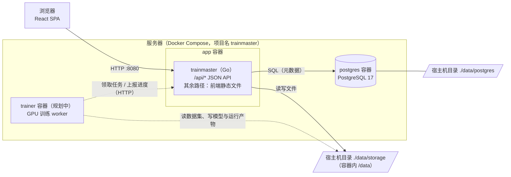

# 架构说明

本文描述 trainMaster 平台框架阶段的整体结构与约定。后续功能开发应遵循这里的约定；需要调整约定时，请同步更新本文。

## 1. 组件总览



- **单镜像**：Go 服务同时提供 `/api` 下的 JSON API 和前端构建产物（`/app/web`），部署只需 `app` 与 `postgres` 两个容器。
- **文件与元数据分离**：图片、模型权重等大文件以普通文件形式保存在宿主机目录；PostgreSQL 只保存元数据（记录、关系、状态）。两者都通过绑定挂载持久化。
- **内网友好**：前端不依赖任何外部 CDN、在线字体或第三方服务。

## 2. 后端模块

后端位于 `backend/`，Go module 为 `github.com/icaruszezen/trainmaster/backend`。依赖保持最少：chi（路由）、pgx（PostgreSQL），日志使用标准库 `log/slog`，不使用 ORM、配置库或迁移库。

| 包 | 职责 |
|---|---|
| `cmd/trainmaster` | 程序入口，按顺序组装各模块并处理优雅关闭 |
| `internal/buildinfo` | 版本号、提交号、构建时间（通过 `-ldflags -X` 注入） |
| `internal/config` | 读取并校验 `TM_*` 环境变量；非法值一次性全部报出并退出 |
| `internal/database` | pgxpool 连接池、启动时连接重试、内置迁移执行器 |
| `internal/storage` | 数据目录布局、启动时创建与可写检查、磁盘用量、安全路径解析 |
| `internal/httpapi` | chi 路由、中间件、统一 JSON 响应与错误信封、各 handler |
| `internal/web` | 前端静态文件服务：SPA 回退、缓存头、禁止目录列表与路径穿越 |

### 启动流程

1. 加载配置，初始化 slog（`TM_LOG_FORMAT=text|json`）。
2. 初始化存储目录：创建根目录和 6 个子目录并做可写探测，失败则退出并提示检查挂载目录权限 / PUID、PGID。
3. 连接数据库：指数退避重试，最长约 60 秒（数据库容器还在启动时会等待），仍失败则以非 0 退出。
4. `TM_DB_AUTO_MIGRATE=true`（默认）时执行待执行的迁移。
5. 启动 HTTP 服务；收到 SIGINT / SIGTERM 后停止接收新请求，等待进行中的请求完成（最长 15 秒）；超时后强制关闭剩余连接（取消其请求的 context），最后关闭数据库连接池。还在等待数据库或迁移锁时收到信号，则直接正常退出。以后的长连接 handler（如 SSE 推送训练日志）应通过 `http.Server.RegisterOnShutdown` 在关闭开始时主动结束。

## 3. API 约定

### 基本规则

- 所有接口都在 `/api` 下，业务接口带版本前缀 `/api/v1`。
- 请求与响应均为 JSON，响应头 `Content-Type: application/json; charset=utf-8`，并带 `Cache-Control: no-store`。
- 成功时**直接返回资源对象**；列表统一为：

  ```json
  {"items": [], "total": 0}
  ```

  （Go 中使用 `httpapi.NewList(items, total)`，空列表编码为 `[]` 而不是 `null`。）
- 失败时统一返回错误信封，`code` 供程序判断，`message` 直接展示给用户（中文）：

  ```json
  {"error": {"code": "not_found", "message": "接口不存在"}}
  ```

- 每个请求都有 `X-Request-ID`：请求头中带了合法值（≤128 个可见 ASCII 字符）就沿用，否则自动生成；响应头会返回它，访问日志中也会记录，便于排查问题。
- `HEAD` 请求自动由对应的 `GET` 路由处理。

### 错误码

| HTTP 状态 | code | 场景 |
|---|---|---|
| 404 | `not_found` | 接口不存在（未设置 `TM_WEB_DIR` 时，非 `/api` 路径也返回它） |
| 405 | `method_not_allowed` | 路径存在但不支持该方法（响应头 `Allow` 列出支持的方法） |
| 500 | `internal_error` | 未预期的错误（handler panic 会被恢复并返回此错误） |
| 501 | `not_implemented` | 规划中的功能模块 |

新增功能需要其它错误码时（如 `bad_request`、`conflict`、`validation_failed`），在 `internal/httpapi/respond.go` 中集中定义，并补充到本表。

### 已有接口

| 方法与路径 | 说明 |
|---|---|
| `GET /api/healthz` | 存活探针，不依赖任何外部组件，返回 `{"status":"ok"}`。Docker HEALTHCHECK 使用它 |
| `GET /api/readyz` | 就绪探针：检查数据库与存储，全部正常 200，否则 503，失败项带 `error` |
| `GET /api/v1/system/info` | 版本、运行时间、数据库与存储信息（工作台和存储管理页使用）。数据库不可用时仍返回 200，`database.status` 为 `unavailable` |
| `/api/v1/datasets`、`/api/v1/annotation/tasks`、`/api/v1/annotation/labels`、`/api/v1/training/jobs`、`/api/v1/evaluations`、`/api/v1/models` 及其子路径 | 预留给规划中的模块，任意方法均返回 `501 not_implemented` |

`/api/readyz` 示例：

```json
{
  "status": "ok",
  "checks": {
    "database": {"status": "ok", "latency_ms": 0.53},
    "storage": {"status": "ok"}
  }
}
```

`/api/v1/system/info` 示例（字段名是与前端 `frontend/src/features/system/api.ts` 的契约，不要随意改名）：

```json
{
  "name": "trainMaster",
  "version": "0.1.0-dev",
  "commit": "d62132f",
  "build_time": "2026-10-30T08:00:00Z",
  "go_version": "go1.24.13",
  "started_at": "2026-10-30T08:00:00Z",
  "uptime_seconds": 120,
  "database": {"status": "ok", "server_version": "17.6", "schema_version": 1},
  "storage": {
    "root": "/data",
    "total_bytes": 1000, "free_bytes": 400, "used_bytes": 600,
    "directories": [{"key": "images", "path": "/data/images", "writable": true}]
  }
}
```

`used_bytes = total_bytes - free_bytes`，`free_bytes` 为非特权进程可用空间。磁盘用量只在 Linux 上实现（部署环境），其它平台上这三个值为 0。

### 中间件

按执行顺序：

1. **RequestID**：见上文。
2. **客户端 IP**：只在设置了 `TM_TRUSTED_PROXIES`（反向代理的 IP / CIDR）时启用：对端是受信代理时，从右往左取 `X-Forwarded-For` 中第一个非受信地址作为客户端 IP。未设置时忽略该请求头，客户端 IP 就是 TCP 对端地址，无法伪造。目前只用于访问日志；以后用于操作审计等场景时，部署方必须只把真正的代理列入 `TM_TRUSTED_PROXIES`。
3. **访问日志**：method、path、status、bytes、duration_ms、client_ip、request_id。5xx（501 除外）记为 ERROR；健康检查记为 DEBUG，避免刷屏。
4. **panic 恢复**：记录堆栈并返回 500 错误信封。

### 前端静态文件

设置 `TM_WEB_DIR` 后，非 `/api` 路径由 `internal/web` 处理：

- 存在的文件直接返回；不存在的路径回退到 `index.html`，以支持前端路由（如刷新 `/datasets/versions`）。
- `/assets/*`（Vite 生成的带内容哈希的文件）返回 `Cache-Control: public, max-age=31536000, immutable`；`index.html` 等其它文件返回 `no-cache`。
- `/assets/` 下不存在的文件返回 404，而不是回退 `index.html`，避免浏览器把 HTML 当作 JS/CSS 缓存。
- 不生成目录列表；路径先经 `path.Clean` 再交给 `fs.FS`，无法访问目录之外的文件。
- 只允许 `GET` / `HEAD`。

## 4. 前端结构

前端位于 `frontend/`（Vite + React + TypeScript + Tailwind CSS v4 + shadcn/ui）。

- `src/config/navigation.ts` 是导航与模块的**唯一配置源**：侧边栏、路由、面包屑和占位页文案都由它生成。
- `src/router.tsx` 中的 `pages` 把每个模块 id 映射到页面组件。
- `src/features/<领域>/` 下每个模块有独立的页面文件；规划中的模块渲染通用占位组件 `ModulePlaceholder`，实现功能时直接替换该文件内容即可。
- `src/lib/api.ts` 提供 `apiGet<T>()`，非 2xx 时解析错误信封并抛出 `ApiError(status, code, message)`；网络错误转换为 `code = "network_error"`。
- 服务端状态用 TanStack Query 管理，界面组件来自 `src/components/ui/`（shadcn/ui）。

开发时由 Vite（:5173）托管前端并把 `/api` 代理到 Go 服务（:8080）；生产环境由 Go 服务托管 `frontend/dist`。

## 5. 存储布局

`TM_DATA_DIR`（容器内 `/data`，绑定挂载宿主机 `TM_HOST_STORAGE_DIR`）下的固定子目录：

| key | 子目录 | 用途 |
|---|---|---|
| `images` | `images/` | 原始图片，直接以文件形式保存（后续按数据集分子目录） |
| `datasets` | `datasets/` | 数据集版本快照、导出的训练集（YOLO / VOC / COCO） |
| `models` | `models/` | 模型权重文件 |
| `runs` | `runs/` | 训练 / 评估运行产物（日志、曲线、中间权重） |
| `exports` | `exports/` | 打包导出、报告 |
| `tmp` | `tmp/` | 上传等临时文件 |

后续功能请遵循：

- **数据库里只存相对路径**（相对于对应 key 的目录，如 `images` 下的 `ds_12/0001.jpg`），不存绝对路径，这样数据目录可以整体搬迁。
- 由相对路径得到磁盘路径一律使用 `storage.Resolve(key, rel)`，它会拒绝绝对路径和 `..` 越界。该检查是字面上的，打开用户可控路径时建议再配合 `os.OpenRoot`。
- 上传先写入 `tmp/`，完成并校验后再 `os.Rename` 到目标目录（同一文件系统内是原子操作），避免出现半个文件。
- 新增顶层目录时，在 `internal/storage` 的 `Keys` 中登记，并同步修改 `deploy/docker/entrypoint.sh` 中的目录列表与本文。

## 6. 数据库迁移约定

- 迁移文件放在 `backend/internal/database/migrations/`，命名 `NNNN_描述.sql`（如 `0002_create_datasets.sql`），版本号从文件名解析，必须为正整数且不能重复（单元测试会检查编号连续）。
- 文件通过 `go:embed` 编译进二进制，启动时自动执行（`TM_DB_AUTO_MIGRATE=false` 可关闭）。
- 执行器使用 `schema_migrations(version, name, applied_at)` 记录已执行的版本；用 `pg_advisory_lock` 防止多个实例并发迁移；每个文件在**一个事务**中执行并记录。
- 因此迁移文件中**不要写 `BEGIN` / `COMMIT`**，也不能包含无法在事务中执行的语句（如 `CREATE INDEX CONCURRENTLY`）。
- 迁移只向前：**已发布的迁移文件不要修改，也不要改名**，需要变更就新增一个文件。
- 同一个版本号只能对应一个文件。执行器会比对 `schema_migrations` 中记录的文件名：数据库里已执行过的版本号在当前代码中对应另一个文件名时（典型情况是两个分支各自新增了 `0002_*.sql`，又共用一个开发数据库），启动直接失败并给出两个文件名，而不是悄悄跳过。此时给后合入的那个文件换一个新编号；开发数据库可以删掉 `data/postgres` 重建。
- `0001_init.sql` 只建了基础设施表 `app_settings(key, value jsonb, updated_at)`。业务表（数据集、标注、训练任务等）随对应功能一起以新迁移加入，不预先设计。

## 7. 日志

- 使用 `log/slog`，开发时默认 text 格式，容器中为 JSON（`TM_LOG_FORMAT=json`），输出到 stderr，由 Docker 收集（`docker compose logs app`）。
- 级别由 `TM_LOG_LEVEL` 控制（debug / info / warn / error）。
- 日志字段名使用英文 snake_case；面向用户的提示（API 的 `message`、界面文案）使用中文。

## 8. 训练节点规划（未实现）

训练需要 GPU 和 Python 生态（PyTorch / Ultralytics 等），计划作为**独立的 worker 服务**接入，而不是放进 Go 服务：

- **镜像**：单独的 `trainer` 镜像（Python + CUDA），`docker-compose.yml` 末尾已以注释形式预留服务示例（`deploy.resources.reservations.devices` 使用 nvidia 驱动）。宿主机需安装 NVIDIA 驱动与 NVIDIA Container Toolkit。
- **任务分发**：训练任务记录在 PostgreSQL 中；worker 主动通过 HTTP API 领取任务（服务端用 `SELECT … FOR UPDATE SKIP LOCKED` 保证一个任务只被一个 worker 领取），并定期上报心跳、进度、日志与指标。Go 服务不直接调度容器。
- **数据交换**：worker 与 app 挂载同一个存储目录，从 `datasets/` 读取导出的训练集，把运行产物写入 `runs/`、最终权重写入 `models/`；训练节点在其他机器上时，通过 NFS 等共享存储挂载同一目录。
- **扩展**：一台服务器可以运行多个 worker（每个绑定不同 GPU），也可以在其他 GPU 机器上单独部署 worker，“计算资源”页面将展示已注册节点与 GPU 状态。
- 评估、批量推理、预标注等耗时任务也将复用同一套 worker 与任务队列机制。
