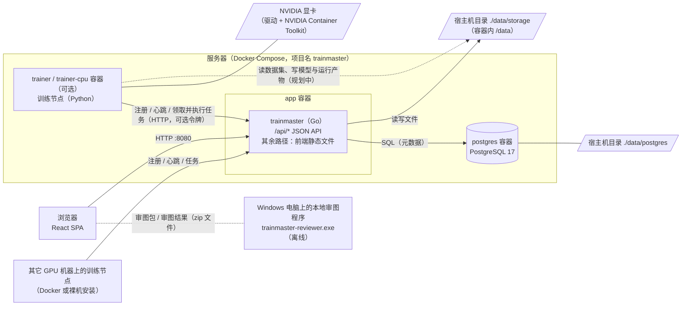

# 架构说明

本文描述 trainMaster 的整体结构与约定（平台框架 + 已实现的数据集、项目、标注、计算资源、模型仓库、模型审图、回收站与数据版本）。后续功能开发应遵循这里的约定；需要调整约定时，请同步更新本文。

## 1. 组件总览



- **单镜像**：Go 服务同时提供 `/api` 下的 JSON API 和前端构建产物（`/app/web`），部署只需 `app` 与 `postgres` 两个容器。
- **训练节点是独立的服务**：Python 训练节点（`trainer/`）运行在有显卡的机器上，主动向平台注册并上报心跳（见第 9 节）。同一台机器上由 compose 的 profile 启用（`gpu` → `trainer`，`cpu` → `trainer-cpu`，`make setup` 自动选择），也可以运行在其它机器上；训练节点还执行平台的任务（目前是模型仓库的 ONNX 转换与模型审图的识别，见第 9–11 节），没有训练节点时转换与识别一直排队，平台的其它功能不受影响。
- **本地审图程序**：`trainmaster-reviewer.exe`（`backend/cmd/trainmaster-reviewer`，Go）是在用户的 Windows 电脑上离线审图的单个程序，随平台镜像分发、在页面上下载；它与平台之间只交换文件：用户从平台下载审图包、在程序中审完后导出审图结果，再上传到平台（见第 11 节）。
- **文件与元数据分离**：图片、模型权重等大文件以普通文件形式保存在宿主机目录；PostgreSQL 只保存元数据（记录、关系、状态）。两者都通过绑定挂载持久化。
- **内网友好**：前端不依赖任何外部 CDN、在线字体或第三方服务。

## 2. 后端模块

后端位于 `backend/`，Go module 为 `github.com/icaruszezen/trainmaster/backend`。依赖保持最少：chi（路由）、pgx（PostgreSQL），日志使用标准库 `log/slog`，不使用 ORM、配置库或迁移库。数据集导入额外使用纯 Go 的解压与图像库（`bodgit/sevenzip`、`nwaples/rardecode`、`ulikunitz/xz`、`xi2/xz`、`klauspost/compress`、`golang.org/x/image`、`golang.org/x/text`），不依赖系统命令，各平台行为一致。

| 包 | 职责 |
|---|---|
| `cmd/trainmaster` | 程序入口，按顺序组装各模块并处理优雅关闭 |
| `cmd/trainmaster-reviewer` | 本地审图程序（Windows）：在 127.0.0.1 上运行 `internal/reviewer`，用 WebView2 窗口（没有时用默认浏览器）显示嵌入的页面（见第 11 节） |
| `internal/buildinfo` | 版本号、提交号、构建时间（通过 `-ldflags -X` 注入） |
| `internal/config` | 读取并校验 `TM_*` 环境变量；非法值一次性全部报出并退出 |
| `internal/database` | pgxpool 连接池、启动时连接重试、内置迁移执行器 |
| `internal/storage` | 数据目录布局、启动时创建与可写检查、磁盘用量、安全路径解析 |
| `internal/dataset` | 数据集：命名规则、图片与 VOC 标注识别、压缩包解压、目录扫描、缩略图、导入任务执行器、下载打包；审图版本（`versions.go`：版本的生成、编号、修改与删除，下载时按所选版本组合标注，见第 11 节“审图版本”）；回收站（`recycle.go`：数据集与审图版本的移入、恢复与到期清理，见第 12 节）；为数据版本读取所选标注版本组合后的图片（`snapshot.go` 的 `OpenSnapshot`）与共用的文件格式、解码函数（`exported.go`，见第 13 节） |
| `internal/project` | 项目：项目的增删改、项目与数据集的多对多关系、按数据集合计的统计与标签分布、项目的类别列表（训练时的类别顺序，标注时的候选类别）、项目的模型数与最新版本、数据版本数与最新的数据版本；删除项目前的检查（`CheckDelete`：模型与数据版本）与回收站中空项目的清理（`PurgeEmptyProjects`，模型与数据版本共用）。不引用 `dataversion`，直接查询 `data_versions` |
| `internal/model` | 模型仓库：分块上传与提交、项目内的版本分配、模型文件夹与 `model.json`、下载；回收站（`recycle.go`：移入、恢复与到期清理，见第 12 节）；ONNX 转换的选项、缓存、任务队列（领取、租约、重试）与训练节点的任务接口；为平台训练预留的 `RegisterTrainedModel`（见第 10 节） |
| `internal/recycle` | 回收站的保留期（`Retention`，7 天）与到期时间的计算，数据集、模型、审图与数据版本模块共用（见第 12 节） |
| `internal/model/checkpoint` | 读取 Ultralytics `.pt` 的元数据：zip 中的 `data.pkl` 由只读的 pickle 解释器解析（不执行任何代码），得到任务、类别、输入尺寸、YOLO 版本、训练信息；纯函数，无数据库依赖 |
| `internal/review` | 模型审图：审图任务的创建、修改与删除；识别任务（实现 `model.TaskSource`，通过训练节点的领取接口下发）、租约与识别结果的写入；审核状态与审图标注；审图包；上传审图结果；合并为数据集审图版本的后台任务（见第 11 节） |
| `internal/reviewfile` | 审图包的文件格式，平台与本地审图程序共用：清单 `review.json` 的读写与校验、Windows 安全的路径（`SafeSegment`、`Layout`）、审图标注（VOC）的读写与原子替换 |
| `internal/reviewer` | 本地审图程序的本机服务：打开与解压审图包、与平台形状相同的审图接口、审核进度 `review-progress.json`、缩略图、导出审图结果、访问控制 |
| `internal/dataversion` | 数据版本：输入的校验与预览、编号与创建、重新生成、修改备注与删除（`create.go`）；划分（`split.go`，纯函数，预览与生成共用）；一次一个的后台生成与重启后的恢复（`build.go`：读取数据集快照、硬链接或复制原图、写 YOLO 标注与 `data.yaml`、增强）；版本文件夹（`folder.go`：`.pending` 标记、移开后在后台删除）；图片与缩略图（`images.go`）；YOLO / VOC / COCO 下载（`export.go`）；回收站与清理（`recycle.go`）。面向用户的错误为 `dataversion.Error`（见第 13 节） |
| `internal/augment` | 数据版本的离线增强：翻转与旋转（二面体群 D4 中的一个方向，框精确变换）、亮度 / 对比度、模糊、噪声，确定的增强计划，输出格式与编码；EXIF / TIFF 方向标记的识别与重置（`orientation.go`）。纯函数，没有数据库与文件 |
| `internal/compute` | 计算资源：训练节点的注册与心跳、上报数据的规范化与校验、在线状态判定、删除与重新检测、内存中的指标历史 |
| `internal/hostinfo` | 平台服务器自身的 CPU、内存、负载、cgroup 限制与 NVIDIA 显卡（读 `/proc`、`/sys`，根目录可替换以便测试）；后台每 5 秒采样一次 CPU 利用率 |
| `internal/httpapi` | chi 路由、中间件、统一 JSON 响应与错误信封、各 handler |
| `internal/web` | 前端静态文件服务：SPA 回退、缓存头、禁止目录列表与路径穿越 |

### 启动流程

1. 加载配置，初始化 slog（`TM_LOG_FORMAT=text|json`）。
2. 初始化存储目录：创建根目录和 7 个子目录（见第 5 节）并做可写探测，失败则退出并提示检查挂载目录权限 / PUID、PGID。
3. 连接数据库：指数退避重试，最长约 60 秒（数据库容器还在启动时会等待），仍失败则以非 0 退出。
4. `TM_DB_AUTO_MIGRATE=true`（默认）时执行待执行的迁移。
5. 恢复上次关闭时未完成的数据集导入任务，补齐图片的排序键（见第 6 节“图片顺序”），整理崩溃留下的回收站文件夹（见第 12 节“文件夹”），然后启动任务执行器（见第 6 节）；启动模型仓库的后台任务（见第 10 节“存储与版本号”）与模型审图的后台任务（先把上次运行中断的合并记为失败、删除它们没有生成完的审图版本，见第 11 节“存储”），以及数据版本的后台任务（先把上次运行中断的生成记为失败，再开始生成排队中的版本，见第 13 节“生成”）。
6. 启动 HTTP 服务；收到 SIGINT / SIGTERM 后停止接收新请求，等待进行中的请求完成（最长 15 秒）；超时后强制关闭剩余连接（取消其请求的 context），最后关闭数据库连接池。还在等待数据库或迁移锁时收到信号，则直接正常退出。收到信号时会立即取消正在执行的导入 / 扫描任务并记为失败（“服务重启，导入被中断”），排队中的任务保留到下次启动执行；正在生成的数据版本同样被取消（关闭期间不清理它的文件夹），下次启动时记为失败，可以重新生成。HTTP 服务关闭后再等待任务执行器的 worker 退出。进程在写入结果前异常退出时，下次启动由恢复逻辑把任务标记为中断，并重新计算受影响数据集的统计数据。长连接 handler 应通过 `http.Server.RegisterOnShutdown` 在关闭开始时主动结束：训练节点领取任务的长轮询（最长 30 秒）就是这样立即返回 `{"task": null}` 的，以后的 SSE 推送（如训练日志）也应如此。

## 3. API 约定

### 基本规则

- 所有接口都在 `/api` 下，业务接口带版本前缀 `/api/v1`。
- 请求与响应均为 JSON，响应头 `Content-Type: application/json; charset=utf-8`，并带 `Cache-Control: no-store`。
- 成功时**直接返回资源对象**；列表统一为：

  ```json
  {"items": [], "total": 0}
  ```

  （Go 中使用 `httpapi.NewList(items, total)`，空列表编码为 `[]` 而不是 `null`。）
- 失败时统一返回错误信封，`code` 供程序判断，`message` 直接展示给用户（中文）：

  ```json
  {"error": {"code": "not_found", "message": "接口不存在"}}
  ```

- 每个请求都有 `X-Request-ID`：请求头中带了合法值（≤128 个可见 ASCII 字符）就沿用，否则自动生成；响应头会返回它，访问日志中也会记录，便于排查问题。
- `HEAD` 请求自动由对应的 `GET` 路由处理。

### 错误码

| HTTP 状态 | code | 场景 |
|---|---|---|
| 400 | `bad_request` | 请求格式不正确（如 JSON 无法解析、参数类型错误、列表的搜索参数 `q` 含无效的 UTF-8 或 NUL 字符（“参数 q 无效：搜索内容包含无效字符”）、训练节点的任务调用缺少 `X-Node-Key`） |
| 401 | `unauthorized` | 配置了 `TM_NODE_TOKEN`，但训练节点的 `/agent/*` 调用（注册、心跳、任务）没有带正确的 `Authorization: Bearer <令牌>`（“节点令牌不正确”） |
| 404 | `not_found` | 接口或资源不存在（未设置 `TM_WEB_DIR` 时，非 `/api` 路径也返回它） |
| 404 | `unknown_node` | 心跳或任务调用中的 `node_key`（`X-Node-Key`）尚未注册（或节点已被删除），训练节点收到后重新注册 |
| 405 | `method_not_allowed` | 路径存在但不支持该方法（响应头 `Allow` 列出支持的方法） |
| 409 | `conflict` | 与当前状态冲突（同名数据集、数据集正在导入、任务状态不允许该操作、类别列表已被他人修改、下载 YOLO 时所选项目还没有类别列表、标注文件不能在平台中修改、删除在线的训练节点、重新检测离线的训练节点、删除有模型的项目、模型文件未上传完就提交、模型上传的临时文件已丢失、转换任务已不属于该训练节点、审图图片还没有识别完成、审图任务正在合并时删除或再次合并、修改或删除正在生成的审图版本、所选版本中没有可以导出的图片、删除有数据版本的项目、新建数据版本时项目还没有类别或类别列表已被修改、划分后训练集或验证集没有图片、数据版本还没有生成完成、重新生成不是失败的数据版本或来源已不能使用等） |
| 409 | `name_taken` | 从回收站恢复时名称已被占用：恢复数据集时有同名的数据集（或文件夹名已被使用），恢复模型或数据版本时一并恢复的项目有同名的项目。带新名称再次恢复即可（数据集为 `name`，模型与数据版本为 `project_name`），见“回收站接口” |
| 409 | `annotation_conflict` | 保存 / 删除标注时，标注文件在 `base_version` 之后已被修改（他人在另一个窗口保存，或用其它工具改了文件）。客户端应重新读取图片详情，或带 `force: true` 覆盖 |
| 409 | `annotation_unpatchable` | 保存标注时，已有的标注文件无法在保留其中平台不编辑的内容的情况下修改（极少见）；带 `regenerate: true` 时按平台的格式重新生成整个文件（`force: true` 只跳过版本检查，不会重新生成） |
| 409 | `upload_offset_mismatch` | 分块上传（数据集压缩包、模型文件）的 `offset` 与服务端已接收的字节数不一致，客户端应重新获取任务或上传后从 `received_bytes` 续传 |
| 413 | `payload_too_large` | 请求体超过限制（单个分块 64 MiB，单次文件夹批量上传 256 MiB，训练节点的 JSON 请求 1 MiB、上传的转换结果 4 GiB，上传前的进度上报按同样的上限预检；保存标注 8 MiB，上传的审图结果 4 GiB） |
| 422 | `validation_failed` | 字段校验失败，`message` 说明具体问题（如数据集名称不合法、ONNX 转换选项不允许） |
| 422 | `unsupported_image` | 无法为该图片生成缩略图（格式不支持、文件损坏或像素过大），前端回退为原图或占位图 |
| 422 | `invalid_model` | 提交的模型文件不是平台支持的 YOLO 模型（不是 PyTorch 文件、旧格式、损坏、不是 Ultralytics 检查点、原版 YOLOv5 仓库、RT-DETR、引用了安全加载不允许的对象等），`message` 说明原因；上传随之失败 |
| 422 | `yolo_version_mismatch` | 模型文件中识别出的 YOLO 版本与所选的不同；上传保留，带识别出的版本（上传的 `detected_yolo_version`）再次提交即可 |
| 500 | `internal_error` | 未预期的错误（handler panic 会被恢复并返回此错误） |
| 501 | `not_implemented` | 规划中的功能模块 |
| 507 | `insufficient_storage` | 存储空间不足，无法接收该上传（数据集与模型的上传、训练节点上传的转换结果及其预检、上传的审图结果） |

新增功能需要其它错误码时，在 `internal/httpapi/respond.go` 中集中定义，并补充到本表。

### 已有接口

| 方法与路径 | 说明 |
|---|---|
| `GET /api/healthz` | 存活探针，不依赖任何外部组件，返回 `{"status":"ok"}`。Docker HEALTHCHECK 使用它 |
| `GET /api/readyz` | 就绪探针：检查数据库与存储，全部正常 200，否则 503，失败项带 `error` |
| `GET /api/v1/system/info` | 版本、运行时间、数据库与存储信息（工作台和存储管理页使用）。数据库不可用时仍返回 200，`database.status` 为 `unavailable` |
| 数据集相关接口 | 见下方“数据集接口” |
| 项目相关接口 | 见下方“项目接口” |
| 模型仓库相关接口 | 见下方“模型仓库接口” |
| 模型审图相关接口 | 见下方“模型审图接口” |
| 数据版本相关接口 | 见下方“数据版本接口” |
| 计算资源相关接口（含训练节点的任务接口） | 见下方“计算资源接口” |
| 回收站相关接口 | 见下方“回收站接口” |
| `/api/v1/annotation/tasks`、`/api/v1/annotation/labels`、`/api/v1/training/jobs`、`/api/v1/evaluations` 及其子路径 | 预留给规划中的模块，任意方法均返回 `501 not_implemented` |

`/api/readyz` 示例：

```json
{
  "status": "ok",
  "checks": {
    "database": {"status": "ok", "latency_ms": 0.53},
    "storage": {"status": "ok"}
  }
}
```

`/api/v1/system/info` 示例（字段名是与前端 `frontend/src/features/system/api.ts` 的契约，不要随意改名）：

```json
{
  "name": "trainMaster",
  "version": "0.1.0-dev",
  "commit": "d62132f",
  "build_time": "2026-10-30T08:00:00Z",
  "go_version": "go1.24.13",
  "started_at": "2026-10-30T08:00:00Z",
  "uptime_seconds": 120,
  "database": {"status": "ok", "server_version": "17.6", "schema_version": 1},
  "storage": {
    "root": "/data",
    "total_bytes": 1000, "free_bytes": 400, "used_bytes": 600,
    "directories": [{"key": "datasets", "path": "/data/datasets", "writable": true}]
  }
}
```

`used_bytes = total_bytes - free_bytes`，`free_bytes` 为非特权进程可用空间。磁盘用量只在 Linux 上实现（部署环境），其它平台上这三个值为 0。

### 数据集接口

字段定义以前端 `frontend/src/features/datasets/api.ts` 中的类型为准（与后端 `internal/httpapi/datasets.go` 保持一致）。`{id}` 等路径参数必须是正整数，否则返回 404。

| 方法与路径 | 说明 |
|---|---|
| `GET /api/v1/datasets` | 数据集列表（`q` 按名称 / 描述筛选；`project_id=<项目ID>` 只列出该项目中的数据集，`project_id=none` 只列出未纳入任何项目的数据集，其它值返回 400），按更新时间倒序；每项带统计数据、封面图片（最多 4 张）、所属项目 `projects: [{id, name}]`（按名称排序）、审图版本数 `version_count`（不含正在生成的）和进行中的导入任务 |
| `POST /api/v1/datasets` | `{name, description?}` 新建数据集并创建同名文件夹；带 `directory` 时把 `datasets/` 下已有的文件夹添加为数据集，并立即开始扫描 |
| `GET /api/v1/datasets/directories` | `datasets/` 下的全部一级文件夹（跳过隐藏目录和符号链接），标明是否已添加，附图片 / 标注文件数量（超过 5 万个条目或 2 秒时为估算值，`approximate: true`） |
| `GET /api/v1/datasets/{id}` | 数据集详情；`directory_missing` 表示文件夹已不在磁盘上 |
| `PATCH /api/v1/datasets/{id}` | 修改名称（只改显示名称，文件夹不变）和描述 |
| `PUT /api/v1/datasets/{id}/projects` | `{project_ids: [...]}` 设置数据集所属的项目（整体替换，`[]` 表示移出所有项目，缺少该字段时返回 422），返回更新后的数据集；所选项目不存在时返回 422，不做任何修改 |
| `DELETE /api/v1/datasets/{id}` | 把数据集移入回收站，返回 204：7 天内可以恢复（`POST /api/v1/recycle-bin/datasets/{id}/restore`），之后自动永久删除，不能提前删除（见第 12 节）。它随之离开所属的项目与审图任务，恢复时回来。`?delete_files=true` 时永久删除时一并删除磁盘上的**整个**文件夹与缩略图缓存（在回收站中时文件夹改名为隐藏的 `.recycle-<ID>`，名称与文件夹名可以再用）；不带时文件夹留在原处，仍属于这个数据集（不能再次添加，只能恢复）。导入 / 扫描正在执行、或正在合并生成审图版本时返回 409；未完成的上传随之取消 |
| `GET /api/v1/datasets/{id}/images` | 图片列表，固定按图片顺序排列（见“图片顺序”）：`offset`、`limit`（≤ 200）、`status`（`all` / `annotated` 有目标 / `empty` 空标注 / `invalid` 标注无效 / `unannotated` 无标注文件）、`label`、`q`（路径包含） |
| `GET /api/v1/datasets/{id}/images/{imageId}` | 单张图片详情：`objects` 等标注信息实时从 VOC 文件解析；文件无法解析或已不存在时 `annotation_error` 给出原因。`annotation_version` 是标注文件内容的版本（没有文件时为 `""`），保存时原样带回；`annotation_unsupported` 是文件中平台无法显示的目标数（如多边形，保存时原样保留）；`annotation_blocked` 不为空时说明这张图片不能在平台中保存标注的原因（如同名的 `.xml` 属于另一张图片，见第 6 节“标注”） |
| `GET /api/v1/datasets/{id}/images/{imageId}/neighbors` | 按图片顺序的上一张 / 下一张：`{prev, next, position, matches, total}`，筛选参数同图片列表（`status`、`label`、`q`）；当前图片不符合筛选条件时 `matches: false`，`prev` / `next` 仍是它前后最近的符合条件的图片 |
| `PUT /api/v1/datasets/{id}/images/{imageId}/annotation` | 保存标注：`{objects: [{name, xmin, ymin, xmax, ymax, difficult, truncated}], base_version, force?, regenerate?}`，写回数据集文件夹中的 VOC 文件并更新索引与计数，返回保存后的图片详情，其中 `annotation_version` 是本次写入内容的版本。`objects` 为 `[]` 时写入没有目标的文件（空标注 / 负样本）。坐标在裁剪到图片范围后大于 2147483647 时返回 422；图片不能在平台中保存标注（`annotation_blocked`），或重新扫描时会改用另一个标注文件、会把标注文件交给另一张图片（需要先重新扫描）时返回 409 `conflict`；文件无法在保留其它内容的情况下修改时返回 409 `annotation_unpatchable`（带 `regenerate: true` 时重新生成整个文件，仍然检查 `base_version`）。见第 6 节“标注” |
| `DELETE /api/v1/datasets/{id}/images/{imageId}/annotation?base_version=&force=` | 删除标注文件，返回图片详情；没有文件时也返回 200。图片通常恢复为“未标注”（`annotation_version` 为 `""`）；还有重新扫描时会配对的另一个标注文件时（如被图片旁的文件取代的 `Annotations/` 中的文件），图片改为与它配对，详情描述该文件。删除后重新扫描会把另一张图片的标注文件配对给这张图片，或配对给原本与这张图片争用被删文件的图片（如同一文件夹中的 `a.png`）时返回 409 `conflict`。见第 6 节“标注” |
| `GET /api/v1/datasets/{id}/classes` | 标注时优先提示的类别：数据集所属项目的类别列表合并后的结果，`{items: [{name, color}], total}`（只读，没有 `version`）。各项目按名称排序（同数据集的 `projects`）依次合并，同名的类别只保留第一次出现的（连同颜色）；数据集不属于任何项目时为空列表。类别列表在项目中修改（见“项目接口”），这里不支持 PUT / POST（405）。见第 6 节“类别列表” |
| `GET /api/v1/datasets/{id}/images/{imageId}/file` | 原图（支持 Range 与条件请求） |
| `GET /api/v1/datasets/{id}/images/{imageId}/thumbnail` | JPEG 缩略图，`size=sm`（320px）/ `lg`（1600px），生成后缓存在 `cache/` 下 |
| `GET /api/v1/datasets/{id}/labels` | 标签分布：每个标签的目标数与图片数 |
| `POST /api/v1/datasets/{id}/scan` | 重新扫描数据集文件夹，与磁盘同步（新增、变化、删除的图片与标注） |
| `GET /api/v1/datasets/{id}/imports` | 导入 / 扫描记录（新的在前）；可按 `annotation_format`、`status` 筛选，`limit` 默认 20 |
| `POST /api/v1/datasets/{id}/imports` | 创建导入任务：`{source: "archive" \| "folder", file_name, file_size, file_count?, on_conflict?: "skip" \| "overwrite", annotation_format?: "voc" \| "xanylabeling" \| "yolo", classes?: [...]}`（`yolo` 时 `classes` 必填，见“标注格式”） |
| `GET /api/v1/datasets/{id}/imports/{importId}` | 导入任务状态与进度（前端轮询） |
| `PUT /api/v1/datasets/{id}/imports/{importId}/archive?offset=N` | 上传压缩包的一个分块（原始字节，≤ 64 MiB），`offset` 必须等于已接收字节数，支持断点续传 |
| `POST /api/v1/datasets/{id}/imports/{importId}/files` | 上传文件夹中的一批文件（multipart，每个文件前带一个 `path` 字段给出相对路径，单次 ≤ 256 MiB） |
| `POST /api/v1/datasets/{id}/imports/{importId}/commit` | 上传完成，进入后台处理队列 |
| `POST /api/v1/datasets/{id}/imports/{importId}/cancel` | 取消上传或处理 |
| `POST /api/v1/datasets/{id}/exports` | 准备下载：`{format: "voc" \| "xanylabeling" \| "yolo", project_id?, classes?: [...], include_base?, version_ids?: [...]}`，返回 201 `{url, file_name, expires_at}`；数据集没有图片或文件夹不存在时 409。`yolo` 需要类别顺序，二者选一：`project_id` 使用该项目的类别列表的顺序，项目必须包含这个数据集且类别列表不为空（项目不存在或不包含该数据集时 422，类别列表为空时 409 `conflict`）；或用 `classes` 手动指定（见“标注格式”，页面上用于不属于任何项目的数据集），两者都没有时 422。两者都带时以 `project_id` 为准，其它格式忽略它们。`include_base`（默认 `true`）与 `version_ids`（审图版本的 ID，默认没有）选择组合的版本（见第 11 节“审图版本”）：两者都省略时只有基础版本，与没有版本时相同；什么都不选或超过 100 个版本时 422；版本不存在或不属于这个数据集时 404，正在生成时 409；所选版本中没有可以导出的图片（如不选基础版本，版本中又没有需加样的图片）时 409。选了审图版本时文件名带上版本，如 `line_a-基础+审图1.1+审图1.3-yolo.zip` |
| `GET /api/v1/datasets/{id}/exports/preview` | 下载的内容（按索引统计，与数据集的计数相同）：`include_base`（`true` / `false`，默认 `true`）、`version_ids`（以逗号分隔的版本 ID）选择版本，规则同上（参数格式不对时 400）。返回 `{image_count, from_versions, annotated_count, empty_count, invalid_count, unannotated_count, object_count, labels, version_image_count, missing_count, changed_count}`：导出的图片数、其中用审图版本标注的、有目标 / 空标注 / 标注无效 / 没有标注的图片数、目标数与各标签的目标数（按目标数降序），以及所选版本中被选中的图片数、其中已不在数据集中与合并后文件被替换（不再用版本的标注）的图片数。下载对话框用它显示将导出的内容、YOLO 的类别对照与默认的类别顺序 |
| `GET /api/v1/datasets/{id}/versions` | 审图版本 `{items, total}`，新的在前，包括正在生成的（`status: building`，还没有名称与编号）。每项：`id`、`name`（如 `审图1.3`）、`major` / `minor`、`note`、`status`（`building` / `ready`）、图片数 `image_count`、`needs_sample_count`、`approved_count` 与目标数 `object_count`（编号时统计）、来自的审图任务 `review: {id, name}`（任务删除后为 null）、`merge_id`、合并时的快照 `source: {review_id, review_name, merge_id, statuses, model}`、`created_at`、`updated_at`、`finished_at` |
| `GET /api/v1/datasets/{id}/versions/{versionID}` | 单个版本（字段同列表项）；不存在或不属于这个数据集时 404 |
| `PATCH /api/v1/datasets/{id}/versions/{versionID}` | `{note}` 修改备注（必填，最多 500 个字符，规则同合并时），返回版本；正在生成时 409 |
| `DELETE /api/v1/datasets/{id}/versions/{versionID}` | 把版本（连同它的标注快照）移入回收站，返回 204：7 天内可以恢复，之后自动永久删除（见第 12 节）；编号不会再分配给别的版本，恢复后仍是原来的编号。正在生成时 409。数据集的标注文件与审图任务不受影响 |
| `GET /api/v1/datasets/{id}/exports/{token}` | 下载 zip（`Content-Disposition: attachment`，流式输出，无 Content-Length）；链接 1 小时内可重复使用，失效后 404 |

### 项目接口

项目按检测任务组织数据集；项目与数据集是多对多关系（表 `project_datasets`），一个数据集可以属于多个项目。字段定义以前端 `frontend/src/features/projects/api.ts` 中的类型为准（与后端 `internal/httpapi/projects.go` 保持一致）。`{id}` 等路径参数必须是正整数，否则返回 404。

| 方法与路径 | 说明 |
|---|---|
| `GET /api/v1/projects` | 项目列表（`q` 按名称 / 描述筛选），按更新时间倒序。每项带其中数据集的合计统计（`dataset_count`、`image_count`、`annotated_count`、`empty_count`、`invalid_count`、`object_count`、`total_bytes`）和封面图片（最多 4 张，轮流取自项目中最早纳入的几个数据集，每项带 `dataset_id`），模型数 `model_count` 与版本号最大的模型 `latest_model`（`{id, version, yolo_version, created_at}`，没有模型时为 null），以及数据版本数 `data_version_count`（不在回收站中的，任何状态）与版本号最大的、不在回收站中的数据版本 `latest_data_version`（`{id, version, status, created_at}`，没有时为 null） |
| `POST /api/v1/projects` | `{name, description?, dataset_ids?}` 新建项目，可同时纳入数据集，返回 201。名称不区分大小写唯一（重名 409 `conflict`），最长 64 个字符，不能含控制字符；描述最长 500 个字符，除换行与制表符外不能含控制字符；不合规时返回 422。所选数据集不存在时返回 422，不创建项目 |
| `GET /api/v1/projects/{id}` | 项目详情（字段同列表项） |
| `PATCH /api/v1/projects/{id}` | 修改名称和描述（规则同上） |
| `DELETE /api/v1/projects/{id}?delete_models=&delete_data_versions=` | 删除项目，返回 204。其中的数据集保留，只是不再属于该项目；进行中的模型上传随项目删除（临时文件由清理任务删除）。项目中有模型时返回 409 `conflict`（“项目中有 N 个模型，请先删除模型，或选择同时删除模型”）；没有模型（或带了 `delete_models=true`）而有数据版本（不在回收站中的，任何状态）时返回 409 `conflict`（“项目中有 N 个数据版本，请先删除数据版本，或选择同时删除数据版本”）。先按同样的规则检查（`project.CheckDelete`），被拒绝的删除不做任何修改；然后 `?delete_data_versions=true` 时处理其数据版本（同 `DELETE /api/v1/data-versions/{id}`：已生成的移入回收站，生成失败的删除，排队中与生成中的停止并删除），`?delete_models=true` 时把其模型移入回收站（同 `DELETE /api/v1/models/{modelID}`），最后删除项目。项目中有模型或数据版本在回收站中时，项目随它们留在回收站中（不显示，名称可以再用），恢复其中任何一个时一并恢复，最后一个模型与数据版本永久删除时项目才删除（见第 12 节）；否则直接删除项目，并删除它的 `models/project-<ID>/` 与 `exports/data-versions/project-<ID>/` 文件夹。`delete_models`、`delete_data_versions` 不是布尔值时返回 400 |
| `GET /api/v1/projects/{id}/datasets` | 项目中的数据集，格式同数据集列表。项目不存在时返回 404（`GET /api/v1/datasets?project_id=` 则返回空列表） |
| `POST /api/v1/projects/{id}/datasets` | `{dataset_ids: [...]}` 把数据集纳入项目（已在项目中的忽略），返回更新后的项目；`dataset_ids` 为空或有数据集不存在时返回 422，不做任何修改 |
| `DELETE /api/v1/projects/{id}/datasets/{datasetId}` | 把数据集移出项目，返回 204（数据集本身不受影响；本来就不在项目中也返回 204） |
| `GET /api/v1/projects/{id}/labels` | 项目中所有数据集合计的标签分布：每个标签的目标数、图片数与所在的数据集数；项目不存在时返回 404 |
| `GET /api/v1/projects/{id}/classes` | 类别列表：`{items: [{name, color}], total, version}`，第 1 个是训练时 YOLO 的类别 0（`color` 为 `#rrggbb`，`""` 表示按名称自动配色）；`version` 是列表内容的版本（空列表也有），整体替换时作为 `base_version` 带回。项目不存在时返回 404。见第 6 节“类别列表” |
| `PUT /api/v1/projects/{id}/classes` | `{classes: [...], base_version?}` 整体替换类别列表（最多 1000 个，名称规则同 YOLO 类别，不能重复；缺少 `classes` 时返回 422，清空时为 `[]`），返回新的列表（格式同 GET）。带 `base_version` 且与当前版本不同时返回 409 `conflict`（“类别列表已被其他人修改，请载入最新的列表后再保存”），列表不变；不带时直接替换。只修改列表，不改动任何标注文件 |
| `POST /api/v1/projects/{id}/classes` | `{name, color?}` 在列表末尾追加一个类别（`color` 为 `""` 或 `#rrggbb`）；已有同名类别（去掉首尾空白后完全相同）时列表不变。校验同 PUT（超过 1000 个时返回 422），返回列表（格式同 GET）。读取与写入在同一事务中并锁定项目行，并发追加不会互相覆盖 |
| `GET /api/v1/projects/{id}/models` | 项目中的模型（格式同模型列表），按版本号倒序；项目不存在时返回 404 |

一次最多提交 1000 个 ID。增减数据集（包括删除其中的数据集）和修改类别列表会更新项目的 `updated_at`（提交的类别列表与原来相同时不更新）；项目与数据集之间的写操作都按“先数据集、后项目，各自按 ID 顺序”加行锁，修改类别列表只锁定项目这一行，并发修改同一关系时不会死锁或丢失更新。数据集或项目进入回收站时，它们之间的关联移到 `recycled_project_datasets`，恢复时（另一方仍在使用时）放回，永久删除时随之删除（见第 12 节）。一个模型只属于一个项目（`models.project_id`，`ON DELETE RESTRICT`：数据库不会在模型文件夹还在时删掉模型记录）；删除项目时在事务中锁定项目行并检查其中的模型数（包括回收站中的），与分配模型版本号使用同一把行锁，正在提交的模型不会漏删。数据版本同样只属于一个项目（`data_versions.project_id`，`ON DELETE RESTRICT`），按项目编号（`projects.data_version_seq`），删除项目时用同样的方式检查（见第 13 节）。训练任务上线后也将归属到项目。

### 模型仓库接口

模型仓库（`internal/httpapi/models.go`，业务逻辑在 `internal/model`）的设计见第 10 节。字段定义以前端 `frontend/src/features/models/api.ts` 中的类型为准，与后端 `internal/model/types.go` 的 json tag 保持一致。`{modelID}`、`{uploadID}`、`{exportID}` 必须是正整数，否则返回 404。

| 方法与路径 | 说明 |
|---|---|
| `GET /api/v1/models` | 模型列表 `{items, total}`，新的在前（`created_at DESC, id DESC`）。筛选：`project_id`（正整数）、`yolo_version`、`source`（`upload` / `training`）、`q`（说明、原始文件名、项目名，不区分大小写），参数值非法时返回 400。每项带所属项目 `project: {id, name}`、版本号、来源与训练任务 `training_job_id`（上传的模型为 null）、YOLO 版本、任务、原始文件名、大小、SHA256、解析出的 `info`、`file_missing`（`model.pt` 已不在磁盘上）、`export_count`（成功的转换数）与 `download_url` |
| `GET /api/v1/models/{modelID}` | 模型详情（字段同列表项） |
| `PATCH /api/v1/models/{modelID}` | `{description}` 修改说明（规则同项目描述：最长 500 个字符，除换行与制表符外不能含控制字符） |
| `DELETE /api/v1/models/{modelID}` | 把模型移入回收站，返回 204：7 天内可以恢复（`POST /api/v1/recycle-bin/models/{modelID}/restore`），之后自动永久删除模型记录、转换记录与整个模型文件夹（含 ONNX 缓存），不能提前删除（见第 12 节）。在回收站中时文件夹与已完成的转换保留，排队中或转换中的转换随之删除，训练节点之后的调用得到 404 而停止；版本号不会被复用。使用它的审图任务等它恢复（不会领取），永久删除后失败 |
| `GET /api/v1/models/{modelID}/file` | 下载 `model.pt`（`Content-Disposition: attachment`，文件名 `<项目名>_v<版本>.pt`，`application/octet-stream`，支持 Range 与条件请求）；文件不在磁盘上时 404 `not_found`（“模型文件不存在…”） |
| `POST /api/v1/models/uploads` | `{project_id, yolo_version, file_name, file_size, description?}` 开始上传，返回 201 与上传 `ModelUpload`（`{id, project_id, yolo_version, description, file_name, file_size, received_bytes, status, detected_yolo_version, error, model_id, …}`）。`yolo_version` 见第 10 节；文件名须以 `.pt` 结尾（不区分大小写）、最长 255 个字符、不能含控制字符；大小 1 字节–8 GiB；项目不存在时返回 422；剩余空间不足文件大小 + 512 MiB 时返回 507 |
| `GET /api/v1/models/uploads/{uploadID}` | 上传状态：`uploading` → `completed` / `failed` / `canceled` |
| `PUT /api/v1/models/uploads/{uploadID}?offset=N` | 上传一个分块（原始字节，≤ 64 MiB，前端每块 8 MiB），`offset` 必须等于已接收的字节数（否则 409 `upload_offset_mismatch`），超出声明的大小时返回 400；失败的分块不留下数据，可以从 `received_bytes` 续传。服务器上的临时文件已丢失（如恢复了数据库但没有恢复 `tmp/`）时返回 409 `conflict`（“服务器上找不到这次上传已接收的数据（临时文件已丢失），请取消后重新上传”）。被拒绝的分块（404、409、507）平台先读完再回应，浏览器收到的是错误而不是连接被重置 |
| `POST /api/v1/models/uploads/{uploadID}/commit` | `{yolo_version?, description?}`（可选，覆盖开始上传时的值）提交上传：校验大小、计算 SHA256、解析文件、校验 YOLO 版本，然后作为项目的下一个版本保存（见第 10 节），返回 201 与模型。已完成的上传再次提交返回 200 与同一个模型（可以安全重试）。同时最多解析 2 个文件，其余的提交等待。还没传完或临时文件已丢失时返回 409；文件不是支持的模型时 422 `invalid_model`（上传置为 `failed`，删除临时文件）；版本不一致时 422 `yolo_version_mismatch`（上传保持 `uploading`，记下 `detected_yolo_version`，可以带新的 `yolo_version` 再次提交）；提交过程中项目被删除时返回 422 |
| `POST /api/v1/models/uploads/{uploadID}/cancel` | 取消上传并删除临时文件，返回上传；已结束的上传原样返回 |
| `GET /api/v1/models/{modelID}/exports` | 该模型的转换记录 `{items, total}`，新的在前 |
| `POST /api/v1/models/{modelID}/exports` | 请求转换：`{format: "onnx", imgsz?, dynamic?, postprocess?, opset?}`（选项见第 10 节“ONNX 转换”）。同样选项的转换已成功且文件还在 → 200 与该记录（缓存）；正在排队或转换 → 202 与该记录；失败过、或成功但文件已不在 → 重新排队（尝试次数与错误清零），202；新的选项 → 新记录，202。选项不合法或该模型不支持时返回 422（如动态尺寸与 `nms` 同时使用、没有检测框的模型选择 `nms` / `end2end`）；模型文件不在磁盘上时返回 409 |
| `GET /api/v1/models/{modelID}/exports/{exportID}` | 转换状态（前端每秒轮询）：`status`（`queued` → `running` → `succeeded` / `failed`）、`stage`（`downloading` / `converting` / `uploading`）、`attempts`、执行的节点 `node`、排队中时的 `queue_position`（从 1 起）、`workers_online`（最近 60 秒内领取过或正在执行转换任务的节点数，前端为 0 时提示没有可以执行转换的训练节点）、下载文件名 `file_name`、成功后的 `size_bytes`、`sha256`、`result`（节点上报的版本、opset、输入输出名称与形状、是否用 ONNX Runtime 验证过、耗时与节点名）与 `download_url`，失败时的 `error`（中文）与 `error_detail`（节点上的错误输出） |
| `GET /api/v1/models/{modelID}/exports/{exportID}/file` | 下载 ONNX（同 PT 下载），文件名如 `<项目名>_v<版本>_640_end2end.onnx`（见第 10 节）；还没成功时返回 409，文件不在磁盘上时返回 404 |
| `DELETE /api/v1/models/{modelID}/exports/{exportID}` | 删除转换记录与结果文件，返回 204；排队中或转换中的也可以删除，执行它的节点之后的调用得到 404 而停止 |

JSON 接口都带 `Cache-Control: no-store`；原图与缩略图带 `?v=<版本>` 请求时返回 `Cache-Control: private, max-age=31536000, immutable`（文件变化后版本号随之改变），否则为 `private, no-cache`。

### 模型审图接口

模型审图（`internal/httpapi/reviews.go`、`review_exchange.go`，业务逻辑在 `internal/review`）的设计见第 11 节。字段定义以前端 `frontend/src/features/reviews/api.ts` 中的类型为准，与后端 `internal/review/types.go` 的 json tag 保持一致。`{reviewID}`、`{imageID}`（审图图片的 ID，不是数据集图片的 ID）、`{mergeID}` 必须是正整数，否则返回 404。

| 方法与路径 | 说明 |
|---|---|
| `GET /api/v1/reviews` | 审图任务列表 `{items, total}`，新的在前（`id DESC`）。筛选：`q`（名称、说明或项目名，不区分大小写）、`project_id`、`dataset_id`（包含该数据集的任务）、`model_id`、`status`（`queued` / `running` / `ready` / `failed`，其它值 400）。每项带创建时的模型快照 `model` 与 `model_exists`、模型所属项目 `project`、识别参数 `options`、识别状态（`status`、`stage`、`attempts`、`node`、`error`、`error_detail`、`result`，排队中的 `queue_position`，`workers_online`）、图片数 `counts`、各数据集 `datasets: [{id, name, folder, counts, next_version}]`（按选择的顺序；`next_version` 是这个数据集下一个审图版本的名称，如 `审图1.3`，合并对话框中显示，实际编号在合并完成时确定）、最近一次上传 `last_upload`、进行中的合并 `active_merge` 与最近完成的合并 `last_merge` |
| `POST /api/v1/reviews` | `{name?, description?, model_id, dataset_ids, options?: {conf?, iou?, imgsz?, max_det?}}` 新建审图任务并排队识别，返回 201。规则见第 11 节“新建”：模型不存在、没有检测框、数据集不存在或超出数量、没有图片、参数超出范围时 422；模型文件不在磁盘上时 409 |
| `GET /api/v1/reviews/{reviewID}` | 审图任务详情（字段同列表项） |
| `PATCH /api/v1/reviews/{reviewID}` | `{name?, description?}` 修改名称和说明（规则同项目） |
| `DELETE /api/v1/reviews/{reviewID}` | 删除审图任务与它的文件夹（审图标注），返回 204；数据集与已经生成的审图版本不受影响（版本的 `review` 变为 null，`source` 中仍有任务名称）。正在合并时 409；正在识别时也可以删除，节点之后的调用得到 404 而停止。记录已删除但文件夹没能完全删除时返回 200 `{"files_removed": false, "message": "…"}` |
| `POST /api/v1/reviews/{reviewID}/retry` | 重新识别失败的任务：清零尝试次数与错误后重新排队，返回 202 与任务，从还没有识别的图片继续。不是 `failed` 时 409（“只有识别失败的审图任务可以重试”），模型已被删除、在回收站中（需先恢复）或模型文件不在时 409 |
| `GET /api/v1/reviews/{reviewID}/images` | 图片列表，按任务中的顺序：`offset`、`limit`（默认 60，≤ 200）、`status`（`all` / `pending` / `approved` / `needs_sample` / `reviewed`）、`dataset_id`、`label`、`q`（数据集中的路径包含，不区分大小写）、`edited`（`all` / `edited` / `unedited`）、`boxes`（`all` / `with` / `without`）、`inference`（`all` / `failed`），参数值非法时 400。每项带数据集与数据集图片的 ID、路径、尺寸、`inferred`、`inference_error`、目标数与类别、`prediction_count`、`edited`、`status`、`revision`、`reviewed_at`、`merged_at`、`annotation_version` |
| `GET /api/v1/reviews/{reviewID}/images/{imageID}` | 单张图片详情：另带 `objects`（审图标注，实时从 VOC 文件读取，没有文件时为 `[]`）、`predictions`（模型的框与置信度）、`dataset_name`，以及文件无法使用时的 `annotation_error` |
| `GET /api/v1/reviews/{reviewID}/images/{imageID}/neighbors` | 按任务中的顺序的上一张 / 下一张：`{prev, next, position, matches, total}`，筛选参数同图片列表（同数据集的 neighbors） |
| `PUT /api/v1/reviews/{reviewID}/images/{imageID}/annotation` | 保存审图标注：`{objects, base_version, force?}`（请求体 ≤ 8 MiB），重新生成任务文件夹中的 VOC 文件，返回图片详情。`base_version` 不是当前版本时 409 `annotation_conflict`（带 `force: true` 覆盖）；还没有识别的图片 409 `conflict`；框不合法时 422 |
| `PUT /api/v1/reviews/{reviewID}/images/{imageID}/status` | `{status: "pending" \| "approved" \| "needs_sample"}` 设置审核状态，返回图片详情；还没有识别的图片 409 |
| `GET /api/v1/reviews/{reviewID}/images/{imageID}/file` | 原图（来自数据集，同数据集的原图接口） |
| `GET /api/v1/reviews/{reviewID}/images/{imageID}/thumbnail` | 缩略图 `size=sm` / `lg`（数据集的缩略图） |
| `GET /api/v1/reviews/{reviewID}/labels` | 审图标注中的类别：`{items: [{name, object_count, image_count}], total}`，按目标数从多到少 |
| `GET /api/v1/reviews/{reviewID}/classes` | 候选类别 `{items: [{name, color}], total, version}`：模型所属项目的类别列表不为空时用它（带它的 `version`），否则为模型的类别名称（`version` 为 `""`） |
| `POST /api/v1/reviews/{reviewID}/packages` | 准备下载审图包：`{statuses?, dataset_ids?}`（省略时为全部），返回 201 `{url, file_name, expires_at, image_count}`；没有识别过的图片、或没有符合条件的图片时 409；选中的图片太多、清单 `review.json` 会超过 256 MiB 时 409（见第 11 节“审图包”） |
| `GET /api/v1/reviews/{reviewID}/packages/{token}` | 下载审图包 zip（`Content-Disposition: attachment`，流式输出，无 Content-Length，每次下载都按当时的状态打包）；链接 1 小时内可重复使用，失效后 404 |
| `POST /api/v1/reviews/{reviewID}/results?overwrite=&file_name=` | 上传本地审图程序导出的审图结果：请求体是 zip 本身（multipart 400），必须带 `Content-Length`（≤ 4 GiB，否则 413），剩余空间不足时 507；不是这个任务的结果或文件无效时 422。返回 `{id, review_id, file_name, overwrite, summary, problems, created_at}`，规则见第 11 节“上传审图结果” |
| `GET /api/v1/reviews/{reviewID}/uploads` | 最近 50 次上传，新的在前（`total` 为全部的次数） |
| `POST /api/v1/reviews/{reviewID}/merges` | 开始合并，生成数据集的审图版本：`{dataset_ids?, statuses, note}`（`note` 为版本备注，必填，最多 500 个字符，可以换行；空白、过长或含其它控制字符时 422），返回 202 与合并记录（`status: running`）。已有合并在进行、没有识别过的图片、没有符合条件的图片时 409 |
| `GET /api/v1/reviews/{reviewID}/merges` | 最近 50 次合并，新的在前（`total` 为全部的次数） |
| `GET /api/v1/reviews/{reviewID}/merges/{mergeID}` | 合并的状态与进度（前端轮询）：`status`、`total`、`done`、`summary`、`problems`、`error`、`note`、生成的版本 `versions: [{id, dataset_id, name, status, image_count}]`（合并进行中为 `status: building`、`name` 为 `""`，合并成功后编号并改为 `ready`，合并失败时丢弃；删除的版本不再列出）、`on_existing`（审图版本之前的合并为 `skip` / `overwrite`，之后为 null） |
| `GET /api/v1/reviews/tool` | 本地审图程序：`{available, file_name: "trainmaster-reviewer.exe", size_bytes, version}`（`version` 为平台的版本，两者一起构建；没有时为 `""`） |
| `GET /api/v1/reviews/tool/download` | 下载本地审图程序（`application/octet-stream`、`attachment`，支持 Range）；平台没有附带（`TM_REVIEWER_TOOL` 未设置或文件不存在）时 404 |
| `GET /api/v1/datasets/{id}/reviews` | 数据集的审核记录：包含该数据集的审图任务，新的在前；每项为审图任务加上这个数据集的部分 `dataset`（带这个数据集中的图片数 `counts`）与包含它的最近 5 次合并 `dataset_merges`。数据集不存在时 404 |

### 数据版本接口

数据版本（`internal/httpapi/dataversions.go`，业务逻辑在 `internal/dataversion`）的设计见第 13 节。字段定义以前端 `frontend/src/features/data-versions/api.ts` 中的类型为准，与后端 `internal/dataversion/types.go` 的 json tag 保持一致。`{id}`、`{imageID}` 必须是正整数，否则返回 404；平台没有启用数据版本服务时，`/api/v1/data-versions` 下的所有路径都返回 404。错误为 `dataversion.Error`（其次是项目与数据集模块的错误），按种类映射为 422 `validation_failed`、409 `conflict`、404 `not_found`、409 `name_taken`、507 `insufficient_storage`、400 `bad_request`。

| 方法与路径 | 说明 |
|---|---|
| `GET /api/v1/data-versions` | 数据版本列表 `{items, total}`（不分页，`total` 为条数），新的在前（`created_at DESC, id DESC`），不含回收站中的版本，也不含回收站中的项目的版本。`project_id`（正整数）只列出该项目的版本，格式不对时 400，项目不存在时为空列表。每项见下方 `DataVersion` |
| `POST /api/v1/data-versions/preview` | 预览：请求体同新建（忽略 `note` 与 `class_version`），返回 200 与 `Preview`（见下）。只按数据集的索引统计，不读取文件；字段校验的错误同新建 |
| `POST /api/v1/data-versions` | 新建：`CreateInput`（见下），返回 201 与排队中的数据版本（`status: queued`），并唤醒后台生成（见第 13 节“生成”）。项目不存在或在回收站中时 422（“项目不存在（可能已被删除）”）；数据集不存在、不在项目中，所选审图版本不存在、不属于该数据集或在回收站中时 422；字段不合规时 422（如比例、种子、备注、`ignore_labels` 中的标签在类别列表中（“忽略的标签“…”在类别列表中”）、增强的方法或份数（“所选增强方式最多能生成 N 份不同的副本”）、增强图片超过 100 000 张）。项目还没有类别（“项目还没有类别，请先在项目中添加类别”）、`class_version` 与项目当前的类别列表不同（“项目的类别列表已经修改，请检查后重新生成”）、所选审图版本还没有生成完成（“审图版本“…”还没有生成完成”）、按预览没有可以放进数据版本的图片、划分后验证集或训练集没有图片时 409 |
| `GET /api/v1/data-versions/{id}` | 单个数据版本（字段同列表项）；在回收站中时 404 |
| `PATCH /api/v1/data-versions/{id}` | `{note}` 修改备注（必填，去掉首尾空白后 1–500 个字符，规则同审图版本的备注），任何状态都可以，返回数据版本；已生成的版本同时原子地改写文件夹中的 `version.json`。在回收站中时 404 |
| `DELETE /api/v1/data-versions/{id}` | 返回 204：已生成的版本移入回收站，7 天内可以恢复（`POST /api/v1/recycle-bin/data-versions/{id}/restore`），之后自动永久删除；生成失败的直接删除（连同文件夹与缩略图）；排队中的直接删除，生成中的停止生成并删除（文件夹由后台的生成任务清理）。编号不会再分配。不存在或已在回收站中时 404；从不返回 409（见第 13 节“删除、停止与重新生成”） |
| `POST /api/v1/data-versions/{id}/retry` | 重新生成失败的版本，返回 200 与排队中的版本（排在队列末尾）：类别列表、设置与来源不变，图片按数据集现在的内容重新取。不是 `failed` 时 409（“只有生成失败的数据版本可以重新生成”）；来源的数据集在回收站中、已不在项目中或已被永久删除，所选审图版本不存在、在回收站中或还没有生成完成时 409，`message` 说明原因与处理方法（见第 13 节“来源的校验”） |
| `GET /api/v1/data-versions/{id}/images` | 已生成的版本中的图片 `{items, total}`，按版本中的顺序（`position`）。筛选：`split`（`train` / `val` / `test`）、`label`（有这个类别的目标）、`dataset_id`、`augmented`（`true` 只看增强图片，`false` 只看原图）、`q`（版本中的路径或数据集中的路径包含，不区分大小写，规则同其它列表的 `q`），`offset`（≥ 0）、`limit`（1–200，默认 60），参数值非法时 400。还没有生成完成时 409（“数据版本还没有生成完成”），在回收站中时 404。每项见下方“图片” |
| `GET /api/v1/data-versions/{id}/images/{imageID}` | 单张图片：列表项的字段加上 `objects`（`[{name, xmin, ymin, xmax, ymax, difficult, truncated}]`，负样本为 `[]`）；不存在或不属于这个版本时 404 |
| `GET /api/v1/data-versions/{id}/images/{imageID}/file` | 版本文件夹中的图片文件，`Content-Type` 按扩展名；版本不再改变，所以带 `Cache-Control: private, max-age=31536000, immutable`（覆盖 JSON 接口的 `no-store`）。文件的大小或修改时间与生成时不同时记录警告，照常返回 |
| `GET /api/v1/data-versions/{id}/images/{imageID}/thumbnail` | JPEG 缩略图：`size=sm`（默认）/ `lg`，其它值 400；无法生成时 422 `unsupported_image`；缓存头同上 |
| `POST /api/v1/data-versions/{id}/exports` | 准备下载：`{format: "yolo" \| "voc" \| "coco", include_augmented}`，返回 201 `{url, file_name, expires_at}`，`url` 为 `/api/v1/data-versions/{id}/exports/{token}`，1 小时内可重复使用。`include_augmented` 为 false 时不含增强图片。版本还没有生成完成时 409。格式见第 13 节“下载” |
| `GET /api/v1/data-versions/{id}/exports/{token}` | 下载 zip（`Content-Disposition: attachment`，流式输出，无 Content-Length；`HEAD` 同样可以）；打开时再次确认版本还在使用中（移入了回收站时 404），链接失效后 404 |

- **`DataVersion`**：`id`、`project_id`、`project_name`（项目现在的名称）、`version`（项目内的编号；接口中没有 `name`，页面显示为“数据版本 v4”）、`note`、`status`（`queued` → `building` → `ready` / `failed`）、`error`（失败的原因，中文，否则为 `""`）、`progress`（生成中时为 `{stage, done, total}`，`stage` 为 `preparing` / `linking` / `augmenting` / `finishing`，否则为 null）、`queue_position`（排队中时在全部项目共用的队列中的位置，按 `queued_at, id`，从 1 起，否则为 null）、冻结的类别列表 `classes`（`[{name, color}]`，顺序即 YOLO 类别编号）与它的版本 `class_version`（与项目类别列表的 `version` 用同一个函数计算）、`config`（`{split: {train, val, test, seed, use_folders, group_by}, include_empty, ignore_labels, augmentation: {methods, copies, only_with_objects} | null}`）、`sources`（`[{dataset_id, dataset_name, dir_name, include_base, versions: [{id, name}], image_count, dataset_deleted}]`：名称为创建时的，审图版本从新到旧；`image_count` 是从这个数据集取用的原图数，生成完成前为 0；`dataset_deleted` 在读取时计算：数据集在回收站中或已被永久删除）、计数 `image_count`、`object_count`、`train_count`（这三个都含增强图片）、`val_count`、`test_count`、`augmented_count`、`total_bytes`（全部图片文件，硬链接的部分与数据集共用磁盘）、`stats`、`created_at`、`updated_at`、`started_at`、`finished_at`。
- **`stats`**（总是完整的对象，生成完成前为 0 与 `[]`）：`labels`（按类别列表的顺序，每个类别在 `train` / `val` / `test` 中的 `{objects, images}`，只统计原图）、`negatives`（各划分中没有目标的原图数）、`by_folder`（按文件夹划分的原图数）、`skipped`（没有取用的图片数，按原因：`unannotated` 没有标注、`invalid` 标注无法解析、`unlisted` 有既不在类别列表中也没有忽略的标签、`empty` 没有纳入的负样本、`missing` 扫描之后文件已不在、`changed` 扫描之后文件被改动、`unknown_size` 读不出尺寸、`unsupported_format` 训练工具读不了的格式（GIF、AVIF）、`augment_skipped` 没能增强的训练图片（每张计一次））、`dropped_objects`（忽略的标签去掉的目标数）、`degenerate_objects`（裁剪到图片范围后没有面积而去掉的框）、`storage`（`{linked, copied, generated, orientation_fixed, copied_bytes, generated_bytes}`：硬链接、复制、增强生成的图片数，其中因 EXIF / TIFF 方向而复制的数量，以及复制与生成的字节数，两者之和就是页面上的“新增占用”）、`compare`（`{version, id, added, removed, split_changed, annotation_changed}`，与上一个已生成的版本比较，没有时为 null，见第 13 节“生成”）。
- **新建的请求体 `CreateInput`**（服务器要求每个字段都带上；页面的默认值为 80/20/0、种子 42、沿用文件夹、按文件名分组、纳入负样本、不增强）：`{project_id, note, class_version, sources: [{dataset_id, include_base, version_ids}], split: {train, val, test, seed, use_folders, group_by}, include_empty, ignore_labels, augmentation: null | {methods, copies, only_with_objects}}`。`class_version` 是页面显示的类别列表的版本（来自预览）。`sources` 为 1–1000 个数据集，每个只能出现一次，每个最多 100 个审图版本，规则同数据集下载的 `include_base` / `version_ids`；服务器按项目中数据集的顺序（纳入项目的先后，`project_datasets.created_at, dataset_id`）与审图版本从新到旧排列它们，这也是版本中图片的顺序。`split`、`ignore_labels` 与 `augmentation` 的规则见第 13 节“划分”“过滤”“增强”。
- **`Preview`**：`classes` 与 `class_version`（项目当前的类别列表，新建时带回 `class_version`）、`image_count` 与 `object_count`（将取用的原图）、`augmented_count`（估计）、`sources`（`[{dataset_id, dataset_name, selected_count, from_versions, image_count, by_folder}]`：所选组合中的图片数、其中用审图版本标注的、将取用的、其中按文件夹划分的）、`skipped`（同 `stats.skipped`；`missing`、`changed`、`augment_skipped` 只有生成时才知道，为 0）、`dropped_objects`、`degenerate_objects`（按索引中的尺寸尽量估计，可能为 0）、`splits`（`train` / `val` / `test` 各自的 `{images, objects, negatives, by_folder}`）、`labels`（同 `stats.labels`）、`unlisted_labels`（`[{name, objects, images, other_project}]`：所选图片中不在类别列表中的标签，按目标数从多到少、再按名称；`other_project` 表示这个标签在另一个使用中的、与所选数据集共用数据集的项目的类别列表中）、`compare`（与项目最新的已生成版本比较；索引中没有框，`annotation_changed` 可能为 0）。
- **图片**：`{id, position, split, split_by, path, file_name, width, height, size_bytes, object_count, labels, dataset_id, dataset_name, source_path, annotation_source, augmented_from, augment, stored, thumbnail_url, file_url}`：`split_by` 为 `ratio` / `folder`；`path` 是版本文件夹中的路径（如 `images/line_a/NG/0001.jpg`）；`labels` 为 `[{name, count}]`（按数量从多到少、再按名称）；`dataset_name` 与 `annotation_source`（`{id, name}`，标注来自的审图版本，基础标注为 null）的名称取自版本的来源快照，不随数据集与审图版本的删除而消失；`source_path` 是数据集中的路径；`augmented_from` 是增强图片的原图 ID（原图为 null），`augment` 是应用的增强方法（原图为 `[]`）；`stored` 为 `link` / `copy` / `generated`。

### 回收站接口

删除数据集、审图版本、已生成的数据版本与模型（包括删除项目时一并删除的模型与数据版本）都把它们移入回收站：保留 7 天，期间可以恢复，到期后自动永久删除。**不能提前永久删除**，也没有清空回收站的接口：误删的东西总有 7 天可以找回。见第 12 节。

| 方法与路径 | 说明 |
|---|---|
| `GET /api/v1/recycle-bin` | 回收站中的内容：`{retention_days, datasets, versions, models, data_versions}`，各自按删除时间新的在前。`datasets` 每项是数据集（同 `GET /api/v1/datasets/{id}`）加上 `deleted_at`、永久删除的时间 `purge_at`、`delete_files`、恢复后回到的项目 `restore_projects: [{id, name}]`（仍在使用的）与审图任务数 `review_count`，`directory_missing` 与 `path` 指它在回收站中的文件夹；`versions` 每项是版本（同版本列表）加上 `dataset_name`、`deleted_at`、`purge_at`（数据集也在回收站中且更早到期时为数据集的时间）与 `dataset_deleted`；`models` 每项是模型（同模型列表，没有 `download_url`）加上 `deleted_at`、`purge_at` 与 `project_deleted`（项目随它在回收站中）；`data_versions` 每项是数据版本（同 `GET /api/v1/data-versions/{id}`）加上 `deleted_at`、`purge_at` 与 `project_deleted`（项目随它在回收站中，恢复它时一并恢复项目），总是存在（没有时为 `[]`） |
| `POST /api/v1/recycle-bin/datasets/{id}/restore` | `{name?}`（可选）恢复数据集，返回 200 与数据集：回到原来的名称、文件夹、仍在使用的项目与审图任务。已有同名的数据集，或删除时带 `delete_files` 而文件夹名已被使用时，返回 409 `name_taken`，带 `name` 用新名称恢复（文件夹也改用新名称）。不在回收站中（已恢复或已永久删除）时 404 |
| `POST /api/v1/recycle-bin/versions/{versionID}/restore` | 恢复审图版本，返回 200 与版本。它的数据集也在回收站中时 409（先恢复数据集）；不在回收站中时 404 |
| `POST /api/v1/recycle-bin/models/{modelID}/restore` | `{project_name?}`（可选）恢复模型，返回 200 与模型。项目随它在回收站中时一并恢复项目（以及项目与仍在使用的数据集的关联）；项目的名称已被占用时返回 409 `name_taken`，带 `project_name` 用新名称恢复项目。不在回收站中时 404 |
| `POST /api/v1/recycle-bin/data-versions/{id}/restore` | `{project_name?}`（可选）恢复数据版本，返回 200 与数据版本，规则同恢复模型：项目随它在回收站中时一并恢复项目（以及项目与仍在使用的数据集的关联），项目的名称已被占用时返回 409 `name_taken`，带 `project_name` 用新名称恢复项目。来源的数据集已被永久删除时也可以恢复（版本文件夹是完整的）。不在回收站中时 404 |

### 计算资源接口

“计算资源”页面使用的接口与训练节点的注册 / 心跳（`/agent/*`）都在 `/api/v1/compute` 下（`internal/httpapi/compute.go`，业务逻辑在 `internal/compute`）。字段定义以前端 `frontend/src/features/training/` 中的类型为准，与后端 `internal/compute/types.go`、训练节点 `trainmaster_trainer` 保持一致。`{nodeID}` 必须是正整数，否则返回 404。

| 方法与路径 | 说明 |
|---|---|
| `GET /api/v1/compute/server` | 平台服务器自身：主机名（Docker 部署时为 compose 中 `hostname` 设置的宿主机主机名 `TM_HOST_HOSTNAME`）、系统与内核、是否在容器中、开机时长、CPU（型号、逻辑 / 物理核数、cgroup 限制、利用率）、内存、负载、NVIDIA 显卡（来自 `/proc/driver/nvidia` 或 PCI 设备，都没有时为 null），以及 `node_registration`（是否需要令牌、心跳间隔、离线判定时间，以及本机训练节点的模式 `local_trainer_mode`：`auto` / `gpu` / `cpu` / `off`，来自 compose 传给 app 的 `TM_TRAINER_MODE`，没有设置时为 null；页面据此在本机关闭了训练节点或选择了 CPU 模式时不提示“没有 GPU 训练节点”） |
| `GET /api/v1/compute/nodes` | 训练节点列表 `{items, total}`：在线在前，再按名称（不区分大小写）与 ID 排序。每项带在线状态、硬件、CUDA 环境（尚未完成第一次检测时为 null）、最新指标与最近的指标历史 |
| `GET /api/v1/compute/nodes/{nodeID}` | 单个节点；不存在时 404 `not_found` |
| `DELETE /api/v1/compute/nodes/{nodeID}` | 删除节点记录与指标历史，返回 204；节点在线时 409 `conflict`（需先停止该节点上的训练节点服务） |
| `POST /api/v1/compute/nodes/{nodeID}/probe` | 请求节点重新检测硬件与 CUDA 环境，返回 202 与 `probe_pending: true` 的节点；节点离线时 409 `conflict` |
| `POST /api/v1/compute/agent/register` | 节点注册：`{node_key, name, hostname?, agent_version?, hardware, environment?, metrics?}`，按 `node_key`（1–64 个 `A-Z a-z 0-9 . _ -` 字符）新建或更新，返回 `{node_id, heartbeat_interval_seconds, server_time}` |
| `POST /api/v1/compute/agent/heartbeat` | 节点心跳：`{node_key, metrics?, environment?, hardware?}`，返回 `{node_id, heartbeat_interval_seconds, probe_requested}`；`node_key` 未注册时 404 `unknown_node` |
| `POST /api/v1/compute/agent/tasks/claim` | 领取任务（长轮询）：`{node_key, kinds: ["model_export", "review_inference"], wait_seconds}`（`wait_seconds` 0–30，超出时 422），返回 `{"task": null \| Task}`（`Task` 的结构按 `kind`：转换任务见下方，审图识别见第 11 节“识别任务”）。没有任务时最多等待 `wait_seconds`，期间有任务入队（或重新排队）立即返回；服务关闭时立即返回 `{"task": null}`。`node_key` 未注册时 404 `unknown_node`；`kinds` 中不认识的类型忽略 |
| `GET /api/v1/compute/agent/model-exports/{exportID}/input` | 下载要转换的 `model.pt`（支持 Range）；读取期间每 15 秒续租一次 |
| `POST /api/v1/compute/agent/model-exports/{exportID}/progress` | `{stage: "downloading" \| "converting" \| "uploading", message?, size_bytes?}` 上报进度并续租，返回 `{"lease_seconds": 60}`。`stage` 为 `uploading` 且 `size_bytes` > 0（即将上传的结果大小）时是上传前的预检，按上传的规则依次检查：转换已删除 404，不属于该节点或已结束 409，超过 4 GiB 413，剩余空间不足 507（“磁盘剩余空间不足：可用 X，至少需要 Y”）；`size_bytes` 为负数时 422，省略或为 0 时只续租 |
| `PUT /api/v1/compute/agent/model-exports/{exportID}/output` | 上传转换结果（ONNX 原始字节，≤ 4 GiB），必须带 `Content-Length` 与 `X-Content-Sha256`（十六进制）；暂存为 `tmp/model-exports/<exportID>/output.onnx.part`，大小或 SHA256 不一致时丢弃（大小不符 400，SHA256 不符 422），剩余空间不足时 507；成功返回 `{"received_bytes": N}` 并续租，再次上传会替换。因任务状态或磁盘被拒绝（404、409、507）时平台先读掉最多 64 MiB 的请求体再回应，更大的结果由上传前的预检得知会被拒绝（平台在读取之前就拒绝时，还在发送的客户端只能看到连接被重置） |
| `POST /api/v1/compute/agent/model-exports/{exportID}/complete` | `{result: {...}}`，要求已上传结果：把文件移入模型文件夹（`onnx/<exportID>.onnx`），转换成功，返回转换记录 |
| `POST /api/v1/compute/agent/model-exports/{exportID}/fail` | `{error, detail?, retryable?}` 报告失败：`retryable` 为 true 且领取次数少于 3 次时重新排队，否则转换失败（`error` 截断到 500 个字符、`detail` 截断到 8 KiB），返回转换记录 |
| `GET /api/v1/compute/agent/review-inferences/{reviewID}/model` | 下载审图任务所用的 `model.pt`（支持 Range）；读取期间每 15 秒续租一次。模型已被删除或文件已不在磁盘上时审图任务失败，返回 404 |
| `GET /api/v1/compute/agent/review-inferences/{reviewID}/images?after=&limit=` | 还没有识别的图片：ID 大于 `after` 的，按 ID 排列，`limit` 默认 200、最多 500；返回 `{items: [{id, file_name, width, height, size_bytes, url}], remaining}`，并续租 |
| `GET /api/v1/compute/agent/review-inferences/{reviewID}/images/{imageID}/file` | 下载一张图片（数据集中的原图，支持 Range）并续租；文件或数据集文件夹已不存在时 404 `not_found`（带数据集的说明；不用 409，它表示任务已不属于这个节点），节点把这张图片报为识别失败 |
| `POST /api/v1/compute/agent/review-inferences/{reviewID}/progress` | `{stage: "downloading" \| "inferring", message?}` 上报进度并续租，返回 `{"lease_seconds": 60}` |
| `POST /api/v1/compute/agent/review-inferences/{reviewID}/results` | 上报一批识别结果：`{results: [{id, ok, width, height, boxes: [{name, class_id, confidence, xmin, ymin, xmax, ymax}], error}]}`（每批最多 500 张），在一个事务中写入并续租，返回 `{lease_seconds, accepted, remaining}`；已经识别过的、不属于任务的图片忽略（可以安全重发） |
| `POST /api/v1/compute/agent/review-inferences/{reviewID}/complete` | `{result: {...}}` 结束识别，任务为 `ready`，返回审图任务；还有没识别的图片时 409（“还有 N 张图片没有识别”），任务不再属于该节点：重新排队，领取满 3 次时失败（见第 11 节“识别任务”） |
| `POST /api/v1/compute/agent/review-inferences/{reviewID}/fail` | `{error, detail?, retryable?}` 报告失败，规则同转换任务的 `fail`（领取次数少于 3 次且可重试时重新排队），返回审图任务 |

- 配置了 `TM_NODE_TOKEN` 时，`/agent/*` 必须带 `Authorization: Bearer <令牌>`，否则返回 401 `unauthorized`（常量时间比较）；浏览器使用的其它接口不需要令牌（平台目前没有登录）。
- `model-exports/{exportID}/*` 与 `review-inferences/{reviewID}/*` 还必须带请求头 `X-Node-Key: <node_key>`（缺少时 400，未注册时 404 `unknown_node`），且该任务正由这个节点执行（`running`）：任务已被删除时返回 404 `not_found`，不属于该节点或已结束时返回 409 `conflict`，节点收到这两种响应后放弃该任务。协议见第 9 节“任务协议”。
- 请求体上限 1 MiB（413 `payload_too_large`；上传转换结果除外，见上表）。上报的 JSON 允许未知字段（新版节点配旧版平台）；数值为 NaN、无穷或负数时置为 null，过长的字符串与数组截断，不认识的枚举值归为保守的值（如 `status` → `error`、`accelerator` → `cpu`），偶尔异常的指标不会让心跳失败。存入数据库（表 `compute_nodes`，`hardware`、`environment`、`metrics` 为 jsonb）和返回的都是规范化之后的结构。
- 注册请求中的 `environment` / `metrics` 为 null 时保留原值（节点重启后先上报硬件，CUDA 环境检测完成后再随心跳上报，页面不会闪烁）。`environment` 为 null 的注册同时记下重新检测的请求（`probe_pending` 为 true）：节点重启后正在检测，页面在上次的结果上显示“正在重新检测”，而不是把上次的结果当作当前的。心跳带有 `environment` 时清除重新检测的请求。
- 节点的 `address` 是平台看到的客户端 IP（见“中间件”中的客户端 IP），可能为 `""`。

协议、状态判定与检测方式见第 9 节。

### 中间件

按执行顺序：

1. **RequestID**：见上文。
2. **客户端 IP**：只在设置了 `TM_TRUSTED_PROXIES`（反向代理的 IP / CIDR）时启用：对端是受信代理时，从右往左取 `X-Forwarded-For` 中第一个非受信地址作为客户端 IP。未设置时忽略该请求头，客户端 IP 就是 TCP 对端地址，无法伪造。目前用于访问日志与训练节点的地址（`address`，只用于显示）；以后用于操作审计等场景时，部署方必须只把真正的代理列入 `TM_TRUSTED_PROXIES`。
3. **访问日志**：method、path、status、bytes、duration_ms、client_ip、request_id。5xx（501 除外）记为 ERROR；健康检查记为 DEBUG，避免刷屏。
4. **panic 恢复**：记录堆栈并返回 500 错误信封。

### 前端静态文件

设置 `TM_WEB_DIR` 后，非 `/api` 路径由 `internal/web` 处理：

- 存在的文件直接返回；不存在的路径回退到 `index.html`，以支持前端路由（如刷新 `/datasets/versions`）。
- `/assets/*`（Vite 生成的带内容哈希的文件）返回 `Cache-Control: public, max-age=31536000, immutable`；`index.html` 等其它文件返回 `no-cache`。
- `/assets/` 下不存在的文件返回 404，而不是回退 `index.html`，避免浏览器把 HTML 当作 JS/CSS 缓存。
- 不生成目录列表；路径先经 `path.Clean` 再交给 `fs.FS`，无法访问目录之外的文件。
- 只允许 `GET` / `HEAD`。

## 4. 前端结构

前端位于 `frontend/`（Vite + React + TypeScript + Tailwind CSS v4 + shadcn/ui）。

- `src/config/navigation.ts` 是导航与模块的**唯一配置源**：侧边栏、路由、面包屑和占位页文案都由它生成。
- `src/router.tsx` 中的 `pages` 把每个模块 id 映射到页面组件。
- `src/features/<领域>/` 下每个模块有独立的页面文件；规划中的模块渲染通用占位组件 `ModulePlaceholder`，实现功能时直接替换该文件内容即可。
- `src/lib/api.ts` 提供 `apiGet<T>()` 和 `apiSend<T>(method, path, body)`，非 2xx 时解析错误信封并抛出 `ApiError(status, code, message)`；网络错误转换为 `code = "network_error"`。
- 服务端状态用 TanStack Query 管理，界面组件来自 `src/components/ui/`（shadcn/ui）。
- 项目模块位于 `src/features/projects/`：项目列表页（卡片 / 列表视图）、项目详情页（数据集 / 类别 / 模型 / 数据版本，当前标签页记在 URL 的 `?tab=`，以前“标签分布”的链接 `?tab=labels` 打开“类别”；标签页在窄屏上横向滚动，使用与数据集详情页共用的 `ScrollingTabsList`）、类别列表的编辑对话框（列表的增删、改名、颜色、顺序与按 `classes.txt` 排列是 `class-edit.ts` 中与界面无关的纯函数，有单元测试）、新建 / 编辑 / 删除对话框（项目中有模型或数据版本时需要勾选“同时删除 N 个模型”“同时删除 N 个数据版本”）、添加数据集对话框，以及数据集页使用的“纳入项目”对话框和项目标记。数据集页的项目筛选记在 URL 的 `?project=<项目ID|none>`。
- 标注模块位于 `src/features/annotation/`：工作台首页（选择数据集）与标注编辑器（`/annotation/workspace/:datasetId`，路由带 `handle.fullBleed`，占满内容区且默认收起侧边栏）。几何计算（`geometry.ts`）、框列表与撤销历史（`document.ts`）、自动保存（`autosave.ts`）、快捷键映射（`shortcuts.ts`）、候选类别与类别配色（`classes.ts`）都是与界面无关的纯函数 / 类，有单元测试；画布（`annotation-canvas.tsx`）用一张 `` 加屏幕坐标的 SVG 叠加层绘制，指针事件统一处理鼠标、触控笔与触屏（双指缩放；触屏与触控笔的按下取消默认行为，不再产生松开之后才派发的兼容鼠标事件，否则短拖动画好框后弹出的类别选择框会被随后的 mousedown 关掉），macOS Safari 的触控板捏合通过 `gesture*` 事件处理；画布容器为 `overflow: clip`（不可滚动），类别选择框等浮层放在画布内，其中的滚轮不缩放图片；类别选择框的高度不超过画布，画布较矮时其中的列表变短（可以滚动）。打开图片时如果焦点不在任何元素上（刚进入编辑器、用快捷键切换图片后），画布获得焦点，Tab 随即可以依次选中框；焦点在输入框、对话框、图片列表等处时不移动焦点。类别选择框关闭（选好类别、Esc）时焦点还在其中、快捷键说明 / 离开与删除的确认对话框关闭、点击提示中的按钮（载入最新版本、仍然保存、重试等）或提示条中的操作（放弃修改并切换）后，焦点也回到画布，不会落到页面上；用户已点到别的控件上、按钮在窄屏时弹出的面板中时不移动，对话框关闭时面板还开着则焦点回到面板中。未保存的修改由 react-router 的 `useBlocker` 守护：切换图片（包括浏览器后退 / 前进）或离开工作台前先保存。
- 数据集模块位于 `src/features/datasets/`：列表页、详情页（图片 / 标签分布 / 导入记录 / 审核记录 / 审图版本，记在 URL 的 `?tab=`）、新建与导入对话框、图片查看器（叠加 VOC 标注框）、下载对话框（选择版本与格式）。“审图版本”标签页（`dataset-review-versions.tsx`）列出基础版本与各审图版本，可以修改备注、删除，或打开选好版本的下载对话框；版本的组合方式与说明文字在 `versions.ts`（纯函数，有单元测试）。上传由全局的上传管理器（`upload-manager.ts`，`useSyncExternalStore`）执行，切换页面不会中断；右下角的上传面板显示进度，上传中关闭页面会弹出提醒。
- 模型审图位于 `src/features/reviews/`：列表页（`/datasets/reviews`，项目与模型的筛选记在 URL 的 `?project=`、`?model=`）、详情页（`/datasets/reviews/:reviewId`：进度、各数据集、本地审图的步骤、上传与合并记录）、审图编辑器（`/datasets/reviews/:reviewId/workspace?image=`，`handle.fullBleed`，筛选记在 URL 中），以及新建、下载审图包、上传审图结果、合并到数据集的对话框；模型详情页的“用这个模型审图”与数据集详情页的“审核记录”（`?tab=reviews`）也在这里。审图编辑器与标注工作台共用画布、框编辑（`features/annotation/box-editing.tsx`）、工具栏部件（`toolbar-parts.tsx`）、保存守护（`save-guard.tsx`）、快捷键（`use-editor-keys.ts`、`shortcuts.ts` 的 `review` 模式）与跨图片的视图设置（`editor-common.ts`），只通过 `ReviewSource`（接口前缀与查询键）读写，所以本地审图程序直接复用它。`review-status.ts`、`review-format.ts`、`params.ts` 是与界面无关的纯函数，有单元测试。
- 本地审图程序的页面位于 `src/reviewer/`（入口 `frontend/reviewer.html`，用 `vite.reviewer.config.ts` 单独构建到 `backend/cmd/trainmaster-reviewer/web/dist`）：开始页（打开审图包、最近打开的包、打开进度）、审图页（复用 `ReviewEditor`，接口为本机的 `/api/review`）与导出对话框。
- 模型仓库位于 `src/features/models/`：列表页（`/models`，桌面为表格、窄屏为卡片）、模型详情页（`/models/:modelId`）、上传对话框与下载对话框（PT / ONNX，ONNX 转换的进度与失败原因）。`yolo-versions.ts`（版本表、各模型允许的与默认的后处理方式、转换选项的范围、输出形状说明、下载文件名）与 `naming.ts`（上传文件名与说明的规则）是与后端 `internal/model` 规则一致的纯函数，有单元测试。模型上传由 `features/models/upload-manager.ts` 执行（做法同数据集，复用 `upload-plan.ts` 的分块与重试，进度显示在同一个上传面板中）。
- 回收站位于 `src/features/recycle-bin/`：回收站页（`/system/recycle-bin`，系统管理分组；桌面为表格、窄屏为卡片，按类型与关键字筛选，显示到期倒计时；数据版本的类型为 `data_version`，恢复时同模型一样可能需要给项目换名）、恢复操作（`restore-actions.tsx`：一键恢复，名称被占用（409 `name_taken`）时打开换名对话框）、删除之后带“撤销”的提示（`recycle-toast.ts`，数据集、模型、审图版本的删除对话框共用）。各类内容合成一个列表、搜索、倒计时与建议的新名称是 `recycle-format.ts` 中的纯函数，有单元测试；删除与恢复后要刷新的查询集中在 `api.ts`（`refreshAfterDatasetMove` 等）。
- 数据版本位于 `src/features/data-versions/`：列表页（`/datasets/versions`，项目筛选记在 URL 的 `?project=`；桌面为表格（宽度 ≥ 48rem 时）、窄屏为卡片；页面说明中写明数据版本与审图版本的区别）、新建页（`/datasets/versions/new?project=<项目ID>&from=<数据版本ID>`：项目；类别（只读，带 YOLO 编号与“在项目中修改”，没有类别时不能继续）；数据集与标注来源；划分（比例预设与自定义、沿用文件夹只在预览发现文件夹划分时显示、“高级”中的种子与分组方式、“换一种划分”）；过滤（不在类别列表中的标签逐个选择忽略框或跳过图片）；增强；备注。桌面右侧是吸顶的实时预览，窄屏为底部栏（划分的数量、提示数与“生成”）；预览请求防抖 300 毫秒，输入不合法时不发请求。`from` 指定的版本、默认为项目最新的版本作为模板；生成后跳到详情页）、详情页（`/datasets/versions/:versionId`：排队位置、阶段与进度、失败原因与“重新生成”；“概览”与“图片”标签页，图片查看器用 `image-orientation: none` 显示原图并叠加框）、下载对话框（`download-data-version-dialog.tsx`：YOLO / VOC / COCO，有增强图片时可选“包含增强图片”）、按状态提供的操作（`data-version-actions.tsx`：已生成的可以下载、修改备注、以此为模板新建、移入回收站（提示中可以撤销）；失败的可以重新生成、修改备注、删除（确认后永久删除）；排队中与生成中的可以修改备注、停止并删除）与项目详情页的“数据版本”标签页（`project-data-versions.tsx`）。`build-watch.ts` 在模块级别轮询提交过的版本（同 `datasets/import-watch.ts`），生成完成时提示“外观检测 · 数据版本 v4 已生成”并带链接，失败时提示错误。`api.ts` 是与后端的类型契约；`format.ts`（标题“数据版本 v4”与“外观检测 · 数据版本 v4”、状态、划分摘要、比例预设与校验、跳过原因、“新增占用”）是纯函数，有单元测试；`augmentations.ts` 是增强方法的名称、说明（含风险）与是否为几何变换，与后端 `internal/augment` 一致。

开发时由 Vite（:5173）托管前端并把 `/api` 代理到 Go 服务（:8080）；生产环境由 Go 服务托管 `frontend/dist`。

## 5. 存储布局

`TM_DATA_DIR`（容器内 `/data`，绑定挂载宿主机 `TM_HOST_STORAGE_DIR`）下的固定子目录：

| key | 子目录 | 用途 |
|---|---|---|
| `datasets` | `datasets/` | 数据集文件夹：每个数据集一个子目录，图片与 VOC 标注直接以文件保存（见第 6 节） |
| `models` | `models/` | 模型仓库：每个模型一个文件夹 `project-<项目ID>/v<版本号>/`，其中有 `model.pt`、`model.json` 与转换缓存 `onnx/`（见第 10 节） |
| `reviews` | `reviews/` | 模型审图：每个审图任务一个文件夹 `review-<任务ID>/`，其中有任务说明 `review.json` 与审图标注（VOC），目录结构与审图包相同（见第 11 节） |
| `runs` | `runs/` | 训练 / 评估运行产物（日志、曲线、中间权重） |
| `exports` | `exports/` | 数据版本：每个版本一个文件夹 `data-versions/project-<项目ID>/v<版本号>/`，Ultralytics 布局的训练集（`images/`、`labels/`、`data.yaml`、`train.txt` / `val.txt` / `test.txt`、`classes.txt`、`version.json`；生成中带 `.pending` 标记），原图为数据集文件的硬链接（不能硬链接时为副本）；删除中的版本文件夹 `data-versions/.deleting-<数据版本ID>-<纳秒>/`（见第 13 节“存储”）。下载的压缩包边打包边下载，不保存在这里 |
| `cache` | `cache/` | 缩略图等可再生的缓存（数据集的 `thumbs/<数据集ID>/`，数据版本的 `data-versions/<数据版本ID>/`），可随时删除，不需要备份 |
| `tmp` | `tmp/` | 上传、解压等临时文件：数据集导入 `imports/`，模型上传 `model-uploads/<上传ID>/`，训练节点上传中的转换结果 `model-exports/<转换ID>/`，平台训练的模型入库前的副本 `model-registrations/`，上传中的审图结果 `review-uploads/` |

平台框架阶段的 `images/` 目录已不再使用（从未写入过数据），旧部署中留下的空目录可以直接删除。

后续功能请遵循：

- **数据库里只存相对路径**（如数据集记录 `datasets.dir_name` 相对于 `datasets/`，图片 `dataset_images.rel_path` 相对于数据集文件夹），不存绝对路径，这样数据目录可以整体搬迁。
- 由相对路径得到磁盘路径一律使用 `storage.Resolve(key, rel)`，它会拒绝绝对路径和 `..` 越界。该检查是字面上的，打开用户可控路径时建议再配合 `os.OpenRoot`。
- 上传先写入 `tmp/`，完成并校验后再 `os.Rename` 到目标目录（同一文件系统内是原子操作），避免出现半个文件。
- 新增顶层目录时，在 `internal/storage` 的 `Keys` 中登记，并同步修改 `deploy/docker/entrypoint.sh` 中的目录列表与本文。

## 6. 数据集与导入

### 存储方式

- 每个数据集对应 `datasets/` 下的一个文件夹（容器内 `/data/datasets/<名称>/`，宿主机默认 `./data/storage/datasets/<名称>/`）。通过网页上传创建的数据集，文件夹名就是数据集名称；文件夹内保留上传时的子目录结构。
- **文件系统是数据的来源，数据库是索引**：`dataset_images` 记录每张图片的相对路径、大小、修改时间、尺寸、匹配到的 VOC 文件和各标签的目标数。用户可以直接在服务器上增删文件，再在页面上点“重新扫描”同步。
- 也可以把整理好的文件夹直接拷贝到 `datasets/` 下，在页面上“添加已有目录”：只建立索引，不移动、不复制文件。
- 数据集名称规则（前后端一致，见 `internal/dataset/naming.go` 与 `frontend/src/features/datasets/naming.ts`）：1–64 个字符，不能包含 `\ / : * ? " < > |` 和控制字符，不能以 `.` 开头、以 `.` 或空格结尾，不能是 Windows 保留名称（`CON`、`NUL`、`COM1` 等）；名称不区分大小写唯一。修改名称不会重命名文件夹。

### 文件识别

- 图片：`.jpg .jpeg .png .bmp .gif .webp .tif .tiff .avif`（不区分大小写）。尺寸通过读取文件头获得（AVIF 无法读取时为空）。
- VOC 标注：与图片**同目录、同名**的 `.xml`（如 `NG/0001.jpg` ↔ `NG/0001.xml`）；也识别标准 Pascal VOC 目录结构 `JPEGImages/0001.jpg` ↔ `Annotations/0001.xml`。根元素必须是 `<annotation>`；XML 声明为 GBK / GB2312 / GB18030 等编码时自动转换。
- 标注状态：含至少一个目标为“已标注”；有 VOC 文件但没有目标为“空标注”（通常是负样本）；配对到的 XML 无法解析或不是 VOC 格式为“标注无效”（可单独筛选，查看图片时显示具体原因）；没有 VOC 文件为“未标注”。
- 忽略：隐藏文件与目录（以 `.` 开头，含 macOS 的 `._*`）、`__MACOSX`、`Thumbs.db`、`desktop.ini`，以及其它非图片、非 XML 的文件（上传 X-AnyLabeling / YOLO 标注时，保留的是 `.json` / `.txt`，见下方“标注格式”）；符号链接一律跳过。文件名不是合法 UTF-8 的文件或文件夹（例如在 Linux 上用不支持 GBK 的工具解压出的乱码文件名）会被跳过并计入结果中的 `names_invalid`，需要在服务器上重命名后重新扫描。

### 导入流程

| 来源 | 上传 | 后台处理 |
|---|---|---|
| 压缩包（`source=archive`） | 浏览器按 8 MiB 分块上传到 `tmp/imports/<任务ID>/`，可断点续传 | 按文件头识别格式（zip、tar、tar.gz / bz2 / xz / zst、7z、rar）→ 解压图片与所选格式的标注文件（zip 中未标记 UTF-8 的文件名按 GB18030 解码；跳过 `..`、绝对路径、符号链接等不安全条目）→ 所有文件位于同一个顶层文件夹时去掉这一层 →（X-AnyLabeling / YOLO）转换为 VOC → 配对标注 → 移入数据集文件夹并建立索引 |
| 文件夹（`source=folder`） | 浏览器分批（每批 ≤ 64 个文件或 32 MiB，3 路并发）上传图片与所选格式的标注文件，路径相对于所选文件夹 |（X-AnyLabeling / YOLO）转换为 VOC → 配对标注 → 移入数据集文件夹并建立索引 |
| 扫描（`source=scan`） | — | 遍历数据集文件夹，与索引比对：新增、变化（大小 / 修改时间 / 标注变化）的文件重新解析，已删除的文件移除索引 |

- 上传时选择压缩包 / 文件夹中标注文件的格式（`annotation_format`）：`voc`（默认）、`xanylabeling` 或 `yolo`；YOLO 需要同时提供类别顺序（`classes`）。转换规则见下方“标注格式”。
- 导入到已有数据集时可选择同名文件的处理方式：`skip`（默认，保留已有文件）或 `overwrite`。
- 任务状态：`uploading` → `queued` → `running` → `succeeded` / `failed` / `canceled`，进度与结果摘要（新增、跳过、匹配标注、无效标注、忽略文件等）写入 `dataset_imports`，前端轮询显示。
- 开始上传前检查磁盘剩余空间（压缩包需要约 2 倍空间用于解压）；解压时也会持续检查实际剩余空间（始终保留 512 MiB），防止压缩炸弹或同时进行的多个导入写满磁盘。xz / zstd / rar 的解压字典大小有上限，避免构造的压缩包耗尽内存。
- 任务执行器在进程内运行（2 个 worker，同一数据集的任务串行执行）。服务重启时：执行中的任务标记为失败（已移入数据集的文件可以通过“重新扫描”纳入），排队中的任务重新入队；超过 24 小时未完成的上传自动取消并清理临时文件。
- 因为任务执行器在进程内，**目前只支持单实例部署**（一个 app 容器）。

### 标注格式

数据集在服务器上**始终以 VOC 保存**（图片 + 同名 `.xml`）。X-AnyLabeling 与 YOLO 标注只在上传时转换、下载时生成（`internal/dataset/formats.go`、`convert.go`、`export.go`，前端镜像规则在 `frontend/src/features/datasets/files.ts` 与 `class-list.ts`）。

**类别顺序**（YOLO 导入、导出都需要）：类别名称列表，第 1 个是类别 0。导出时通常使用项目的类别列表的顺序（见下方“下载”与“类别列表”）；手动指定时页面上每行一个类别，可直接输入或读取 `classes.txt`；去掉首尾空白与首尾空行，中间不能有空行，名称不能为空、不能重复（区分大小写）、不能含控制字符、不超过 255 个字符，最多 1000 个。

**上传时的配对与转换**（在临时目录中完成，之后与 VOC 上传的流程相同）：

| 格式 | 上传 / 解压的标注文件 | 与图片配对 | 转换 |
|---|---|---|---|
| X-AnyLabeling（`xanylabeling`） | `.json`（X-AnyLabeling / LabelMe 格式，根对象含 `shapes`） | 同目录同名（先精确，再忽略大小写）；否则按 JSON 中的 `imagePath`（相对于 JSON 所在目录）；多张图片争同一个 JSON 时按 `imagePath` 的文件名决定 | `rectangle`、`rotation`、`quadrilateral`、`polygon`、`cuboid` 取点的外接矩形，`circle` 取外接正方形；`point`、`line`、`linestrip` 等无法表示为矩形框的形状跳过（`objects_skipped`）。保留 `difficult` |
| YOLO（`yolo`） | `.txt`（`classes.txt` 除外） | 同目录同名；否则 Ultralytics 布局：路径中最后一个 `images` 目录换成 `labels`（如 `images/train/a.jpg` ↔ `labels/train/a.txt`，忽略大小写） | 每行 `class cx cy w h`（归一化，第 6 列置信度忽略）或多边形 `class x1 y1 x2 y2 x3 y3 …`（分割 / OBB，取外接矩形）；空文件为空标注（负样本）。按图片实际尺寸换算为像素 |

- 转换结果写成图片同目录的 `<图片名>.xml`（`<filename>`、`<size>` 取图片实际值），坐标裁剪到图片范围并取整，宽或高为 0 的框跳过；原始 json / txt 不保存到数据集中，非所选格式的标注文件（如选了 YOLO 时的 `.xml`）也不导入。
- 无法解析的标注文件（不是 JSON / LabelMe 格式、YOLO 行格式错误或坐标不是 0–1 的归一化值、YOLO 读不出图片尺寸）计入 `annotations_failed`，对应图片按“未标注”导入（覆盖模式下替换已有图片时，数据集中原有的同名 `.xml` 一并删除，因为它属于被替换的图片）；没有对应图片的标注文件计入 `annotations_orphaned`。
- YOLO 标注中出现超出类别列表的类别编号时，**整个导入任务失败**，数据集不做任何改动，错误信息指出文件、行号和类别数，修正类别顺序后重新导入即可。
- 结果摘要另有 `annotations_converted`（成功转换的标注文件数）；处理阶段多一个 `converting`（正在转换标注）。

**下载**（`POST …/exports` 生成 1 小时内有效、可重复使用的下载链接，`GET` 该链接时边打包边下载，不占用额外磁盘空间；浏览器直接保存，数据集再大也不经过内存）。压缩包为 zip（JPEG / PNG 等已压缩的图片不再压缩，BMP / TIFF 与标注文件用 Deflate），所有文件位于与数据集文件夹同名的顶层文件夹中：

| 格式 | 内容 |
|---|---|
| VOC | 图片与配对的 `.xml` 按原路径原样复制 |
| X-AnyLabeling | 图片按原路径；有效标注（已标注 / 空标注）的图片在同目录生成 `<名称>.json`（X-AnyLabeling 4.x 格式，矩形为 4 个点，`imageData` 为 null） |
| YOLO | Ultralytics 布局：`images/…`（保持子目录；图片原本就全在 `images/` 下时不再加一层）、`labels/…`（`class cx cy w h`，6 位小数）、`classes.txt`、`data.yaml`（检测到 `images/train`、`images/val`（或 `valid`）、`images/test` 时按此划分，否则 train 与 val 都指向全部图片）。不在所用类别顺序中的标签不导出；有标注文件但目标全部被排除的图片生成空 txt |

下载为 YOLO 时，类别顺序来自数据集所属项目的类别列表（请求带 `project_id`），类别编号与用这个项目训练时一致：只属于一个项目时直接使用它；属于多个项目时由用户选择使用哪个项目的顺序（各项目的类别顺序都相同、或只有一个项目有类别列表时已默认选好，否则必须选择）；所选项目还没有类别列表时不能下载，页面提示先在项目的“类别”中添加类别。数据集没有纳入任何项目时手动指定类别顺序（请求带 `classes`），页面上的默认值为：数据集有成功的 YOLO 导入时，先沿用最近一次导入所用的顺序（类别编号与导入时一致），数据集中其余的标签按名称排在后面；没有 YOLO 导入时按标签名称排序。

选了审图版本时（见第 11 节“审图版本”），用版本标注的图片按版本中的框生成标注（VOC 也重新生成 `.xml`，而不是复制数据集中的文件），其余图片同上。顶层文件夹与文件名带上所选的版本，如 `line_a-基础+审图1.1+审图1.3/`（超过 4 个版本时为 `审图1.0…审图1.5（6个版本）`；文件夹名超过 200 字节时改为 `基础+6个审图版本`，仍然过长时截短数据集文件夹名）。不选基础版本时 YOLO 的 `data.yaml` 中注明只含数据集的部分图片。下载对话框中的数量按索引统计，同一文件夹中 `a.jpg` 与 `a.png` 这类在压缩包中标注文件同名的情况没有扣除（只有基础版本时也是如此）。打包开始时在一个只读的可重复读事务中确认版本还在并读出要导出的图片：准备下载之后版本被删除时返回 404（“所选的版本已被删除，请重新下载”），已没有可以导出的图片时返回 409。版本的标注在打包过程中分批读出，打包中途版本被删除时连接被中断（同下）。

压缩包中的文件按图片顺序排列。未标注或标注无法解析的图片只包含图片本身；扫描之后已被删除的图片会被跳过。两个文件在压缩包中的名称相同时（如 `a.jpg` 与 `a.png` 的 `a.json`），只保留按图片顺序在前的那个。打包中途出错时连接被中断，浏览器会显示下载失败，而不会留下不完整的压缩包。

### 图片顺序

数据集中的图片只有一种顺序，图片网格（含筛选、分页）、查看大图时的上一张 / 下一张、数据集与项目卡片的封面、下载的压缩包都按它排列。规则与 Windows 资源管理器默认的“按名称”升序一致（中文 Windows；资源管理器用 `StrCmpLogicalW` 比较名称，Windows 7 起相当于 `CompareStringEx` 加 `NORM_IGNORECASE | SORT_DIGITSASNUMBERS`）：

- **像文件夹树一样逐层排列**：每一层文件夹在前（连同其中的全部内容），文件在后。例如 `NG/…`、`OK/…` 排在根目录下的图片前面。
- **整个名称一起比较，包括扩展名**，不区分大小写和全角 / 半角（`Ａ`、`１` 等同于 `A`、`1`）。
- **连续的数字按数值比较**：`img2` < `img10`；数值相同时前导零多的在前（`img001` < `img01` < `img1`）。与 Windows 相同，最多 19 位数字作为一个数，全角数字与半角数字相邻时分成两个数。
- **符号 < 数字 < 其他数字字符 < 字母 < 汉字**：符号按 Windows 排序表的顺序（空格 `! # $ % & ( ) , . ; @ [ ] ^ _` `` ` `` `{ } ~ + =`，所以 `a (1).jpg` < `a.jpg` < `a_1.jpg`；中文标点和 GB 2312 中的符号如 `、。《》【】“”·※△` 也按该表）；`①②…⑳`、`⑴`、`⒈`、上标、分数、罗马数字 `Ⅰ Ⅱ Ⅲ` 等按数值排列（`½` < `①` < `⑩` < `Ⅰ` < `Ⅳ`），排在所有数字之后、字母之前；字母按字母表，忽略重音；汉字按拼音。零宽空格等不可见字符也按 Windows 处理（零宽空格算作空白，`U+FFFD` 等被忽略）。
- **连字符和撇号先忽略**（Windows 的“word sort”）：`a-b` 紧挨着 `ab`；除此之外完全相同时，不带的在前。
- 仍然相同的名称（如 Linux 上同时存在的 `A.jpg` 与 `a.jpg`）按字符编码排列，因此顺序不会因导入先后而变化。

汉字的拼音顺序来自 Unicode CLDR（`golang.org/x/text/collate`），与 Windows 自带的拼音表绝大多数一致，个别多音字（如“谁”“地”）和同音字的先后可能不同。其余已知差异都只涉及文件名中很少见的字符：`㈠…㈩`、`㊀…㊉` 按数值排在其他数字字符之后（Windows 排在汉字之后）；`℃ ㎜ ™` 等字母式符号、表情符号、韩文和日文假名、不在上述符号表中的少见符号的位置与 Windows 不同。

图片顺序决定显示与下载时的先后。两张图片匹配同一个 VOC 文件、`<filename>` 又分不出时，扫描按相对路径的字符编码决定文件归属（见“标注”），与图片顺序可能不同。

实现：`internal/dataset/order.go` 中的 `ImageSortKey` 把相对路径编码为字节串，按字节比较两个键即得到两张图片的先后；建立索引时写入 `dataset_images.sort_key`（`0005_image_sort_key.sql`，索引 `(dataset_id, sort_key, id)`），所有查询统一使用 `ORDER BY sort_key, id`（`dataset.ImageOrder`），分页由数据库完成。规则的版本（`imageOrderRevision` 加上所用 Unicode 数据的版本：`golang.org/x/text` 的排序、全角半角和规范化表，以及 Go 的 `unicode` 包）记录在 `app_settings` 的 `dataset.image_order` 中：服务启动时为还没有排序键的图片补上键；版本变化时（修改规则，或升级 Go / `golang.org/x/text` 带来新的 Unicode 数据后）重新计算全部键。修改规则时必须增加 `imageOrderRevision`，`TestImageSortKeyStable` 会在键变化时提醒。

### 标注

标注工作台（`/annotation/workspace/<数据集ID>?image=<图片ID>`）逐张编辑图片的矩形框，直接读写数据集文件夹中的 VOC 文件，因此文件夹始终可以用 LabelImg 等工具打开，也可以按任意格式下载。实现见 `internal/dataset/annotate.go`、`voc_patch.go` 与 `frontend/src/features/annotation/`。

- **写到哪个文件**：重新扫描时会与图片配对的文件。没有配对时按扫描的配对规则依次查找已存在的文件：与图片同目录的 `<图片名>.xml`（先精确匹配，再忽略大小写），图片位于 `JPEGImages/`（或 `images/`）时再找旁边 `Annotations/` 文件夹中的 `<图片名>.xml`；都没有时新建：写到 `<图片名>.xml`（与图片同目录），图片位于 `JPEGImages/`（或 `images/`）且旁边有 `Annotations/` 文件夹时写到 `Annotations/<图片名>.xml`。例外是旁边另一个 `JPEGImages/` / `images/` 文件夹或 `Annotations/` 文件夹中有同名的图片（如 `JPEGImages/a.jpg` 与 `images/a.jpg`，或与放在 `Annotations/` 中的图片 `Annotations/a.jpg`）：两张都会匹配 `Annotations/a.xml`，文件中的 `<filename>` 也分不出它们，归谁取决于另一张此时有没有自己的标注文件，删除那个文件就会改变，所以新文件写到图片旁边。图片本身位于 `Annotations/` 文件夹中时，新文件只能写在它旁边；旁边 `JPEGImages/` / `images/` 中的同名图片还没有自己的标注文件、因此也会匹配这个新文件，又按相对路径的字符编码排在前面时（如 `JPEGImages/a.jpg` 与 `annotations/a.jpg`），新文件会归那张图片，所以这张图片不能保存（`annotation_blocked` 给出原因），等那张图片有了自己的标注文件后才可以。在区分大小写的文件系统上，旁边有几个只是大小写不同的 `Annotations` 文件夹时，`JPEGImages/`（或 `images/`）中的图片使用按字符编码排在最前的那个文件夹中的文件；新文件会因此取代另一张图片现有的标注文件时（如 `ANNOTATIONS/a.png` 新建的 `ANNOTATIONS/a.xml` 排在 `JPEGImages/a.jpg` 使用的 `annotations/a.xml` 之前，`JPEGImages/a.jpg` 会改去匹配新文件又按 `<filename>` 输给 `a.png`，原来的文件连同框会转给别的图片），这张图片同样不能保存。已配对的图片使用配对的文件；配对的文件不在图片旁边（如在 `Annotations/` 中），之后图片旁边又出现了 `<图片名>.xml`（LabelImg 默认保存在图片旁边）时，扫描会优先使用后者，因此查看与保存也改用它，保存时同时更新配对。查看图片时只多检查这一个文件；保存与删除时再按扫描规则完整查找一次，重新扫描会改用别的文件（如大小写不同的 `<图片名>.XML`、另一个 `Annotations` 文件夹中的文件，或配对的文件已不存在而找到了别的文件），或会把配对的文件交给另一张图片（其它工具改了文件中的 `<filename>`，或另一张图片自己的标注文件在平台外被删除）时返回 409 `conflict`，提示先重新扫描；配对的文件已不存在、也没有找到别的文件时，保存按上面新建文件的规则写入。因此平台写入的框在之后的重新扫描中仍属于这张图片；扫描之后被其它工具改动的文件，查看时可能与重新扫描的结果不同，平台在保存或删除时发现后拒绝写入，直到重新扫描。`a.jpg` 与 `a.png` 位于同一文件夹时，`a.xml` 属于 `<filename>` 指向的那张，`<filename>` 不能确定时属于相对路径按字符编码排在前面的那张（区分大小写，大写字母排在小写字母之前，与“图片顺序”不同；扫描规则），例如 `<filename>` 为 `a.jpg` 的 `Annotations/a.xml` 同时被 `JPEGImages/a.jpg` 与 `images/a.jpg` 匹配时属于 `JPEGImages/a.jpg`（图片列表中 `images/a.jpg` 排在它前面）。新建的文件记录正在标注的图片的文件名，按上面的规则写入后属于这张图片。另一张不能在平台中查看或保存该文件，即使选择覆盖也不行（详情中 `annotation_blocked` 给出原因），需要先重命名其中一张；索引中拥有该文件的图片的配对已过期时（那张图片或它的标注文件已不存在、那张图片旁边出现了取代它的文件，或 `<filename>` 已改为指向这张图片），改为提示先重新扫描。符号链接、不是普通文件的目标拒绝写入。
- **写入方式**：先写同目录下的隐藏临时文件，再改名覆盖目标，读取方和崩溃都不会看到写了一半的文件；保留原文件的权限。同一张图片的保存串行执行；先在事务中更新 `dataset_images` 中这张图片的索引与数据集计数（与导入一样先锁定数据集行），改名覆盖（或删除）文件是提交前的最后一步，提交失败时恢复原来的文件，因此文件与索引保持一致，不需要重新扫描。坐标裁剪到图片范围并取整，宽或高为 0 的框、坐标大于 2147483647 的框拒绝保存。
- **保留其它内容**：保存已有的 VOC 文件时只替换矩形框，其余内容逐字节原样保留：根元素的开始标签（属性与命名空间声明，如 LabelImg 审核后写入的 `verified="yes"`）、`<path>`、`<source>`、注释、处理指令、根元素中的文本和其它自定义元素及其顺序；平台无法显示的目标（没有名称或没有数值 `<bndbox>`，如多边形）留在原处；没有修改的框保留原来的元素（包括 `<pose>`、`<occluded>` 等字段、命名空间和小数坐标）。新的和修改过的框按 LabelImg 的格式写在原来第一个框的位置；`<size>` 与图片实际尺寸不一致时替换，没有时补上。顶层元素之间的缩进统一为一个制表符（保留文件原来的换行符），文件统一写为 UTF-8，根元素之后的内容（如填充的空字节）丢弃。极少数无法在保留其它内容的情况下修改的文件，保存时返回 409 `annotation_unpatchable`，页面提示后由用户选择“仍然保存”（带 `regenerate: true`）才重新生成。重新生成与覆盖他人的修改是两个独立的确认：`regenerate` 仍然检查版本，提示期间文件被他人修改时返回 409 `annotation_conflict`；冲突时选择“用我的版本覆盖”（`force: true`）遇到这样的文件同样返回 `annotation_unpatchable`，不会悄悄重新生成，用户再选择“仍然保存”时两者都带上。无法解析的文件只能在用户确认后覆盖。
- **并发修改**：每次读取图片详情都会返回 `annotation_version`（文件内容的哈希）；保存与删除必须带上开始编辑时的版本，文件在此之后变化（另一个窗口保存过，或在服务器上被其它工具修改）时返回 409 `annotation_conflict`，不会覆盖别人的修改。页面上可以选择载入最新版本，或带 `force: true` 用自己的版本覆盖。保存成功后返回的 `annotation_version` 是本次写入内容的版本；改名之前会再次确认文件未被修改。
- **空标注与未标注**：没有任何框时有两种含义。图片原本就有标注文件，或用户明确标为“空标注（无目标）”时，写入没有目标的 VOC 文件（负样本）；否则（例如画了一个框又删掉）删除本次编辑中创建的文件，图片恢复为“未标注”，不会被误当成负样本。
- **删除标注文件**：删除这张图片当前使用的文件。图片还有重新扫描时会配对的另一个文件时（如被图片旁的 `<图片名>.xml` 取代的 `Annotations/<图片名>.xml`），图片改为与它配对，返回的详情和页面显示其中的框，与重新扫描的结果一致；那个文件按扫描规则属于另一张图片，或没有剩下的文件、而按上面的规则这张图片不能新建文件时，图片为“未标注”（详情中 `annotation_blocked` 给出原因，与之后查看时一致）。删除后重新扫描会把索引中另一张图片的文件配对给这张图片时（如 `JPEGImages/a.jpg` 删除自己的 `a.xml` 后，会与使用 `Annotations/a.xml` 的 `images/a.jpg` 争用该文件并胜出，那张图片的框就会出现在这张图片上），拒绝删除并返回 409 `conflict`。被删的文件同时被别的图片匹配、这张图片按扫描规则胜出时（如 `<filename>` 指向 `b.png` 的 `JPEGImages/b.xml` 也被 `JPEGImages/b.jpg` 匹配），那些图片在删除后会改找各自的下一个文件，因此同样检查：会把索引中另一张图片的文件交给它们时也拒绝删除（如 `b.png` 删除 `b.xml` 后，`JPEGImages/b.jpg` 会从 `images/b.jpg` 那里赢得 `Annotations/b.xml`）。需要清空框时可以标为空标注。
- **类别**：框的类别以 VOC 文件为准，可以使用任何名称；标注时不需要类别顺序。画完框后提示的候选类别来自数据集所属项目的类别列表和数据集中已有的标签，见下方“类别列表”。
- **坐标与图片方向**：框的坐标、`<size>` 和缩略图都以文件中存储的像素为准，不按 EXIF 方向标记旋转（与 LabelImg 一致）；编辑器和图片查看器用 CSS `image-orientation: none` 显示原图，带旋转标记的照片因此按存储方向（可能是横躺的）显示，框与内容始终对齐。
- **只读的情况**：数据集文件夹缺失、标注文件无法解析（需要用户确认后才能覆盖）、`annotation_blocked` 不为空、读不出图片尺寸时，页面只显示不编辑。

前端编辑器的保存策略：停止编辑约 0.8 秒后自动保存；切换图片（包括浏览器的后退 / 前进）、离开标注工作台（站内链接、侧边栏等）前先保存，保存失败或有冲突时不离开，提示可以留在页面处理或放弃修改（放弃后这张图片的框回到最后保存成功的内容，放弃的修改之后也不会再被保存；保存冲突时页面在后台重新读取这张图片，编辑器中的框不变，放弃修改或之后再打开它时显示文件的当前内容；读取返回前就选择了“用我的版本覆盖”时，以覆盖后的文件为准，不用这次读取的结果）；“标为空标注”同样经过保存队列，切换图片前会等它完成。关闭浏览器标签页时用 `keepalive` 请求补发最后的修改（包括删除本次创建、框又全部删掉的标注文件）。上一张 / 下一张按“图片顺序”，可以只在符合筛选条件（如“未标注”）的图片之间切换。打开图片时直接使用 30 秒内读取过的详情（包括预加载的前后图片），更早读取的先重新读取文件、读取完成后才显示，看到的是他人修改后的内容，第一次保存不会因为显示的是旧内容而冲突；已经打开的图片在后台重新读取（如保存冲突后）时，编辑器中的框不变。

### 类别列表

类别列表属于**项目**（`projects.classes`，实现见 `internal/project/classes.go`、`frontend/src/features/projects/`）：项目要训练的类别，按顺序排列，每个类别有可选的显示颜色。顺序就是训练时导出 YOLO 的类别编号（第 1 个是类别 0）。数据集与标注不需要类别顺序：VOC 文件直接记录类别名称，框的类别以 VOC 文件为准；同一个数据集可以属于几个类别顺序不同的项目，下载 YOLO 时选择按哪个项目的顺序（见“标注格式”中的“下载”）。

- **在项目页面中编辑**：项目详情页的“类别”列出类别列表，每个类别带它在项目数据集中的目标数、图片数与所在的数据集数（来自项目的标签分布）；项目数据集中已有、但不在列表中的标签列在后面（训练导出时会忽略它们的目标），可以逐个“加入”或“全部加入”（按目标数从多到少追加到列表末尾）。“编辑类别”对话框中可以添加、改名、改颜色、调整顺序、删除类别，同样可以“全部加入”这些标签，或读取 `classes.txt`：文件中的类别按文件顺序排在最前（列表中没有的新建），其余类别排在后面，用于沿用已有模型或其它工具的类别编号。
- **只是元数据**：修改类别列表不会改写任何标注文件。改名只修改列表，已保存的标注文件中仍是原来的名称，需要时逐张修改；在此之前训练导出时会忽略这些目标。
- **并发修改**：几个人可以同时修改同一个项目的类别列表。每次读取都返回列表内容的版本；保存整个列表（“编辑类别”中保存、“类别”中全部加入）时带上读取到的版本（`base_version`），列表在此期间被别人修改过时不保存（409），提示载入最新的列表；逐个“加入”标签时使用追加接口，只追加这一个类别，不会覆盖别人同时做的修改。读取与写入在同一事务中并锁定项目行，列表有变化时更新项目的 `updated_at`。
- **标注时的候选类别**：标注工作台中画完框后总是弹出类别选择框。候选依次是数据集所属项目的类别列表（`GET /api/v1/datasets/{id}/classes`：各项目按名称排序依次合并，同名的类别只保留第一次出现的，连同颜色）和数据集中已有的其它标签（按目标数从多到少；本次标注中新输入、还没有计入统计的名称排在最后）。默认选中上一次使用的类别，按 Enter 直接确定；输入文字可以筛选，候选中没有的名称可以直接作为新类别使用（只是框的类别名称，不会加入任何类别列表）；选好类别后框才加入，按 Esc 关闭选择框时放弃这个框。数据集所属的项目有类别列表时，不在其中的候选标为“不在类别列表”（训练导出 YOLO 时不包含它们的框）；没有类别列表时不逐个标出。数字键 1–9、0 对应前 10 个候选（选中框时修改它的类别，否则切换当前类别），框的类别下拉框也按这个顺序。候选类别还在读取或读取失败时，仍然可以选择已有的候选或输入新的名称。工作台中不显示、也不修改类别列表：右侧面板只有“本图的框”与“图片信息”，“更多操作”中可以前往数据集所属项目的“类别”。
- **从数据集的类别列表升级**：类别列表原来属于数据集（`0006_dataset_classes.sql`）。`0009_project_classes.sql` 把它们移到项目：每个项目得到其中各数据集原有的类别列表（数据集按纳入项目的先后，列表内按原来的顺序），同名的类别只保留第一次出现的（连同颜色），最多 1000 个；不属于任何项目的数据集的列表不再保留（标签仍在标注文件中）。

### 缩略图

缩略图在第一次请求时生成（`sm` 320px 用于网格，`lg` 1600px 用于查看器），保存为 `cache/thumbs/<数据集ID>/<图片ID>-<尺寸>-<版本>.jpg`。同时生成的数量按 CPU 核数和预估内存占用（按图片格式估算解码所需内存，如 JPEG 的采样方式与渐进式编码）限制，相同请求只生成一次；像素过多或长宽比极端、解码缩放所需内存过大的图片不生成缩略图（返回 `unsupported_image`，前端回退为原图或占位图）。文件变化后版本号改变，会生成新的缩略图。删除 `cache/` 不影响数据，缩略图会按需重新生成。

## 7. 数据库迁移约定

- 迁移文件放在 `backend/internal/database/migrations/`，命名 `NNNN_描述.sql`（如 `0002_create_datasets.sql`），版本号从文件名解析，必须为正整数且不能重复（单元测试会检查编号连续）。
- 文件通过 `go:embed` 编译进二进制，启动时自动执行（`TM_DB_AUTO_MIGRATE=false` 可关闭）。
- 执行器使用 `schema_migrations(version, name, applied_at)` 记录已执行的版本；用 `pg_advisory_lock` 防止多个实例并发迁移；每个文件在**一个事务**中执行并记录。
- 因此迁移文件中**不要写 `BEGIN` / `COMMIT`**，也不能包含无法在事务中执行的语句（如 `CREATE INDEX CONCURRENTLY`）。
- 迁移只向前：**已发布的迁移文件不要修改，也不要改名**，需要变更就新增一个文件。
- 同一个版本号只能对应一个文件。执行器会比对 `schema_migrations` 中记录的文件名：数据库里已执行过的版本号在当前代码中对应另一个文件名时（典型情况是两个分支各自新增了 `0002_*.sql`，又共用一个开发数据库），启动直接失败并给出两个文件名，而不是悄悄跳过。此时给后合入的那个文件换一个新编号；开发数据库可以删掉 `data/postgres` 重建。
- `0001_init.sql` 只建了基础设施表 `app_settings(key, value jsonb, updated_at)`；`0002_create_datasets.sql` 建立数据集相关的 `datasets`、`dataset_images`、`dataset_imports`；`0003_create_projects.sql` 建立 `projects` 和项目与数据集的关联表 `project_datasets`；`0004_import_annotation_format.sql` 记录导入的标注格式与 YOLO 类别顺序；`0005_image_sort_key.sql` 为图片增加排序键（见第 6 节“图片顺序”）；`0006_dataset_classes.sql` 为数据集增加类别列表；`0007_compute_nodes.sql` 建立训练节点表 `compute_nodes`（见第 9 节）；`0008_create_models.sql` 建立模型仓库的 `models`、`model_uploads`、`model_exports`（转换任务，同时是转换结果的缓存），并为 `projects` 增加 `model_version_seq`（见第 10 节）；`0009_project_classes.sql` 把类别列表从数据集移到项目（`projects.classes`），带上每个项目中数据集原有的列表，然后删除 `datasets.classes`（见第 6 节“类别列表”）；`0010_create_reviews.sql` 建立模型审图的 `reviews`、`review_datasets`、`review_images`、`review_uploads`、`review_merges`（见第 11 节）；`0011_dataset_versions.sql` 建立数据集的审图版本 `dataset_versions`、`dataset_version_images`，为 `datasets` 增加 `review_version_seq`，为 `review_merges` 增加 `note` 并允许 `on_existing` 为空（见第 11 节“审图版本”）；`0012_recycle_bin.sql` 为 `datasets`、`dataset_versions`、`models`、`projects` 增加 `deleted_at`（回收站），为 `datasets` 增加 `delete_files`，把名称的唯一索引改为只约束使用中的记录，并建立 `recycled_project_datasets`、`recycled_review_datasets`、`recycled_review_images`（见第 12 节）；`0013_data_versions.sql` 建立数据版本的 `data_versions`、`data_version_images`，并为 `projects` 增加 `data_version_seq`（见第 13 节）。其它业务表（标注、训练任务等）随对应功能一起以新迁移加入，不预先设计。

## 8. 日志

- 使用 `log/slog`，开发时默认 text 格式，容器中为 JSON（`TM_LOG_FORMAT=json`），输出到 stderr，由 Docker 收集（`docker compose logs app`）。
- 级别由 `TM_LOG_LEVEL` 控制（debug / info / warn / error）。
- 日志字段名使用英文 snake_case；面向用户的提示（API 的 `message`、界面文案）使用中文。

## 9. 训练节点

训练需要 GPU 和 Python 生态（PyTorch / Ultralytics），因此作为**独立的服务**接入，而不是放进 Go 服务：训练节点（`trainer/`，Python 包 `trainmaster_trainer`）运行在每台 GPU 机器上，主动向平台注册并上报心跳，并领取、执行平台的任务（目前是模型仓库的 ONNX 转换与模型审图的识别，见下方“任务协议”“模型转换”与第 11 节）。平台不连接节点，也不调度容器。

### 部署形态

- **Docker**：镜像 `trainmaster-trainer:<TM_IMAGE_TAG>-<变体>`（构建上下文为 `trainer/`，变体即 `TM_TORCH_VARIANT`，换变体不会误用旧镜像；没有设置时 `trainer` 为 `cu130`，`trainer-cpu` 为 `cpu`）。`docker-compose.yml` 中的两个服务共用 `x-trainer` 定义：`trainer`（profile `gpu`，用 `deploy.resources.reservations.devices` 预留全部 NVIDIA 显卡）与 `trainer-cpu`（profile `cpu`）。没有设置 `COMPOSE_PROFILES` 时两者都不启动，部署仍只有 `postgres` 与 `app`。训练节点不依赖 `app`（没有 `depends_on`），在其它机器上可以只运行它，通过 `TM_SERVER_URL` 连接平台。compose 还通过环境变量告诉节点自己的服务名（`TM_TRAINER_SERVICE`：`trainer` / `trainer-cpu`）、`make setup` 的模式（`TM_TRAINER_MODE`）与固定的 PyTorch 变体（`TM_TRAINER_VARIANT`，`auto` 为不固定），节点据此给出修复建议；`TM_TRAINER_MODE` 也传给 `app`（`GET /api/v1/compute/server` 的 `local_trainer_mode`，app 启动时读取）；容器的主机名为宿主机的主机名（`hostname: ${TM_HOST_HOSTNAME}`，`make setup` 写入），不是每次重建都会变化的容器 ID，`app` 同样如此。
- **裸机**：`trainer/scripts/install.sh` 创建虚拟环境，安装匹配的 PyTorch 与 Ultralytics，写入配置文件，可注册为 systemd 服务。
- **Windows**：`trainer/scripts/install.ps1`（Windows PowerShell 5.1 或 PowerShell 7）做同样的事，变体由 `python -m trainmaster_trainer recommend --json` 选择（与 Linux 同一份规则；只用标准库，创建虚拟环境之前用系统的 Python 加 `PYTHONPATH` 运行），可注册为以 SYSTEM 运行的计划任务 `trainmaster-trainer`（开机启动，不在运行时每 5 分钟重新启动），任务运行 `python -m trainmaster_trainer run --env-file <trainer.env>`，由训练节点自己读取配置文件（`envfile.py`，格式与 `install.sh` 写入的相同）并写日志文件（`TM_LOG_FILE`，按大小轮转）。安装目录、状态目录与配置文件的权限只允许 SYSTEM 与管理员修改，防止普通用户借计划任务以 SYSTEM 身份运行代码。平台（`TM_TRAINER_PACKAGE_DIR`，`internal/trainerpkg`）提供 `GET /api/v1/compute/windows/install.ps1`（去掉 BOM 的 UTF-8 文本）与 `/trainer.zip`，“接入节点”中的命令是 `& ([scriptblock]::Create((irm '<平台>/api/v1/compute/windows/install.ps1'))) …`：以脚本块运行，结束时不关闭用户的 PowerShell 窗口。训练节点在 Windows 上把子进程放进 Job 对象（`procs.py`，结束超时或取消的任务时结束整个进程树，训练节点退出时子进程也随之结束），硬件信息来自注册表与 CIM（`winsys.py`），上报 `hardware.platform = "windows"`，修复建议改为在管理员 PowerShell 中重新运行平台的安装命令、重启计划任务。
- 镜像中只有 PyTorch 的 pip 包自带的 CUDA 运行库，没有 CUDA Toolkit；宿主机需要 NVIDIA 驱动，使用 Docker 时还需要 NVIDIA Container Toolkit（容器启动时挂载驱动库与 `/dev/nvidia*`）。`deploy/scripts/setup-compute.sh`（`make setup`，`make up` 会先执行它）检测显卡、驱动与 Docker 的 GPU 支持，加 `--install-toolkit` 时安装 / 配置 Toolkit，并把结果写入 `.env`，见 [部署指南第 10 节](deployment.md#10-gpu-训练节点)。`make up` 先构建并启动 `postgres` 与 `app`，再构建并启动训练节点：训练节点镜像（数 GB 的 PyTorch）构建失败只警告，不影响平台。

### 协议与状态

接口见第 3 节“计算资源接口”。

1. 节点第一次启动时在状态目录（容器内 `/var/lib/trainmaster`，宿主机 `TM_HOST_TRAINER_DIR`）中生成并保存 `node-key`（uuid4），以它作为身份：重启、重建容器后仍是同一个节点；删除状态目录后会作为新节点注册。拷贝状态目录（如连同 `./data/trainer` 拷贝整个部署目录）或克隆虚拟机会复制这个身份，两台机器共用一条节点记录；平台在注册时发现节点在线、而上报的主机名变了，会记录一条警告（因此容器的主机名要稳定，见“部署形态”），处理方法见[部署指南第 6 节](deployment.md#6-备份与恢复)。
2. 注册时带上硬件信息与第一份指标（CUDA 环境稍后上报）。平台不可达或返回 5xx 时指数退避重试（1 秒起，最长 60 秒，带抖动）；401 / 422 时记录清晰的错误并同样退避重试（配置可能稍后修正），不退出。
3. 之后每 `heartbeat_interval_seconds`（平台的 `TM_NODE_HEARTBEAT_INTERVAL`，默认 10 秒，由注册与心跳的响应下发）发送一次心跳，带实时指标；收到 404 `unknown_node`（节点记录被删除）时重新注册，网络错误时退避，恢复后继续。
4. 令牌：平台配置了 `TM_NODE_TOKEN` 时节点必须携带同一个值。同一台机器上的节点与平台读取同一个 `.env`（`make setup` 生成令牌）；其它机器上的节点配置平台的令牌。
5. 在线 / 离线由平台按 `last_seen_at` 计算：超过 3 × 心跳间隔 + 5 秒（默认 35 秒）没有注册或心跳即为离线。节点记录保留到用户删除，在线的节点不能删除。
6. 每次心跳成功后节点更新状态目录中的 `heartbeat` 文件，Docker HEALTHCHECK（`python -m trainmaster_trainer healthcheck`）据此判断节点是否正常。

### 检测与自检

- **硬件**（快，在常驻进程中）：显卡用 NVML（nvidia-ml-py）探测，失败时回退解析 `nvidia-smi`；读取 `/proc/driver/nvidia/gpus` 判断“宿主机有显卡、但没有传入容器”，这时还从 `/proc/driver/nvidia/version` 读取宿主机的驱动版本：低于所有 CUDA 版 PyTorch 的最低驱动（x86_64 为 450.80.02，aarch64 为 `cu130` 的 580）时报告警告 `driver_too_old`（先升级驱动），而不是 `gpu_not_passed_through`（安装 NVIDIA Container Toolkit 解决不了）。CPU、内存、磁盘与 `/dev/shm` 来自 psutil、`/etc/os-release` 与 cgroup。
- **CUDA 环境**（慢，在子进程中）：子进程 `python -m trainmaster_trainer.environment` 导入 torch / torchvision / ultralytics，收集版本与 CUDA 状态并自检，把原始结果以 JSON 输出给常驻进程：有 CUDA 时在每块可见的显卡上做一次矩阵乘法，再在 `cuda:0` 上用 `YOLO("yolo11n.yaml")`（从配置构建，不下载权重）做一次 1×3×320×320 前向推理（FP32，再试 FP16）；没有 CUDA 时在 CPU 上做同样的推理。放在子进程中，常驻进程不占用显存，导入失败或崩溃也不影响心跳。自检设置 `YOLO_OFFLINE=1`，不访问网络，超时为 `TM_SELF_TEST_TIMEOUT`（默认 300 秒）。面向用户的 `python -m trainmaster_trainer selftest [--json]` 启动同一个子进程，打印与硬件检测合并后的结果（与上报的 `environment` 相同），不是子进程的原始输出。
- 检测在后台线程中运行，完成后随下一次心跳上报 `environment`，期间心跳照常。页面上的“重新检测”在平台上记下请求，节点在心跳响应中看到 `probe_requested` 后重新探测硬件并启动检测，上报新的 `environment` 时平台清除请求。检测正在进行时节点忽略 `probe_requested`（如重启后注册带来的请求），不会再启动一次。
- 节点由硬件与子进程的结果生成 `status`（`ready`：GPU 可用且自检通过；`cpu_only`：没有可用的 GPU、CPU 自检通过；`error`：有错误级的问题）和按严重程度排序的 `issues`，如 `driver_too_old`、`arch_unsupported`、`torch_cpu_build`、`cuda_unavailable`、`gpu_not_passed_through`、`shm_small`、`cpu_mode_selected`（有意选择了 CPU 模式，提示级），每条带中文说明与修复建议（提示级的问题可以没有修复建议）。新旧显卡混用时，裸机节点用 `CUDA_VISIBLE_DEVICES` 排除了全部不受支持的显卡后，`arch_unsupported` 降为没有修复建议的提示。平台只校验长度，页面只展示说明与建议，新增问题类型不需要修改平台。
- 修复建议中的命令用反引号包住（页面显示为代码，整条建议就是一条命令时带复制按钮），并按节点的部署方式给出：平台所在机器上的 compose 节点（`TM_SERVER_URL` 的主机为 `app`）用 `make up` / `make up SETUP_ARGS="…"`；其它机器上的 compose 节点用 `make setup …` 加 `docker compose up -d --build <服务>`（服务名来自 `TM_TRAINER_SERVICE`），不会建议 `make up` 或不带服务名的 `docker compose up -d`（会在那台机器上再启动一套平台）；裸机节点用 `sudo trainer/scripts/install.sh --variant …`；Windows 节点用在管理员 PowerShell 中运行的 `& ([scriptblock]::Create((irm '<平台>/api/v1/compute/windows/install.ps1'))) -Variant …`（平台地址来自配置文件），重启用 `Stop-ScheduledTask` / `Start-ScheduledTask`。换变体一律通过 `--variant`（`TM_TRAINER_VARIANT`），不建议直接修改每次都会被 `make setup` 改写的 `TM_TORCH_VARIANT`。
- `python -m trainmaster_trainer probe` 打印完整的检测报告（JSON），不连接平台，便于排障。

### PyTorch 变体

`trainer/trainmaster_trainer/torch_variants.txt` 是唯一的数据源（变体名、torch / torchvision 版本、安装来源、CUDA 版本、最低驱动、编译的显卡架构）。bash（`trainer/scripts/lib/torch-variant.sh`，部署与裸机安装脚本使用）与 Python（`trainmaster_trainer.variants`，节点诊断与推荐变体）按同一规则选择，两边的测试覆盖同样的用例：

1. 没有显卡或没有驱动 → `cpu`。
2. 非 x86_64：aarch64 / arm64 且所有显卡的计算能力 ≥ 8.0、驱动不低于 `cu130` 的最低驱动 → `cu130`，否则 `cpu`；其它架构 → `cpu`。
3. x86_64：按表中顺序（跳过 `cpu`）遍历驱动版本满足的变体，取第一个支持全部显卡的；没有时取支持显卡最多的（并列取靠前的），并记录不支持的计算能力；一个都不支持时为 `cpu`（区分“驱动过旧”和“显卡过旧”两种原因）。
4. 架构覆盖：同一主版本、且次版本不小于构建的次版本（如 `86` 覆盖 RTX 40 系列的 8.9）；Jetson 的计算能力（5.3、6.2、7.2、8.7）只被完全相同的构建覆盖。旧版 `nvidia-smi` 查不到计算能力时按 7.5 估计。

镜像的变体在构建时确定（`TM_TORCH_VARIANT`，`make setup` 写入 `.env`）。节点同时上报已安装的变体与按当前驱动和显卡推荐的变体：已安装的不能用时给出错误级的问题与重新构建的命令，能用但有更合适的（如驱动升级到 580 后可以换 `cu130`）时给出 `variant_upgrade_available` 提示。

### 指标历史

“计算资源”页面上的曲线来自最近的指标（每个节点最多 60 个点：CPU、内存与每块显卡的利用率和显存）。它们**只保存在 app 进程的内存中**（`internal/compute` 中按节点的环形缓冲），服务重启后清空，删除节点时一并删除；数据库只保存每个节点最新的一份 `hardware`、`environment` 与 `metrics`。因此与导入任务执行器一样，目前只支持单实例部署。

### 任务协议

节点主动向平台领取任务，平台从不连接节点（接口见第 3 节“计算资源接口”）。任务记录在 PostgreSQL 中，目前有两种：`model_export`（表 `model_exports`，模型仓库的 pt → ONNX 转换）与 `review_inference`（表 `reviews`，模型审图的识别，见第 11 节“识别任务”）。下面以转换为例；审图识别使用同样的领取、身份、租约、重试与停止规则，接口与结果的上报方式不同。

1. **能力**：任务线程（`trainmaster_trainer/tasks.py`）在第一次注册成功后启动。本机能找到每类任务需要的模块（`REQUIRED_MODULES`，`importlib.util.find_spec`，常驻进程不导入它们）时才在 `kinds` 中带上这类任务：`model_export` 需要 `torch`、`ultralytics` 与 `onnx`，`review_inference` 需要 `torch` 与 `ultralytics`；缺少时记录一条日志，之后每 5 分钟重新检查（裸机节点可能随后补装了依赖）。
2. **领取（长轮询）**：`POST …/agent/tasks/claim`，`wait_seconds=25`（平台最多等 30 秒，客户端超时为等待时间 + 15 秒），返回 `{"task": null}` 时立即再领。平台用 `UPDATE … WHERE id = (SELECT id FROM model_exports WHERE status = 'queued' ORDER BY id FOR UPDATE SKIP LOCKED LIMIT 1)` 取最早排队的转换，一个任务只会交给一个节点；节点同时提供几种类型时先取转换，没有转换时再按注册顺序问其它任务来源（`model.TaskSource`，目前是审图识别）；任务入队或重新排队时通过进程内的通知唤醒正在等待的领取。平台关闭时（`http.Server.RegisterOnShutdown`）正在等待的领取立即返回 `{"task": null}`，节点在平台重启后再领。领取时 404 `unknown_node` → 请主循环重新注册；其它 404 / 405 / 501（旧版平台没有任务接口）→ 每 5 分钟重试一次，只记录一次日志；网络错误与 5xx → 与心跳相同的指数退避。
3. **身份**：领取的请求体带 `node_key`；之后关于这个任务的每个调用（任务中给出的 `input_url`、`progress_url`、`output_url`、`complete_url`、`fail_url`）都带请求头 `X-Node-Key`。平台只接受领取它的节点、且任务仍在执行中的调用：任务被删除（用户删除了转换或模型）时返回 404，已不属于该节点或已结束时返回 409，节点收到后结束子进程、放弃任务，不再上报。
4. **租约**：领取后任务为 `running`，租约 60 秒（`lease_seconds`）。每次上报进度、下载输入与上传结果的过程中（每 15 秒）、结果上传完成时都会续租；节点在执行期间每 15 秒上报一次进度。平台每 15 秒检查一次：租约过期（节点崩溃、断网或被强制停止）的任务在领取次数少于 3 次时重新排队，否则失败（“训练节点在转换过程中失去联系（已尝试 3 次）”）。
5. **失败与重试**：`fail` 带 `retryable`：网络错误、下载的文件大小或 SHA256 不一致、节点磁盘空间不足、平台返回 5xx（507 除外）或 401 等可能下次成功的失败为 true，领取次数少于 3 次时重新排队；转换本身的失败（模型无法加载、后处理方式不适用、超时、ONNX Runtime 验证失败等）与平台拒绝接收结果（上传前的预检或上传返回 413、507）为 false，直接失败，`error` 为中文说明，`error_detail` 为节点上的错误输出（截断到 8 KiB）。用户再次请求同样的转换时重新排队，尝试次数清零。
6. **结果**：节点先计算结果文件的 SHA256，以 `{"stage": "uploading", "size_bytes": N}` 上报一次进度（预检，见第 3 节：404 / 409 放弃任务，413 / 507 为不可重试的失败，带平台的说明；不认识 `size_bytes` 的旧版平台照常续租），再用 `PUT output` 一次上传（带 `Content-Length` 与 `X-Content-Sha256`），平台边接收边计算并核对大小与 SHA256，不一致时丢弃（节点把 422 视为传输错误，可以重试）。上传中连接被重置时，节点再上报一次不带大小的进度来区分原因：404 / 409 放弃，507 不可重试，其它情况按网络错误重试；再 `POST complete`，平台把文件从 `tmp/model-exports/` 移入模型文件夹，转换成功。
7. **停止**：节点停止（`docker stop`、`systemctl stop`）时结束正在运行的转换子进程，以 `retryable: true` 上报失败（超时 5 秒，不拖慢停止），任务立即重新排队（领取次数已满 3 次时为失败）；没能上报时由租约过期处理。空闲时停在长轮询中的领取不等待，直接退出。
8. 一个节点同时只执行一个任务。“可以执行这类任务的节点数”（`workers_online`）按类型统计：最近 60 秒内在领取中提供过这类任务、或上报过任务的节点（正在执行审图识别的节点仍算作可以转换，反之亦然），只保存在 app 进程的内存中；与指标历史一样，目前只支持单实例部署。

### 模型转换

`model_export` 任务由 `trainmaster_trainer/model_export.py` 执行（工作目录为状态目录中的 `work/model-export-<转换ID>/`，开始前清理残留，结束后删除；节点启动时也清理上次留下的工作目录）：

1. 检查剩余空间（至少为 pt 文件大小的 3 倍，不足时为可重试的失败）；下载 `model.pt`（流式写入，边写边计算 SHA256），与任务中的 `size_bytes`、`sha256` 核对。
2. 在**子进程** `python -m trainmaster_trainer.model_export --spec <JSON>` 中转换。pt 来自用户上传，子进程只继承运行 Python 需要的环境变量（`PATH`、`HOME`、语言与时区、临时目录、`PYTHON*`、`VIRTUAL_ENV`、`LD_LIBRARY_PATH`、CPU 线程数、`LC_*`、`YOLO_*` 等，见 `_EXPORT_ENV_NAMES`），没有 `TM_NODE_TOKEN` 等节点配置、代理与云服务密钥；另外设置 `YOLO_OFFLINE=1`、`YOLO_CONFIG_DIR=<状态目录>/ultralytics`、`CUDA_VISIBLE_DEVICES=""`（在 CPU 上转换，不占用显存、不受正在进行的训练影响）、`YOLO_AUTOINSTALL=False`（不让 Ultralytics 在线安装缺少的依赖）与 `ULTRALYTICS_SAFE_LOAD=1`（安全加载，子进程在导入 ultralytics 之前也会设置）；超时为 `TM_EXPORT_TIMEOUT`（默认 900 秒），超时或停止时结束整个进程组。torch、ultralytics、onnx 只在这个短命的子进程中导入。
3. 子进程：先确认安全加载已生效（有 `ultralytics.nn.tasks._SafeLoad`、`_SafeLoad.SUPPORTED`（PyTorch 2.6 及以上）、`SAFE_LOAD` 已打开），否则不加载、转换失败（不可重试），提示升级训练节点：这时 Ultralytics 会静默退回普通加载。`YOLO(pt, task=…)` 加载模型（`torch.load(weights_only=True)`，只还原 `_SafeLoad` 允许清单中的对象），按后处理方式设置 `nms`（`raw` → `None`，`nms` → `True`，`end2end` → `False`），调用 `model.export(format="onnx", imgsz=[高, 宽], dynamic=…, nms=…, opset=…, simplify=True, device="cpu", batch=1)`。规则与平台相同（第 10 节“ONNX 转换”）：`nms` 与 `end2end` 只用于有检测框的任务（检测、分割、姿态、旋转框），`end2end` 还要求检测头带 one-to-one 分支（`one2one_cv2`，YOLOv10、YOLO26）；`nms` 不能与 `dynamic` 同时使用：Ultralytics 的 `NMSModel` 逐张处理 batch，导出时这个循环按 batch 1 展开，动态 batch 时第一张之后的输出全为 0。
4. 核对结果：`onnx.checker.check_model`，读取 opset、输入输出的名称 / 形状 / 类型与 metadata；Ultralytics 会静默忽略不适用的选项（如 YOLO11 上的 `nms=False`），所以按 metadata 中的 `end2end`、`nms` 与输入形状核对是否符合请求，不符时报错。再用 ONNX Runtime（CPU）以全零输入推理一次，输出必须是有限值（`result.verified`）。
5. 子进程把结果以 JSON 输出到 stdout 的最后一行（`{"ok": true, "onnx_path", "result"}` 或 `{"ok": false, "error", "detail"}`），常见的失败翻译成中文：如节点的 Ultralytics 版本太旧、不认识模型中的类（YOLO26 需要 8.4.0 及以上、YOLO11 需要 8.3.0 及以上，模型由更新的 Ultralytics 保存时一并说明；安全加载拒绝的是允许的模块中节点上没有的类时也按这种情况处理），安全加载拒绝了文件中的对象（“模型文件中引用了不允许加载的对象（posix.system），为了安全训练节点不会加载它…”），文件损坏或不是检查点，内存不足，缺少 onnx / onnxslim / onnxruntime，opset 不可用。
6. 上传结果并完成（见“任务协议”第 6 条），`result` 中带上节点名。

**信任边界**：用户上传的 pt 只在这个子进程中反序列化，且只按 Ultralytics 的允许清单还原对象；平台在上传时已拒绝引用了清单之外对象的文件（第 10 节“解析模型文件”）。安全加载不是沙箱：子进程仍以训练节点的用户运行，能访问节点能访问的文件（包括挂载的 `/data`），PyTorch 安全加载与 Ultralytics 清单本身的漏洞不在防护之内。用户下载 PT 后自己用普通方式加载（Ultralytics 默认不启用安全加载，或 `torch.load(weights_only=False)`）时，文件仍会被完整反序列化，平台的检查对此没有保证。

`python -m trainmaster_trainer export --weights x.pt [--imgsz 640] [--postprocess raw|nms|end2end] [--dynamic] [--opset N] [--output out.onnx] [--json]` 用同一个子进程在本机转换，不连接平台，便于排障；训练节点镜像构建时也用它离线转换一次 YOLO11n（320×320），保证镜像中的 ONNX 依赖完整、安全加载可用。

### 为平台训练预留

- **模型来源**：`models.source` 区分用户上传（`upload`）与平台训练（`training`）；`training` 的模型必须有 `training_job_id`（数据库约束；训练任务表上线后再加外键）。
- **入库接口**：`model.Service.RegisterTrainedModel(ctx, TrainedModelInput{ProjectID, TrainingJobID, YOLOVersion, Description, WeightsPath, FileName})` 把训练任务产出的权重（`WeightsPath` 是 `runs/` 下的相对路径，如 `job-7/weights/best.pt`）**复制**到 `tmp/model-registrations/` 后，与上传的提交走同一条路径（SHA256、解析、版本校验、分配版本号、移入模型文件夹、写 `model.json`），成为项目的下一个版本，`runs/` 中的文件保留。目前只有测试调用它。
- **任务协议**：训练任务将复用上面的领取协议：节点在 `kinds` 中加入训练任务的类型，平台按同样的 `FOR UPDATE SKIP LOCKED`、租约与重试规则交给一个节点，进度、日志与指标通过任务中的 URL 上报。

### 后续工作

- **训练任务调度**：训练任务记录在 PostgreSQL 中，训练一个数据版本（第 13 节），按上面的任务协议由节点领取并上报进度、日志与指标，训练完成后通过 `RegisterTrainedModel` 把最终权重存入模型仓库。训练任务表将带 `training_jobs.data_version_id`（引用 `data_versions`，`ON DELETE RESTRICT`）：被训练任务使用的数据版本不能删除，模型因此可以追溯到训练它的数据。`/api/v1/training/jobs` 目前仍返回 501。
- **数据交换**：节点与 app 挂载同一个存储目录（compose 中训练节点已把它挂载为 `/data`），从 `exports/` 中的数据版本文件夹读取训练集（Ultralytics 布局，`data.yaml` 可以直接使用，见第 13 节“存储”），把运行产物写入 `runs/`；其它机器上的节点通过 NFS 等共享存储挂载同一目录。（模型转换与审图识别都不需要共享存储：节点通过 HTTP 下载 pt 与图片，上传 ONNX 与识别结果。）
- 模型审图的识别已经复用了这套协议（第 11 节）；评估、预标注、TensorRT 等其它格式的转换等耗时任务也将复用同一套训练节点与任务协议。

## 10. 模型仓库

模型仓库保存用 Ultralytics 训练的 YOLO 权重文件（`.pt`）。实现在 `internal/model`（上传、版本分配、存储、下载、转换队列）与 `internal/model/checkpoint`（读取 `.pt` 的元数据），接口见第 3 节“模型仓库接口”，训练节点一侧见第 9 节“任务协议”“模型转换”。

### 存储与版本号

- **一个模型属于且只属于一个项目**，项目内按版本号编号（v1、v2…）。版本号由 `projects.model_version_seq` 分配，只增不减，删除模型后也不复用，所以版本号与文件夹都不会冲突。分配时锁定项目行（`UPDATE projects SET model_version_seq = model_version_seq + 1 … RETURNING`），同一项目的并发提交得到不同的版本号，删除项目会等正在进行的提交结束。
- 文件在 `models/` 下，每个模型一个文件夹，数据库中只存相对路径（`models.dir_name`，如 `project-12/v3`）：

  ```text
  models/
  └── project-<项目ID>/
      └── v<版本号>/
          ├── model.pt          # 上传的原始文件，字节不变（SHA256 记在数据库中）
          ├── model.json        # 说明文件：模型 ID、项目、版本、来源、YOLO 版本、原始文件名、大小、SHA256、上传时间与解析出的 info
          └── onnx/
              └── <转换ID>.onnx  # 转换结果的缓存，可以删除，再次下载时重新转换
  ```

  `model.json` 让 `models/` 的拷贝或备份不依赖数据库也能看懂；它在模型入库时写入（先写临时文件再改名），之后不再更新（如项目改名、修改说明）。
- **入库**（上传的提交与 `RegisterTrainedModel` 共用）：打开文件 → 计算 SHA256 → 解析（`checkpoint.Inspect`）→ 校验 YOLO 版本 → 在一个事务中分配版本号、插入 `models`（上传的提交同时把上传标为 `completed`），并在提交事务前把文件 `os.Rename` 进模型文件夹、写入 `model.json`。任何一步失败都回滚，文件移回 `tmp/`，因此不会出现没有文件夹的模型记录。移入文件之前先在模型文件夹中写入并 `fsync` 标记 `.pending`（`{"upload_id": N}`），事务提交后删除。进程在移入与提交之间崩溃时，留下的是带 `.pending`、没有模型记录的文件夹：启动时与每小时的清理（以及分配到这个版本号、删除项目时）把其中的文件放回仍在等待它的上传（`tmp/model-uploads/<上传ID>/upload.pt`，可以再次提交），再把文件夹改名为 `models/.deleting-pending-…` 由清理删除，这个版本号随之可以使用；有模型记录的（崩溃发生在提交之后）只删除标记；上传正忙或无法判断时保留，下次再试。分配到的版本号对应的文件夹已经存在、又没有 `.pending` 时（如手动恢复的文件），跳过这个版本号而不是覆盖它。解析最多同时进行 2 个（每个最多约 1 秒 CPU 与几百 MB 内存），其余的提交等待空位。上传的提交不因浏览器断开而中断（大文件的哈希需要一些时间），只在服务关闭时取消。
- **上传**：分块写入 `tmp/model-uploads/<上传ID>/upload.pt`（第一个分块创建文件），每个分块写入前截断到 `offset` 并在写完后 `fsync`，失败的分块不留下数据；之后的分块或提交发现文件已不在、或比已接收的字节数短时返回 409（临时文件已丢失，需要取消后重新上传），不会用 0 补齐；同一个上传的分块与提交串行执行。开始上传与每个分块都检查剩余空间（始终保留 512 MiB）。
- **删除**：模型移入回收站（`models.deleted_at`），文件夹留在原处，排队中与转换中的转换随之删除；7 天后永久删除时在事务中删除模型与其转换记录，并把文件夹改名为 `models/.deleting-<模型ID>`，事务提交后再删除它，没能完全删除时（如权限不足）剩余的文件由每小时的清理删除。版本号不复用，留下的文件夹不会被新模型占用。见第 12 节。
- **文件缺失**：模型的 `model.pt` 不在磁盘上（在服务器上被删除或移动）时，详情中 `file_missing` 为 true，下载返回 404，不能请求转换（409）；转换结果文件被删除时，再次请求同样的转换会重新排队。
- **后台任务**（`model.Service.Start`，服务关闭时 `Stop`）：每 15 秒把租约过期的转换重新排队或置为失败（见第 9 节“任务协议”）；启动时与每小时永久删除在回收站中满 7 天的模型（见第 12 节），取消 24 小时没有进展的上传（“上传超时未完成，已自动取消”），清理崩溃留下的带 `.pending` 的模型文件夹（见上），并删除不属于进行中的上传或转换的临时文件夹、没删干净的 `.deleting-*` 文件夹。领取的通知、`workers_online` 与上传的串行锁都在进程内存中，与导入任务执行器一样，**目前只支持单实例部署**。

### 解析模型文件

平台（Alpine 镜像）不安装 Python 与 PyTorch。PyTorch 1.6 起的 `.pt` 是 zip，模型对象以 pickle 保存在 `<根目录>/data.pkl` 中；`internal/model/checkpoint` 只读取这个文件（不超过 64 MiB，不读张量数据），用自己实现的只读 pickle 解释器（协议 0–5）解析：

- **从不导入或执行任何东西**：`GLOBAL` / `STACK_GLOBAL` 只得到 `{模块, 类名}`；`REDUCE`、`NEWOBJ`、`BUILD` 只对已知的构造器做结构化处理（`OrderedDict`、张量与参数的重建函数（记录形状，参数计入参数量）、`set` / `frozenset`、`pathlib` 路径、numpy 标量等），其余得到占位对象。
- **只允许安全加载认可的对象**：`GLOBAL` / `STACK_GLOBAL` / `INST` 引用的每个 `模块.名称`（按 PyTorch 的方式映射 Python 2 的模块名之后）都要在 Ultralytics 安全加载（`ULTRALYTICS_SAFE_LOAD=1`，`ultralytics/nn/tasks.py` 的 `_SafeLoad`；训练节点就这样加载）允许的范围内（`checkpoint/safe.go`，对应 torch 2.14 与 Ultralytics 8.4.198）：PyTorch 自己的清单、`_SafeLoad._build` 中的条目、`torch.nn.modules` / `ultralytics.nn.modules`（及其直接子模块）/ `ultralytics.nn.tasks` / `ultralytics.utils.loss` 等模块中的类，以及文件引用了它们时的分类预处理（`torchvision.transforms`）与 CLIP。引用了其它对象（如 `os.system`、自定义模块中的类）的文件以 `unsafe` 拒绝，说明中列出最多 3 个对象；文件的其它问题（如原版 YOLOv5、TorchScript）优先报告。平台不导入任何模块，只按名称判断类（含大写字母的标识符），所以比训练节点稍宽（如 `ultralytics.nn.tasks.LOGGER` 这样的非类名称、Ultralytics 只在加载时才限制的 `getattr` 调用），这样的文件在训练节点加载时被拒绝。pickle 协议 0、1 保存的文件引用 `copyreg._reconstructor`，因此也被拒绝；协议 4、5 的文件能通过检查，但 PyTorch 的安全加载读不了，转换会失败（`torch.save` 使用协议 2）。
- 操作数、对象数、栈深度、MARK 与 MEMO 的数量都有上限；解析中构造的字符串（类名、路径、编码转换、`bytes`、张量形状等）总长度不超过 16 MiB 加 `data.pkl` 的大小，解析时间不超过 10 秒（真实的检查点最多用到约 15 KB、30 毫秒），超出时以 `too_large` 拒绝（“模型文件的结构过于复杂（data.pkl 第 N 字节：字符串总长度超过上限 / 解析时间超过上限）…”）。构造的文件不能耗尽内存或 CPU；解析器对任何输入都不应 panic（`FuzzInspect` 模糊测试），万一 panic 也被恢复为“文件损坏”的错误。
- 模型对象取 `ckpt["ema"]`，为空时取 `ckpt["model"]`。任务来自模型类：`DetectionModel` → detect、`SegmentationModel` → segment、`ClassificationModel` → classify、`PoseModel` → pose、`OBBModel` → obb、`SemanticSegmentationModel` → semantic、`DepthModel` → depth（YOLO26 的语义分割与深度估计），YOLO-World / YOLOE 按检测或分割处理，其它 Ultralytics 模型类按 `train_args.task`、模型的 `task` 或检测头推断。

读出的信息存为 `models.info`（接口中的 `info`，字符串与数量都有上限）：模型类与检测头、模型配置文件名与规模（n / s / m / l / x …）、识别出的 YOLO 版本与识别方式、类别名称、训练输入尺寸、输入通道数、参数量、是否带端到端检测头、保存时的 Ultralytics 版本、训练时间、总轮数与当前轮次（-1 为训练完成的最终权重）、best fitness、`train_metrics` 中的指标（最多 64 个，如 `metrics/mAP50(B)`）、训练数据与基础模型、是否含优化器状态（可续训的 `last.pt`）。未知的数值为 null。

拒绝的文件返回 422 `invalid_model`，`message` 为中文原因（`checkpoint.Error` 的 `Reason`）：不是 zip 或没有 `data.pkl`（`not_torch`）、PyTorch 1.6 之前的旧格式（`legacy_format`）、zip 或 pickle 损坏 / 截断（`corrupt`）、不是 Ultralytics 检查点（纯 `state_dict`、TorchScript 等，`not_ultralytics`）、原版 YOLOv5 仓库训练的模型（类来自 `models.yolo` / `models.common`，`yolov5_repo`）、RT-DETR、YOLO-NAS 等不支持的模型（`unsupported_model`）、`data.pkl` 过大或结构过于复杂（`too_large`）、引用了安全加载不允许的对象（`unsafe`，见上）。测试夹具（`internal/model/checkpoint/testdata/`）是真实的 Ultralytics 检查点，只保留其中的 `data.pkl`，生成方法见其中的 README。

### YOLO 版本

支持的版本（`internal/model/versions.go`；前端 `yolo-versions.ts` 与训练节点 `model_export.py` 中有同样的表）：

| 值 | 显示 | 端到端（NMS-free）检测头 | ONNX 默认后处理 |
|---|---|---|---|
| `yolov8` | YOLOv8 | 否 | `raw` |
| `yolov9` | YOLOv9 | 否 | `raw` |
| `yolov10` | YOLOv10 | 是 | `end2end` |
| `yolo11` | YOLO11 | 否 | `raw` |
| `yolo12` | YOLO12 | 否 | `raw` |
| `yolo26` | YOLO26 | 是 | `end2end` |

`models.yolo_version` 由应用层校验，增加版本不需要迁移。上传时由用户选择版本，解析器同时从文件中识别：

1. 按模型配置文件名（`model.yaml` 中的 `yaml_file`，没有时为 `train_args.model`）：`yolov8*` → `yolov8`，`yolo11*` / `yolov11*` → `yolo11`，`yoloe-11*` → `yolo11`，`yolov8*-worldv2` → `yolov8` 等（`version_source: yaml_file`）。
2. 配置文件名是自定义的（如 `line-a-detector.yaml`）时按 `model.yaml` 中的模块推断（`version_source: architecture`）：有 `A2C2f` → YOLO12；YOLO26 的检测头，或带端到端检测头且有 `C3k2` → YOLO26；`v10Detect`、`SCDown`、`PSA` 或 `C2fCIB` → YOLOv10；`RepNCSPELAN4`、`ADown` 或 `SPPELAN` → YOLOv9；`C3k2` → YOLO11（分类模型除外：YOLO11 与 YOLO26 的分类网络相同，不认定版本）；`C2f` 且检测头属于 Detect 系 → YOLOv8。
3. 都识别不出时按用户所选的版本保存。

识别出的版本与所选的不同时，提交返回 422 `yolo_version_mismatch`，`message` 如“所选的版本是 YOLO11，但文件中的模型是 YOLOv8（yolov8n.yaml）。请改选 YOLOv8 后再保存”；上传保持 `uploading`，记下 `detected_yolo_version`，文件留在 `tmp/` 中，带新的 `yolo_version` 再次提交即可（不需要重新上传）。

### ONNX 转换

请求转换时（`POST …/exports`），平台按模型规范化选项（`internal/model/options.go`，前端 `yolo-versions.ts` 规则相同）：

- `imgsz`：`[高, 宽]`，每边 32–4096 且是 32 的倍数；可以只给一个整数（正方形）。省略时为训练时的输入尺寸（向上取 32 的倍数），不知道时为 640。
- `dynamic`：动态输入（batch、高、宽），默认 false；不能与 `postprocess: nms` 同时使用（422：嵌入的 NMS 只能固定 batch 为 1，见第 9 节“模型转换”）。
- `postprocess`：`raw`（原始输出，需要自行 NMS；Ultralytics `nms=None`）、`nms`（导出时嵌入 NMS；`nms=True`）、`end2end`（端到端检测头，不需要 NMS；`nms=False`）。允许的方式：只有有检测框的任务（检测、分割、姿态、旋转框）有 `end2end` 与 `nms`，其中 YOLOv10、YOLO26（以及文件中带端到端检测头的模型）有 `end2end`，并作为默认，其余默认 `raw`；分类与 YOLO26 的语义分割、深度估计模型只有 `raw`。不允许的组合返回 422，说明中只建议允许的方式（如“语义分割模型没有检测框，不能导出为 end2end，请选择 raw”）。
- `opset`：null（由 Ultralytics 选择）或 11–21。

规范化后的选项写成 `options_key`（如 `imgsz=640x640;dynamic=0;postprocess=raw;opset=auto`），`model_exports` 对 `(model_id, format, options_key)` 唯一：**一条转换记录同时是该选项的缓存**。同样的选项已成功且结果文件还在时直接返回（200）；正在排队或转换时返回同一条记录；失败过或结果文件已不在时把同一条记录重新排队（尝试次数与错误清零）；新的选项新建一条记录。入队后唤醒正在长轮询的训练节点，之后的领取、续租、重试与上传见第 9 节。

下载文件名：PT 为 `<项目名>_v<版本>.pt`；ONNX 为 `<项目名>_v<版本>_<高>x<宽>[_dynamic][_nms|_end2end][_opset<N>].onnx`，正方形时 `<高>x<宽>` 写作边长（如 `A线外观检测_v3_640_end2end.onnx`）。项目名中的 `\ / : * ? " < > |` 与控制字符替换为 `_`。

节点上报的 `result`（版本、opset、输入输出、是否验证、耗时、节点名）由平台按类型与长度清洗后存储；动态维度的形状元素为字符串（如 `"batch"`）。

## 11. 模型审图

模型审图用模型仓库中的一个模型识别一个或多个数据集的图片，再由人逐张审核：识别正确的标为“已审核”（`approved`），需要参与后续训练的修正识别框后标为“需加样”（`needs_sample`），最后把审图标注合并为数据集的审图版本（下载时选择版本）。实现分几部分：`internal/review`（审图任务、识别任务、审核、审图包、上传结果、合并），`internal/reviewfile`（审图包的文件格式，平台与本地审图程序共用），本地审图程序 `cmd/trainmaster-reviewer` 与 `internal/reviewer`，前端 `src/features/reviews/` 与 `src/reviewer/`，训练节点 `trainmaster_trainer/review_inference.py`。接口见第 3 节“模型审图接口”与“计算资源接口”。

### 数据模型

`0010_create_reviews.sql`：

| 表 | 内容 |
|---|---|
| `reviews` | 审图任务：名称、说明、`model_id` 与 `project_id`（模型或项目删除后为 NULL）、创建时的模型快照 `model_ref`（`{id, project_id, project_name, version, yolo_version, task, file_name, class_names}`，模型删除后仍能显示）、识别参数 `options`（`{conf, iou, imgsz: [高, 宽], max_det}`）、识别状态（`status`、`stage`、`node_id`、`attempts`、`lease_expires_at`、`error`、`error_detail`、`result`、开始与结束时间） |
| `review_datasets` | 任务的数据集，按选择的顺序（`position`）；`folder` 是数据集在任务文件夹与审图包中的文件夹名，`dataset_name` 是创建时的名称 |
| `review_images` | 任务的图片：创建时数据集图片的**快照**（`rel_path`、尺寸、`image_version`），`position` 为任务中的顺序；`package_path` / `annotation_path` 是图片与审图标注在任务文件夹（审图包）中的路径。识别结果 `inferred`、`inference_error`、`predictions`（模型的框，之后不再改变）；当前审图标注的 `object_count`、`labels`、`annotation_version`（文件内容的版本，没有文件时为 `""`）与 `edited`；审核状态 `status`、`reviewed_at`；`revision`（标注与状态各自每变一次加 1）；`merged_at` / `merged_revision`（最近一次合并）；`upload_package_id` / `upload_revision`（最近一次改了它的上传来自哪个审图包、改成的 `revision`，见“上传审图结果”） |
| `review_uploads` | 上传的审图结果与应用结果：`file_name`、`overwrite`、`summary`、最多 100 条 `problems` |
| `review_merges` | 合并到数据集的后台任务：`dataset_ids`、`statuses`、版本备注 `note`（`0011`）、`on_existing`（审图版本之前的合并：`skip` / `overwrite`；之后为 NULL）、`status`（`running` → `succeeded` / `failed`）、进度 `total` / `done`、`summary`、`problems`、`error`；部分唯一索引保证一个任务同时只有一个合并在进行。生成的版本见“审图版本” |

- **图片是快照**：创建时按所选数据集的顺序、数据集内按“图片顺序”（第 6 节）写入 `review_images`；之后数据集中新增的图片不会加入。数据集中的图片被删除（重新扫描、覆盖导入）或数据集被永久删除时，对应的审图图片级联删除。数据集在回收站中时，它在审图任务中的记录（`review_datasets` 与 `review_images`）移到 `recycled_review_datasets`、`recycled_review_images`，恢复时原样放回（ID、顺序、审核状态与识别结果都不变），见第 12 节。
- **计数不存储**：各状态的图片数（`counts`：`total`、`inferred`、`inference_failed`、`pending`、`approved`、`needs_sample`、`edited`、`merged`）总是用 `GROUP BY` 现算，级联删除不会让计数过期。
- **任务状态**：`queued` → `running` → `ready`；`running` 的任务在节点报告可重试的失败或租约过期时回到 `queued`（最多领取 3 次），否则 `failed`；`failed` 的任务可以“重新识别”（`POST …/retry`：清零尝试次数与错误后排队），继续识别还没有识别的图片。
- **审核状态**：`pending`（待审核，默认）、`approved`（已审核：识别结果正确，模型不需要再学习这张图片）、`needs_sample`（需加样：这张图片需要参与后续的训练）。只有识别过的图片（`inferred`，包括识别失败的）可以审核与编辑。`edited` 表示审图标注与模型的识别结果不同：按类别名称与坐标作为多重集合比较（顺序、`difficult` / `truncated` 与置信度不算，`reviewfile.SameBoxes`）。

### 存储

```text
reviews/
├── review-<任务ID>/
│   ├── review.json                     # 任务说明：任务、模型快照、识别参数、数据集、图片数、创建时间（创建时写入，之后不再更新）
│   └── <数据集文件夹>/<子目录>/<图片名>.xml  # 审图标注（VOC），每张识别过的图片一个
└── .deleting-<任务ID>/                  # 删除中的任务文件夹
```

- 任务文件夹只保存审图标注，图片始终从数据集读取（原图、缩略图都用数据集的接口与缓存）；文件夹中的 `review.json` 是任务的说明，不是审图包的清单格式。
- **审图标注属于平台**：每次保存都用导入时的 VOC 写入器重新生成整个文件（不保留其它内容），同样的框总是得到同样的文件，`annotation_version` 随内容变化。文件通过 `os.Root` 访问（任务文件夹中的符号链接不能指向外面），先写同目录的隐藏临时文件再改名替换；同一张图片的修改串行执行（按图片加锁），先写文件、再在同一事务中更新这张图片的行，失败时恢复原来的文件。
- **Windows 安全的路径**（`reviewfile/paths.go`，审图包要在 Windows 上解压）：数据集文件夹名为 `SafeSegment(数据集文件夹名)`，与已用的名称不区分大小写地重复时加 `~<数据集ID>`；图片的路径逐段 `SafeSegment`，同一文件夹中重复（不区分大小写，`FoldKey`）时在扩展名前加 `~2`、`~3`…；标注为 `<图片名去掉扩展名>.xml`，被占用时为 `<图片文件名>.xml`，仍被占用时为 `<图片名>~N.xml`。`SafeSegment` 把 `< > : " | ? * \ /`、控制字符与无效的 UTF-8 换成 `_`，末尾的点与空格换成 `_`，Windows 设备名（`CON`、`PRN`、`AUX`、`NUL`、`CONIN$`、`CONOUT$`、`COM0`–`COM9`、`LPT0`–`LPT9`，含上标数字的写法）前加 `_`，每段不超过 255 个 UTF-16 单元。顶层的 `review.json`、`review-progress.json`、`README.txt` 是保留的名称，数据集文件夹不会用它们。
- **删除**：在事务中锁定任务、确认没有进行中的合并后删除记录，并把文件夹改名为 `reviews/.deleting-<任务ID>`，提交后再删除；没能完全删除时剩余的文件恢复为原来的名称（任务 ID 不复用），接口返回 200 与说明。数据集不受影响。
- **后台任务**（`review.Service.Start` / `Stop`）：启动时把上次运行中断的合并记为失败（“服务重启，合并被中断，没有生成新的版本，可以重新合并”），在同一事务中删除所有正在生成的审图版本（只有合并生成版本，`Start` 返回前没有合并在进行）；每 15 秒处理租约过期的识别任务；启动时与每小时删除 `.deleting-*`、没有对应任务的文件夹与 1 小时前暂存、已不再使用的上传（`tmp/review-uploads/`）。审图包的下载链接、按图片的锁与合并任务都在进程内存中，**目前只支持单实例部署**。

### 新建

`POST /api/v1/reviews`（`internal/review/create.go`）：

- **模型**：必须存在（否则 422）、模型文件还在磁盘上（否则 409），且有检测框：检测、分割、姿态、旋转框模型；分类、语义分割、深度估计模型返回 422（“分类模型没有检测框，不能用于审图”）。
- **数据集**：1–50 个（重复的 ID 忽略），合计 1–200 000 张图片（没有图片时 422 “所选数据集中没有图片”）。
- **名称与说明**：名称省略时为 `<项目名> v<版本> 审图`（项目名过长时截短）；规则同项目：名称最长 64 个字符、不能含控制字符，说明最长 500 个字符。名称不要求唯一。
- **识别参数**：`conf` 0.01–1（默认 0.25）、`iou` 0.1–0.95（默认 0.7）、`max_det` 1–1000（默认 300）、`imgsz` 规则同 ONNX 转换（每边 32–4096 且为 32 的倍数，整数或 `[高, 宽]`，默认为训练时的尺寸，第 10 节“ONNX 转换”）。
- 在一个事务中插入任务、数据集与图片（`COPY`），创建任务文件夹并写入 `review.json`，任务为 `queued`，然后唤醒正在等待的领取（`model.Service.NotifyTasks`）。创建期间有数据集图片被删除（外键错误）时整体重试，最多 3 次。

### 识别任务

`review.Service` 实现 `model.TaskSource`（`Kind()` 为 `review_inference`，`Claim(ctx, nodeID)`），创建时用 `model.Service.AddTaskSource` 注册，因此复用训练节点的领取接口、长轮询与唤醒（第 9 节“任务协议”）：

1. **领取**：节点在 `kinds` 中带上 `review_inference`。平台先找转换任务（`model_export`），没有时再按注册顺序问各个任务来源；审图任务按 `SELECT … FROM reviews WHERE status = 'queued' ORDER BY id FOR UPDATE SKIP LOCKED LIMIT 1` 取最早排队的，置为 `running`、记下节点、`attempts + 1`、租约 60 秒。模型在回收站中的任务不领取，等模型恢复；模型已被永久删除或模型文件不在时，这个任务直接失败（“模型已被删除，无法识别” / “模型文件不存在，无法识别”），领取继续看下一个（一次最多跳过 20 个）。
2. **任务**（`review.Task`）：`{kind, id, lease_seconds, model: {id, project_id, version, yolo_version, task, file_name, size_bytes, sha256, class_names}, options, image_count, remaining, model_url, images_url, progress_url, results_url, complete_url, fail_url}`，URL 都在 `/api/v1/compute/agent/review-inferences/<任务ID>/` 下。
3. **执行**：节点下载模型（`GET model`，支持 Range，读取期间每 15 秒续租；这时才发现模型已删除（包括移入回收站：“模型已在回收站中，无法识别；在回收站中恢复模型后可以重试”）或文件已不在时任务失败，返回 404），上报进度（`downloading` / `inferring`）；按页取还没有识别的图片（`GET images?after=<上一页最后的 ID>&limit=`，按 ID 排列，带 `remaining`），逐张下载（`GET images/{imageID}/file`）并识别，结果攒批上报（`POST results`，每批最多 500 张、请求体 1 MiB）。
4. **写入结果**：每个请求在一个事务中处理：识别成功的图片写入 VOC 文件（模型的框，不带置信度与 `difficult` / `truncated` 标记）并记下 `predictions`、`object_count`、`labels`、`annotation_version`；识别失败的图片只记 `inference_error`（中文原因，没有文件）。图片的尺寸（裁剪框、VOC 的 `<size>`）取数据集索引中现在的尺寸（文件被替换后重新扫描时随之更新，图片列表交给节点的也是它），没有时用创建时复制的尺寸，都没有时才用节点上报的，并记到行中。已经识别过的、不属于这个任务的图片 ID 忽略，因此重发同一批结果是安全的；返回 `{lease_seconds, accepted, remaining}`。框按上报的值清洗：类别名称去掉控制字符与首尾空白、最长 255 个字符，名称为空或坐标不是有限值的框丢弃；坐标裁剪到图片范围并取整，面积为 0 的框丢弃；置信度限制在 0–1 并保留 4 位小数；每张图片最多保留置信度最高的 1000 个框。
5. **完成**：`POST complete`（`{result}`）使任务为 `ready`。还有没识别的图片时（如节点最后一次列出图片之后，有数据集从回收站恢复）返回 409（“还有 N 张图片没有识别，审图任务已重新排队”），节点随之放弃，任务立即重新排队，下一次领取识别剩下的图片，不用等租约过期；领取满 3 次时改为失败（“训练节点结束识别时还有图片没有识别（已尝试 3 次）”）。`result` 只保留 `device`、`torch_version`、`ultralytics_version`、`node_name`、`elapsed_seconds`、`images_per_second`。
6. **租约与失败**：同模型转换：每个调用都续租，平台每 15 秒检查一次，租约过期的任务在领取次数少于 3 次时重新排队，否则失败（“训练节点在识别过程中失去联系（已尝试 3 次）”）；`POST fail`（`{error, detail?, retryable?}`）可重试且领取次数少于 3 次时重新排队，否则失败。重新排队与重试都从还没有识别的图片继续，已经上报的结果保留。任务被删除时节点的调用得到 404，已不属于该节点或已结束时得到 409，节点随之放弃。
7. **排队与在线节点**：排队中的任务带 `queue_position`（在排队的审图任务中的位置，从 1 起；模型在回收站中的任务不在队列中，没有位置，也不算在别的任务的位置里，页面显示“等待恢复模型”）；`workers_online` 是最近 60 秒内在领取中提供过 `review_inference`、或上报过任务的节点数（`model.Service.WorkersOnline(kind)`，按类型统计，正在执行转换的节点仍算作提供了审图识别）。为 0 时页面提示没有可以识别的训练节点。

### 训练节点上的识别

`review_inference` 任务由 `trainmaster_trainer/review_inference.py` 执行。节点在本机能找到 `torch` 与 `ultralytics` 时才提供这类任务（不需要 `onnx`，见第 9 节“任务协议”）。

1. 工作目录为状态目录中的 `work/review-inference-<任务ID>/`（开始前清理残留，结束后删除，节点启动时也清理）；检查剩余空间（模型大小 + 256 MiB，不足时为可重试的失败）；下载 `model.pt` 并核对大小与 SHA256。
2. 启动**子进程** `python -m trainmaster_trainer.review_inference --spec <JSON>`：环境变量的处理与模型转换相同（只继承运行 Python 需要的变量，没有节点令牌；`YOLO_OFFLINE=1`、`YOLO_AUTOINSTALL=False`、`ULTRALYTICS_SAFE_LOAD=1`，并确认安全加载已生效），只是**显卡可见**（节点自己设置了 `CUDA_VISIBLE_DEVICES` 时沿用）：有 CUDA 时在 `cuda:0` 上识别，否则在 CPU 上。子进程加载模型并预热一次后输出一行 `{"ready": true, "device", "names", "versions", …}`；之后父进程每张图片写一行 `{"id", "path"}`，子进程回答一行 `{"id", "ok": true, "width", "height", "boxes": [[x1, y1, x2, y2, 置信度, 类别], …]}`，或这张图片的 `{"id", "ok": false, "error"}`；显存不足、显卡出错等继续下去没有意义的错误输出不带 `id` 的失败后退出。
3. 图片按存储的像素方向读取（OpenCV 的 `IMREAD_IGNORE_ORIENTATION`；TIFF 先把 Orientation 标签改为 1，因为 OpenCV 与 Pillow 读 TIFF 时都会按它旋转；OpenCV 读不了的格式（GIF、部分 AVIF 等）用 Pillow 读取第一帧，同样不旋转），坐标与平台显示、标注的图片一致；旋转框模型取旋转框的外接矩形（`obb.xyxy`）。torch、ultralytics 与 OpenCV 只在子进程中导入。
4. 父进程按页（200 张）取图片，用 4 个线程预先下载（最多领先 8 张，工作目录中同时只有这么多张图片），依次交给子进程（最多 2 张在途），结果攒满 32 张、512 KB 或 5 秒时上报一批，期间定期上报进度（续租）。超过 1 GiB 的图片不下载，上报这张图片识别失败；单张图片下载时得到 404 或 409 时同样只是这张失败（任务已不属于本节点时，下一次上报结果或进度同样得到 409，随即放弃）。平台不再列出图片时完成；一轮之后平台仍列出未识别的图片时再来一轮，连续 3 轮都有时放弃。
5. **超时**：单张图片的识别（从子进程开始处理它算起）与启动子进程、加载模型都受 `TM_INFERENCE_IMAGE_TIMEOUT` 限制（默认 300 秒；启动至少 120 秒），超时后结束整个进程组，任务失败（不可重试，“识别超时（单张图片 N 秒内没有识别完成）…”）；超时的图片先记为识别失败（随失败一起上报），所以“重新识别”时跳过它、继续识别其余的图片。
6. **失败**：平台返回 404 / 409 时放弃任务；5xx（507 除外）、401、网络错误、磁盘不足等为可重试的失败；节点停止时结束子进程并上报可重试的失败（“训练节点正在停止，识别已中断”）；模型无法加载等识别本身的失败不可重试，`error` 为中文说明（翻译规则同模型转换），`detail` 为子进程 stderr 的最后部分。子进程在识别某张图片时意外退出（“识别进程崩溃（信号 SIGSEGV）”等；只有 SIGKILL 说明“可能是内存不足”）时同样先把这张图片记为识别失败、再让任务失败，`detail` 的最后注明出错的图片，一张有问题的图片不会让任务永远完成不了。

`python -m trainmaster_trainer infer --weights x.pt [--conf 0.25] [--iou 0.7] [--imgsz 640|高x宽] [--max-det 300] [--device cpu|cuda:0] [--task …] [--json] 图片…` 用同一个子进程在本机识别图片（离线，不连接平台），打印每张图片的尺寸、检测框与耗时，便于排查识别失败或结果不对的原因；任何一张失败时退出码为 1。

### 审核

- **读取**：图片列表与上一张 / 下一张按任务中的顺序（`position`），筛选：`status`（`all` / `pending` / `approved` / `needs_sample` / `reviewed` 即已审核与需加样）、`dataset_id`、`label`（审图标注中的类别）、`q`（数据集中的路径包含，不区分大小写）、`edited`（`all` / `edited` / `unedited`）、`boxes`（`all` / `with` / `without`）、`inference`（`all` / `failed`）；`limit` 默认 60、最多 200。图片详情的 `objects` 实时从任务文件夹中的 VOC 文件读取（文件无法使用时 `annotation_error` 说明原因，编辑器只读），并带 `predictions`。原图与缩略图来自数据集。
- **候选类别**（`GET …/classes`）：模型所属项目的类别列表（带 `version`）不为空时用它，否则用模型的类别名称（`version` 为 `""`）。`GET …/labels` 是审图标注中各类别的目标数与图片数，按目标数从多到少。
- **保存审图标注**（`PUT …/annotation`，请求体最多 8 MiB）：`{objects, base_version, force?}`，校验与裁剪同数据集的标注；`base_version` 与当前文件版本不同时返回 409 `annotation_conflict`（带 `force: true` 覆盖），还没有识别的图片返回 409 `conflict`。框按数据集索引中这张图片现在的尺寸裁剪（与记下的不同时一并更正，上传结果时同样）。重新生成整个 VOC 文件，更新 `object_count`、`labels`、`edited` 与 `annotation_version`，`revision` 加 1；框与当前文件相同时不算修改。`objects` 为 `[]` 时写入没有目标的文件。
- **审核状态**（`PUT …/status`，`{status}`）：改为 `approved` / `needs_sample` 时记下 `reviewed_at`，改回 `pending` 时清空；状态变化时 `revision` 加 1。还没有识别的图片返回 409。
- **编辑器**（`src/features/reviews/review-editor.tsx`）与标注工作台共用画布、框编辑、工具栏部件、保存队列与离开前的保存（`features/annotation/` 中的 `box-editing.tsx`、`toolbar-parts.tsx`、`save-guard.tsx`、`use-editor-keys.ts`、`editor-common.ts`），只通过 `ReviewSource`（接口前缀与查询键）读写，平台（`/api/v1/reviews/<ID>`）与本地审图程序（`/api/review`）共用。地址栏中没有图片（`?image=`）、审核状态筛选为全部时，打开符合其它筛选条件的第一张已识别的待审核图片（还没有识别的也是待审核，但不能标记），没有时第一张符合筛选条件的（`params.ts` 的 `pickStartImage`）；“网页审图”与数据集的“审图”入口不带审核状态筛选，所以列表显示全部图片、从第一张待审核的开始。审图时快捷键多了 <kbd>S</kbd> / <kbd>X</kbd> / <kbd>U</kbd>（已审核 / 需加样 / 待审核，`shortcuts.ts` 的 `review` 模式），<kbd>N</kbd>（空标注）不可用，<kbd>Shift</kbd>+<kbd>D</kbd> / <kbd>Shift</kbd>+<kbd>A</kbd>（没有选中框时还有 <kbd>Shift</kbd>+<kbd>→</kbd> / <kbd>←</kbd>）跳到当前数据集筛选下的下一张 / 上一张待审核图片。标记前先等这张图片的保存完成；“标记后自动跳到下一张”（默认开，记在浏览器中）开启时，标为已审核或需加样后跳到下一张符合筛选条件的图片，改回待审核不跳。

### 审图包

`POST …/packages`（`{statuses?, dataset_ids?}`，默认全部状态与数据集）检查后返回 201 `{url, file_name, expires_at, image_count}`；只打包识别过的图片，没有时 409。平台与本地审图程序都只读取 256 MiB 以内的清单，所以先按选中的图片估算 `review.json` 的大小（每张约 400 字节加路径，每个框约 100 字节），超过 240 MiB 时 409（“选中的图片太多：审图包中的 review.json 会超过 256 MiB…，请按数据集或审核状态分批下载”）。链接的令牌（`crypto/rand` 的 `rand.Text()`）保存在进程内存中，1 小时内可以重复下载，**每次下载都按当时的状态现场打包**：边打包边输出，没有 Content-Length，不占用磁盘空间；中途出错时中断连接（同数据集下载），链接过期后 404（“下载链接已失效，请重新下载”）。

zip 中只有一个顶层文件夹 `审图-<任务ID>-<任务名>/`（`SafeSegment`，也是 zip 的文件名）：先是 `README.txt`（UTF-8 带 BOM、CRLF 换行的中文说明），然后按任务中的顺序依次是每张图片（`package_path`）与紧随其后的审图标注（`annotation_path`，有文件时），最后是清单 `review.json`。图片按数据集下载的规则选择存储或 Deflate（`dataset.ZipMethod`）；数据集中已不存在的图片文件同时从 zip 与清单中略去。

**清单 `review.json`**（`reviewfile/manifest.go`，字段名是文件格式，同一版本的平台与本地审图程序必须能互相读取）：

- `format: "trainmaster-review"`、`version: 1`、`kind`（`package` 审图包 / `results` 审图结果）、`package_id`（每次下载随机生成的 128 位十六进制，审图结果沿用）、`platform`（如 `trainMaster 0.1.0-dev (d62132f)`）、`exported_at`。
- `review`（`{id, name, description, created_at}`）、`model`（模型快照）、`options`、`classes`（`[{name, color}]`，候选类别）、`datasets`（`[{id, name, folder}]`）。
- `images`：按任务中的顺序，每张 `{id（审图图片）, dataset_id, image_id（数据集图片）, path（包中的图片）, source_path（数据集中的路径）, annotation（包中的标注文件）, has_annotation, width, height, predictions, inference_error, base_status, base_revision, base_annotation_version, status, reviewed_at, edited}`。`base_*` 是打包时平台上的状态、`revision` 与标注文件的版本，是之后上传结果时判断“谁改过”的依据。写入时每张图片一行，便于查看与比对。
- 读取时校验：格式与版本（更新的版本提示升级程序）、`kind`、`package_id` 为 32 位小写十六进制（本地审图程序用它命名文件夹）、ID 为正数且不重复、数据集文件夹合法且不是保留的名称、每个路径都合法并位于自己的数据集文件夹中、路径不区分大小写不重复。zip 中的清单是最浅的 `review.json`（最多 3 层文件夹，忽略 `__MACOSX`），同一层有多个时报错。解码之前先检查各列表的长度（`MaxManifestImages` 等：`images` 最多 200 000 张，每张最多 1000 个框、合计最多 3 000 000 个框，其它列表最多 65 536 项），很小的文件不会解码成几 GB 的内存。

### 上传审图结果

`POST …/results?overwrite=&file_name=`，请求体就是 zip 本身（`Content-Type: application/zip`，multipart 返回 400），必须带 `Content-Length`，最大 4 GiB（413）。剩余空间至少为大小 + 512 MiB（否则 507）；请求体先暂存到 `tmp/review-uploads/<随机名>.zip`，接收完之后的处理不再因浏览器断开而中断。清单最大 256 MiB；不是这个任务的结果时返回 422（“这是审图任务 #N 的审图结果，不是这个任务的”）。重新压缩的审图包也可以上传（其中的图片忽略，标注只在内容变化时才算修改），但在本地审图程序中打开过的审图包文件夹（有 `review-progress.json`）不行（422）：其中标记的审核状态只保存在进度文件中，要在程序中“导出审图结果”再上传。zip 中未标记 UTF-8 的文件名按 GB18030 解码（中文 Windows 的压缩工具写的是 GBK），`\` 当作文件夹分隔符；文件夹条目（包括名称不以 `/` 结尾、只带文件夹属性的）忽略，没有 `review.json` 时 422。

逐张比较清单与打包时的状态：

1. 清单中的图片不在任务中 → `unknown`；`image_id` 或标注路径与平台不符 → `invalid`。
2. **本地的修改**：`status` 与 `base_status` 不同为状态修改；zip 中有这张图片的标注文件、且版本与 `base_annotation_version` 不同为标注修改（解析并按平台的规则规范化，文件无效时整张图片作为 `invalid` 跳过，大小上限同数据集的标注文件）。都没有 → `unchanged`。
3. 在这张图片的锁内，只有与平台**当前内容**不同的部分才算数：都相同时为 `unchanged`（所以重复上传同一份结果不会重复应用）。平台上的 `revision` 与 `base_revision` 不同（下载之后平台上也改过）且没有 `overwrite=true` 时为冲突（“平台上的这张图片在下载审图包之后被修改过”），否则应用（写入标注文件、更新状态，规则同保存与审核，`reviewed_at` 为应用的时间）。
4. **接着上传**：本地审图程序再次导出时 `base_*` 仍是包中的，同一个审图包的结果可以随着审核多次上传。应用时平台在同一个事务中记下改了这张图片的审图包（`package_id`）与改成的 `revision`（`upload_package_id` / `upload_revision`）；之后没有别人再改过（`revision` 仍是那次的）的图片，同一个包的上传从平台现在的状态接着比较：本地的状态与标注和平台现在的不同就算修改（改回包中的状态或标注也算），也不算冲突。重新压缩的审图包没有自己的状态，这时只比较标注。同一个包解压到两个文件夹分别审、先后上传时，后上传的会把先上传改过的图片改回去。

每张图片单独处理，一张的问题不影响其它。返回并记录到 `review_uploads` 的结果为 `summary`（`images`、`applied`、`status_changes`、`annotation_changes`、`unchanged`、`conflicts`、`invalid`、`unknown`）与最多 100 条 `problems: [{path, kind, message}]`；`GET …/uploads` 列出最近 50 次上传（`total` 为全部的次数）。页面在有冲突时可以带 `overwrite=true` 再上传一次。

### 合并到数据集

`POST …/merges`（`{dataset_ids?, statuses, note}`，`statuses` 至少一种，`note` 为版本备注）返回 202 与合并记录，在后台按任务中的顺序处理所选数据集中这些状态的识别过的图片（页面提供需加样（默认）与已审核，接口也接受 `pending`）。合并**不修改数据集的文件**：每个有要合并的图片的数据集生成一个新的审图版本（见下一节），图片的审图标注与审核状态保存在版本中。已有合并在进行时 409，没有符合条件的图片时 409。进度至少每 50 张或每秒保存一次，`GET …/merges/{mergeID}` 查看，`GET …/merges` 列出最近 50 次（`total` 为全部的次数）。

开始时在事务中锁定任务（`KEY SHARE`，之后删除任务时会看到合并在进行），并记下版本的来源快照（任务名称、合并的状态、模型）。每张图片在它的锁下读出审核状态与审图标注：

- 审图图片已被删除（与数据集图片一起）、审图标注无法读取 → `failed`；
- 审核状态在合并开始之后改为了不合并的状态 → `skipped_changed`（“审核状态在合并时被改为其它状态，没有合并”）；
- 没有审图标注文件（识别失败、之后也没有编辑过）→ `skipped_empty`；
- 否则加入这个数据集的版本（第一次遇到这个数据集时由 `dataset.Service.CreateReviewVersion` 新建，`status: building`）：`AddVersionImage` 按图片在数据集文件夹中的路径写入框、尺寸、审核状态，以及数据集中这张图片**此时**的大小与修改时间（版本只用于仍是这个文件的图片）。框为空时作为空标注（负样本）。数据集中已没有这张图片、或数据集已被删除 → `failed`（“图片已不在数据集中（可能已被删除）”）；成功 → `merged`。

个别图片的失败不影响合并的结果（`succeeded`，`summary`：`merged`、`skipped_empty`、`skipped_changed`、`failed`，以及最多 100 条 `problems`；`skipped_existing` 与 `conflicts` 只出现在审图版本之前的合并中）；只有合并本身出错时为 `failed`。合并的结束在一个事务中记下：先更新合并记录（只更新仍为 `running` 的），再按 ID 顺序锁定涉及的数据集（`FOR NO KEY UPDATE`）、为版本编号并统计图片数（`FinishReviewVersions`，见下一节），最后记下合并了的图片的 `merged_at` 与 `merged_revision`；合并失败、或已在别处被记为结束时删除它生成的版本。这个事务因暂时性的错误失败时（连接中断、数据库正在重启、资源不足、序列化失败与死锁：不是来自服务器的错误与 SQLSTATE 类 08、53、57、58、40）从 1 秒起加倍、最长每 30 秒重试一次，直到成功或服务停止，合并不会一直显示为进行中；其它错误（如违反约束）重试也不会成功，合并改为失败（“合并失败：服务器内部错误（详见服务器日志），没有生成新的版本，可以重新合并”）并删除版本。服务停止或重启时进行中的合并为失败，不生成版本，可以再次合并。任务自己的审图标注不受影响；进行中的合并会阻止删除任务。

审图版本之前的合并直接写进了数据集的 VOC 文件（`on_existing` 为 `skip` / `overwrite`），它们的记录保留，页面显示为“直接写入数据集”；那些标注就是现在基础版本的一部分。

### 审图版本

数据集文件夹中的图片与 VOC 文件是数据集的**基础版本**：导入、扫描、标注工作台修改的都是它，标签分布与数据集的计数也只统计它。合并审图任务生成**审图版本**（`internal/dataset/versions.go`），是合并时审图标注的快照，不修改基础版本。

`0011_dataset_versions.sql`：

| 表 | 内容 |
|---|---|
| `dataset_versions` | 版本：`dataset_id`、`kind`（目前只有 `review`）、编号 `major` / `minor`（名称为 `审图<major>.<minor>`，生成中为 NULL）、`note`、`status`（`building` → `ready`）、来自的 `review_id` 与 `merge_id`（删除后为 NULL）与快照 `source`（`{review_id, review_name, merge_id, statuses, model}`）、编号时统计的 `image_count`、`needs_sample_count`、`approved_count`、`object_count`，`finished_at`（编号的时间）。约束保证编号、`ready` 与 `finished_at` 同时出现，`(dataset_id, kind, major, minor)` 唯一 |
| `dataset_version_images` | 版本中的图片，按图片在数据集文件夹中的路径 `rel_path`（主键 `(version_id, rel_path)`）：合并时数据集图片的 `image_size` 与 `image_mod_time`、审核状态 `review_status`、尺寸、框 `objects`（`[]` 为负样本）、`object_count`、`labels`（`{类别: 目标数}`） |
| `datasets.review_version_seq` | 这个数据集编号过的审图版本数，即下一个版本的 `minor` |

- **编号**：版本在合并结束的事务中编号（`FinishReviewVersions`）：按 ID 顺序锁定这次合并涉及的数据集，`review_version_seq` 加 1，加之前的值作为 `minor`（`major` 目前总是 1），版本变为 `ready`。所以同一个数据集的版本按合并**完成**的先后编号，删除的版本号不会再分配，失败的合并不占用编号。审图任务的 `datasets[].next_version` 是按 `review_version_seq` 预计的下一个名称。
- **版本不变**：`ready` 的版本除了备注不再改变；之后修改审图任务、再次合并都不影响它（再次合并生成下一个版本，包含当时所选状态的全部图片，不只是改过的）。
- **对应图片**：版本按路径对应数据集的图片，只要数据集中这个路径上的图片的大小与修改时间（索引中的值）与合并时相同，版本就用于这张图片：文件暂时移走、重新扫描后又放回原处（保留修改时间）时也是。路径上换成了别的文件（重新扫描或覆盖导入后大小或修改时间变了）时，版本的标注不再适用；通过平台再次导入同一张图片也算换了文件，因为导入写入的文件修改时间是新的。
- **删除**：删除版本把它移入回收站（`dataset_versions.deleted_at`），7 天后永久删除，级联删除它的图片；数据集在回收站中时它的版本随它保留，永久删除数据集时级联删除。删除审图任务或合并记录时版本保留（`review_id`、`merge_id` 为 NULL）。正在生成的版本不能修改或删除（409）。见第 12 节。

**下载时组合版本**（`VersionSelection{IncludeBase, VersionIDs}`）：所选的审图版本从新到旧排列；对数据集中的每张图片，取所选版本中最新的、包含这张图片并且仍然适用的版本的标注（`layerSQL`：`DISTINCT ON (rel_path)`，按版本在从新到旧的列表中的位置排序）。

| 选择 | 导出的图片 |
|---|---|
| 只有基础版本（省略版本字段） | 与没有版本时相同：全部图片与数据集自己的标注 |
| 基础版本 + 审图版本 | 全部图片；取到版本标注的图片用版本的标注（任何审核状态），其余用基础版本的标注 |
| 只有审图版本 | 只导出取到的版本标注为**需加样**的图片（同一张图片在新版本中是已审核时不导出：以新版本为准），不含基础版本的标注 |

例如选择审图1.3、1.2、1.1 与基础版本：1.3 中的图片用 1.3 的标注，其余在 1.2 中的用 1.2 的，再其余在 1.1 中的用 1.1 的，剩下的用基础版本的标注。版本中已不在数据集中的图片不导出；文件已被替换的图片不用版本的标注（有基础版本时用基础版本的，否则不导出）。`GET …/exports/preview` 用同样的查询统计导出的内容，另外按所选版本中每个路径最新的那条记录统计被选中的图片数（`version_image_count`）、其中已不在数据集中的（`missing_count`）与文件已被替换的（`changed_count`），下载对话框中提示这些图片不按版本导出。

### 本地审图程序

`trainmaster-reviewer.exe`（`backend/cmd/trainmaster-reviewer`，Go，`GOOS=windows`、`-H windowsgui`）是在 Windows 电脑上离线审图的单个可执行文件：

- **分发**：平台镜像中带着它（`/app/tools/trainmaster-reviewer.exe`，`TM_REVIEWER_TOOL`），`GET /api/v1/reviews/tool` 说明是否可以下载与版本（与平台同时构建，版本即平台的版本），`GET …/tool/download` 下载。页面（`frontend/reviewer.html`，`vite.reviewer.config.ts`）构建到 `cmd/trainmaster-reviewer/web/dist`，编译时用 `go:embed` 嵌入；没有构建时嵌入的是占位页。
- **启动**：只监听本机地址（`-addr`，默认 `127.0.0.1:0`，端口为 0 时先试 47821，这样每次的地址相同，WebView2 保留页面的设置；被占用时随机选择）。Windows 上用 WebView2（`github.com/jchv/go-webview2`，数据目录为程序缓存目录 `%LOCALAPPDATA%\trainmaster-reviewer` 中的 `webview2\`）打开标题为“trainMaster 本地审图”的窗口；系统没有 WebView2 运行时、窗口打不开或带 `-browser` 时改用默认浏览器打开，并用一个消息框让程序保持运行，点“确定”退出。窗口出现之后 WebView2 才失败时（创建环境或控制器失败，如数据目录不能写；go-webview2 这时用 `log.Fatal` 结束程序）程序拦下它，关掉留下的窗口后同样改用浏览器；标准库 `log` 的输出（go-webview2 的报错）写进 `reviewer.log`。关闭窗口时先通知页面（`window.__tmReviewerRequestClose`），页面保存最后的修改后调用 `POST /api/quit`；3 秒内没有回应（页面没有加载）时直接关闭。命令行的参数（或拖到程序图标上的文件）是启动时要打开的审图包。`TM_REVIEWER_DEBUG` 不为空时启用开发者工具；其它系统上的构建用于开发，在浏览器中打开。
- **访问控制**（`internal/reviewer/security.go`）：本机的任何程序与网页都能访问 127.0.0.1，所以只回应程序打开的页面：程序打开 `/?token=<随机令牌>`，服务器把令牌设为 Cookie（`HttpOnly`、`SameSite=Strict`，名称带端口）后重定向到不带令牌的地址，之后每个请求都必须带它（否则 401）；`Host` 必须是服务器自己的地址（监听的地址与端口，监听 `127.0.0.1` 或 `::1` 时还有 `localhost:<端口>`，防 DNS 重绑定，否则 403；程序打开的也是监听的地址）；浏览器标为来自其它来源的请求（`Origin` 与本机地址不符，`Sec-Fetch-Site` 不是 `same-origin` / `none`）返回 403（127.0.0.1 的其它端口对 Cookie 来说是同一个站点）。
- **接口**：`/api/review/*` 与平台的审图接口形状相同（审图编辑器直接复用），另有程序自己的 `/api/session`、`/api/browse`（打开对话框中浏览文件夹：下载、桌面、文档与各个盘符）、`/api/open`、`/api/open/cancel`、`/api/close`、`/api/export`、`/api/reveal`（在资源管理器中显示）、`/api/recent/remove`、`/api/closing`、`/api/quit`。
- **打开审图包**（`extract.go`）：zip 解压到它旁边与 zip 同名的文件夹（`审图-12-外观.zip` → `审图-12-外观\`），只解压清单中列出的文件（以及 `README.txt` 与进度文件）；有任何不安全的条目（绝对路径、盘符、`..`、NUL、符号链接）时拒绝整个 zip。单个图片文件不超过 4 GiB、清单不超过 256 MiB，剩余空间至少为要解压的总大小 + 64 MiB。先解压到临时文件夹 `.tm-extracting-*`，全部完成后改名，因此最终名称的文件夹总是完整的（24 小时前的临时文件夹作为崩溃残留删除）。同名文件夹已存在且是同一个包（`package_id` 相同）时直接打开、接着审；否则改用 `<名称> (2)`、`<名称> (3)`…（最多到 100）。也可以直接打开解压好的文件夹、其中的 `review.json`，或只含一个审图包的文件夹；打开审图结果的 zip 时提示到平台上传。zip 中未标记 UTF-8 的文件名按 GB18030 解码；输入的路径两端的引号（资源管理器“复制为路径”加的）去掉。打开期间锁住文件夹中的 `.tm-reviewer.lock`（Windows 上为 `LockFileEx`，Linux / macOS 为 `flock`；程序退出或崩溃时由系统释放，文件留着），另一个程序（如再次把 zip 拖到程序图标上）打开同一个包时提示“这个审图包已在另一个本地审图程序窗口中打开”，免得两边的审核状态互相覆盖；文件夹不能写或文件系统不支持锁时照常打开（不加锁）。
- **审核进度**：审图标注就是文件夹中的 VOC 文件（保存方式同平台）；审核状态保存在 `review-progress.json`（`format: "trainmaster-review-progress"`、`version: 1`、`package_id`、`review_id`、`updated_at`，只记状态与包中不同的图片 `[{id, status, reviewed_at}]`，以及最近一次导出 `last_export`），都是原子替换。进度文件损坏时不打开这个包。 页面修改标注与审核状态时带着请求头 `X-Review-Package: <package_id>`：程序中已经换成另一个审图包时返回 409（“程序中已经打开了另一个审图包，这次修改没有保存…”），换包之前排队的修改不会写进新的审图包；不带这个头的请求（脚本）作用于当前打开的包。
- **导出审图结果**（`export.go`）：在审图包文件夹旁边原子写入 `<文件夹名>-审图结果.zip`（再次导出时替换），其中顶层文件夹 `<审图包文件夹名>-审图结果/` 有 `README.txt`、`kind` 为 `results` 的 `review.json`（包中每张图片及其当前状态，`base_*` 与包中相同）与每张图片现在的 VOC 文件（能读取的都在，`has_annotation`；与包中相同的，平台只在“接着上传”时才算修改）；读不出的改动过的标注文件跳过并计数。
- **其它**：缩略图 `sm`（320px）用平台的代码生成，缓存在程序缓存目录的 `thumbs\<package_id>\` 中（不是 32 位十六进制的 ID 用它的 SHA-256 命名，不会指到缓存目录之外）（30 天没有再打开的包的缩略图删除）；`lg` 对浏览器能显示的格式直接返回原图，其它格式（如 TIFF）生成 1600px 的 JPEG。最近打开的包（最多 12 个）记在用户配置目录（`%APPDATA%\trainmaster-reviewer`）的 `recent.json` 中；日志写到程序缓存目录的 `reviewer.log`（超过 4 MiB 时另起，旧的保留为 `reviewer.log.1`）。开发时用 `TM_REVIEWER_WEB_DIR` 从磁盘读取页面（见开发指南）。

## 12. 回收站

删除数据集、数据集的审图版本、已生成的数据版本与模型都不会立即删除它们，而是移入回收站：**保留 7 天**（`internal/recycle` 的 `Retention`），期间可以在“系统管理 · 回收站”（`/system/recycle-bin`）中查看与恢复，到期后由后台任务自动永久删除。删除项目时勾选“同时删除模型”“同时删除数据版本”的模型与已生成的数据版本同样进入回收站（生成失败、排队中与生成中的数据版本直接删除，见第 13 节“删除、停止与重新生成”）。回收站**不提供提前永久删除**（也没有“清空回收站”）：保留期是强制的，误删的东西总有 7 天可以找回。接口见第 3 节“回收站接口”。

### 软删除

回收站中的记录是软删除的：`deleted_at` 记录移入的时间（`0012_recycle_bin.sql`），其它所有查询都把这样的记录当作不存在（列表、详情、统计、下载、标注、导入、扫描、审图都看不到它）。名称的唯一索引只约束使用中的记录（`WHERE deleted_at IS NULL`），所以回收站中的数据集或项目的名称可以再用；恢复时名称已被占用则返回 409 `name_taken`，带新名称再次恢复。

| 内容 | 回收站中的状态 | 恢复 | 永久删除 |
|---|---|---|---|
| 数据集 | 记录、图片索引、导入记录、审图版本都保留；所属项目的关联移到 `recycled_project_datasets`，审图任务中的记录移到 `recycled_review_datasets` / `recycled_review_images`（`RecycleHook`，由 `review.Service` 实现）。带 `delete_files` 删除的，文件夹改名为隐藏的 `datasets/.recycle-<ID>`；不带的，文件夹留在原处（仍属于这个数据集，不能作为新数据集再次添加） | 关联放回（项目或审图任务已删除的除外）；已经识别完的审图任务拿回还没识别的图片时重新排队（模型可用或在回收站中时，后者等模型恢复）；正在识别的不变，节点每一轮都从头列出还没有识别的图片，下一轮会识别它们（节点已经列完、正要结束时，结束被拒绝，任务立即重新排队，见第 11 节“识别任务”）；文件夹在事务提交后改回原名（或新名称） | 删除记录（级联删除图片、导入、版本与关联）与缩略图缓存；带 `delete_files` 的删除文件夹，不带的文件夹留在原处，可以再作为数据集添加 |
| 审图版本 | 版本与它的标注快照保留，版本列表、下载与审图任务的合并记录都不再显示它（数据集在回收站中时，它的版本也一样）；编号不会再分配 | 回到版本列表，编号不变；数据集也在回收站中时需先恢复数据集 | 删除版本，级联删除它的图片 |
| 模型 | 记录、已完成的转换与文件夹（`model.pt`、`model.json`、ONNX 缓存）原样保留，排队中与转换中的转换删除；使用它的审图任务等它恢复 | 原样回到模型仓库；项目也在回收站中时一并恢复项目 | 删除记录与转换记录，删除文件夹；使用它的审图任务随之失败（“模型已被删除，无法识别”） |
| 数据版本（只有已生成的） | 记录、图片记录与版本文件夹原样保留；列表、详情、图片、缩略图与下载都看不到它（已经准备好的下载链接也失效）；编号不会再分配 | 原样回到数据版本列表；项目也在回收站中时一并恢复项目（`project.RestoreInTx`，名称被占用时用 `project_name` 换名），否则锁定项目（`FOR KEY SHARE`）后恢复；来源的数据集已被永久删除也可以恢复 | 删除记录（级联删除图片记录），版本文件夹改名为 `exports/data-versions/.deleting-<ID>-<纳秒>` 后删除，删除缩略图缓存 |

**项目**本身不进入回收站，但模型与数据版本必须属于一个项目（`ON DELETE RESTRICT`）：删除项目时其中有模型或数据版本在回收站中，项目也被软删除（不显示，名称可以再用，与数据集的关联移到 `recycled_project_datasets`），恢复其中任何一个模型或数据版本时一并恢复项目（名称被占用时用 `project_name` 换名），最后一个模型与数据版本永久删除时项目才真正删除（`project.PurgeEmptyProjects`，模型与数据版本的清理任务都调用它，返回删除的项目，各自删除自己的 `project-<ID>` 文件夹）。项目中没有回收站中的模型与数据版本时，删除项目直接删除它。

### 到期删除

到期时间是 `deleted_at + 7 天`（列表中的 `purge_at`）。数据集与审图版本由数据集模块的清理任务（每 30 分钟）永久删除，模型由模型仓库的清理任务（启动时与每小时）永久删除，数据版本由数据版本模块的清理任务（启动时与每 30 分钟）永久删除，所以实际删除可能比 `purge_at` 晚一点。永久删除前在事务中锁定记录并再次确认它仍在回收站中且已到期，与恢复同时发生时不会删掉刚恢复的内容。回收站中的项目在最后一个模型与数据版本删除后由模型或数据版本的清理删除。

### 并发

- 加锁顺序与项目和数据集的写操作相同：先数据集，后项目，再模型；审图任务的记录先锁审图任务（按 ID 顺序）。删除项目时先锁住它的数据集再锁项目，期间有新的关联加入时重试（最多 3 次）。新建数据版本同样先按 ID 顺序以 `FOR KEY SHARE` 锁定所选的数据集，再锁定项目分配编号（删除数据集时先锁数据集、再锁它的项目，反过来会死锁）。
- 移入回收站与恢复都在一个事务中完成，与会写入这条记录的操作（导入、上传模型的提交、创建审图任务）用行锁互斥：在插入时带 `FOR KEY SHARE` 再次确认目标仍在使用中，不会把新数据写进回收站中的数据集或项目。
- 正在导入 / 扫描、或正在合并生成审图版本的数据集不能删除（409）；正在生成的审图版本不能删除（409）。数据版本则任何状态都可以删除：排队中与生成中的停止生成并直接删除，不进入回收站；删除数据集不需要检查数据版本（它们有自己的文件）。

### 文件夹

- 移入回收站时，文件夹改名为 `.recycle-<ID>` 是事务提交前的最后一步，提交失败时改回；恢复时反过来，事务提交后才改回原名。这样崩溃在任何时候发生，都不会出现数据集还在回收站中、文件夹却已回到原名的情况（原名下的文件夹与之后新放进去的无法区分）。下次启动时整理：使用中的数据集的 `.recycle-<ID>` 改回原名（原名不存在时；删除的事务没有提交，或恢复后没来得及改回、改回失败），已经没有记录的改名为 `.deleting-<ID>` 由清理删除。
- 同一个数据集的删除与恢复在进程内串行（连同提交后的改名）。这两个事务不随请求或服务关闭取消（优雅关闭会等请求完成），客户端断开不会让提交的结果不确定；提交仍然失败时（如数据库连接中断）重新读取数据集是否在回收站中，文件夹按实际的结果放置，读不到时留在 `.recycle-<ID>`，由下次启动时的整理处理。读取时带 `FOR SHARE`，会等服务器还在处理的那次提交结束。
- 使用中的数据集的文件夹留在 `.recycle-<ID>` 时（上面那些出错的情况，在下次启动之前），再次删除它会先把文件夹改回原名（原名下也有文件夹时返回 409，请先检查这两个文件夹），所以不删除文件的删除不会把文件留在永久删除时会清理的位置；启动时的整理也把不删除文件、在回收站中的数据集的 `.recycle-<ID>` 改回原名。
- 永久删除先把文件夹改名为 `.deleting-<ID>` 再删除；没能删干净时（如权限不足）剩余的文件由之后的清理再次删除。
- 回收站中的内容仍占用磁盘空间，7 天后才释放。

## 13. 数据版本

数据版本是**项目的冻结训练集**：项目中所选数据集的图片与标注（每个数据集按下载时的规则组合基础版本与审图版本，见第 11 节“审图版本”），连同项目当时的类别列表，划分为训练 / 验证 / 测试集，可选为训练集生成离线增强的图片，作为一个文件夹保存在 `exports/` 中，生成后除了备注不再改变。实现分几部分：`internal/dataversion`（校验、预览、创建、后台生成、图片、下载、回收站），`internal/augment`（增强与 EXIF / TIFF 方向，纯图像代码，没有数据库与文件），数据集一侧的 `dataset.Service.OpenSnapshot`（`internal/dataset/snapshot.go`）与导出的辅助函数（`exported.go`：`UltralyticsLabelPath`、`DecodeImage`、`DecodeImageConfig`、`ReserveImageMemory`、`IsTrainableImage` 等），前端 `src/features/data-versions/`。接口见第 3 节“数据版本接口”。

**命名**：“版本”在数据集中已经指审图版本（表 `dataset_versions`、接口 `/api/v1/datasets/{id}/versions`、回收站的 `versions`），数据版本在各层都使用不同的名称：表 `data_versions`、`data_version_images` 与 `projects.data_version_seq`，Go 包 `dataversion`，接口 `/api/v1/data-versions`，回收站的 `data_versions`（`POST /api/v1/recycle-bin/data-versions/{id}/restore`，前端的类型为 `data_version`）。界面上总是写作“数据版本 v3”（模型也编号为 v1、v2…，不单独写“v3”），带项目时为“外观检测 · 数据版本 v3”；接口中没有 `name` 字段，标题由前端（`format.ts`）生成。

### 数据模型

`0013_data_versions.sql`：

| 表 | 内容 |
|---|---|
| `data_versions` | 版本：`project_id`（`ON DELETE RESTRICT`）、项目内的编号 `version`（`(project_id, version)` 唯一）、文件夹 `dir_name`（相对于 `exports/`，如 `data-versions/project-3/v4`）、`note`、`status`（`queued` / `building` / `ready` / `failed`）、`error`、生成中的 `stage` 与 `progress_done` / `progress_total`、冻结的类别列表 `classes`（`[{name, color}]`）、规范化的设置 `config`、来源快照 `sources`（数据集与所选审图版本的 ID 与创建时的名称）、生成完成时的计数（`image_count`、`object_count`、`train_count`、`val_count`、`test_count`、`augmented_count`、`total_bytes`）与 `stats`，`created_at`、`queued_at`（队列的顺序，重新生成时排到最后）、`updated_at`、`started_at`、`finished_at`（生成完成或失败）、`deleted_at`（回收站，约束保证只有 `ready` 的版本可以在回收站中） |
| `data_version_images` | 已生成的版本中的每个图片文件（原图与增强图片）：`position`（版本中的顺序：来源依次排列，每个数据集内按图片顺序，增强图片紧跟它的原图）、`split`、`split_by`（`ratio` / `folder`）、版本文件夹中的路径 `path`（`(version_id, path)` 唯一）、存储的文件的 `size_bytes` 与 `mod_time`、`width`、`height`、框 `objects`（`[]` 为负样本）、`object_count`、`labels`（`{类别: 目标数}`）；来源：`dataset_id`、数据集中的 `source_path`、取用时数据集文件的 `source_size` 与 `source_mod_time`、标注来自的审图版本 `annotation_source`（NULL 为基础版本）；增强图片的原图 `augmented_from` 与应用的方法 `augment`；存储方式 `stored`（`link` / `copy` / `generated`）。来源没有外键：数据版本比它的数据集与审图版本存在得更久 |
| `projects.data_version_seq` | 这个项目分配过的最大编号 |

- **编号**：创建时锁定项目行分配（`UPDATE projects SET data_version_seq = data_version_seq + 1 … RETURNING`，同模型的版本号），只增不减，删除的编号不会再分配。分配到的编号对应的文件夹 `v<n>` 已经存在时（如数据库从较早的备份恢复，又分配了一次这个编号）跳过它，最多跳过 100 个。
- **冻结**：类别列表、设置与来源在创建时写入；生成完成后版本不再改变（备注除外），之后修改数据集、标注、审图版本或项目的类别列表都不影响它。每张图片记录了来源（数据集、数据集中的路径、所用的审图版本、取用时文件的大小与修改时间）。
- **状态**：`queued`（排队）→ `building`（生成中）→ `ready`（已生成）或 `failed`（生成失败，`error` 为中文原因）；失败的版本可以重新生成（回到 `queued`）。只有 `ready` 的版本有图片记录，也只有它进入回收站。
- **备注**：必填，规则同审图版本（`dataset.NormalizeVersionNote`：去掉首尾空白后 1–500 个字符），任何状态都可以修改。

### 存储

```text
exports/data-versions/
├── project-<项目ID>/
│   └── v<版本号>/
│       ├── .pending                         # 生成中的标记，生成完成时删除
│       ├── version.json                     # 说明文件（见下）
│       ├── classes.txt                      # 类别名称，每行一个，顺序即 YOLO 类别编号
│       ├── data.yaml                        # Ultralytics：train: train.txt、val: val.txt、test: test.txt（测试集有图片时）、nc、names；没有 path
│       ├── train.txt / val.txt / test.txt   # 每行一张图片 ./images/…（相对于版本文件夹）；test.txt 只在测试集有图片时
│       ├── images/<数据集文件夹>/<数据集中的路径>               # 原图：数据集文件的硬链接，不能硬链接时为副本
│       ├── images/<数据集文件夹>/<子目录>/<名称>-aug<k>.jpg|.png  # 增强图片，在原图旁边（k = 1…份数）
│       └── labels/…                         # YOLO 标注：每张图片一个 .txt（class cx cy w h，6 位小数；负样本为空文件）
└── .deleting-<数据版本ID>-<纳秒>/            # 正在删除的版本文件夹
```

- **可以直接训练**：文件夹就是 Ultralytics 的布局：图片的标注在 `dataset.UltralyticsLabelPath(图片路径)`（路径中最后一个 `images` 换成 `labels`、扩展名换成 `.txt`），列表中的行以 `./` 开头（Ultralytics 把这样的行解析为相对于列表文件的路径），`data.yaml` 不写 `path`。（规划中的）训练任务直接读取它，不需要转换。VOC 的 `.xml` 不保存在文件夹中：框在数据库中，下载 VOC 时生成。
- **`version.json`**：`{format: "trainmaster-data-version", format_version: 1, project: {id, name}, version, note, classes, config, sources, counts: {images, objects, train, val, test, augmented}, created_at, finished_at}`，生成完成时写入，没有数据库也能看懂文件夹。修改已生成的版本的备注时，在锁定版本行（`FOR UPDATE`）的事务中原子地改写它（临时文件 + 改名）；生成完成的事务同样锁定这一行，两者不会交错。
- **名称不重复**：版本中图片的路径去掉扩展名后不区分大小写不重复，标注路径（`UltralyticsLabelPath`）也不重复，所以每种下载格式中每张图片只有一个标注文件。名称已被占用时后来的图片存为 `<名称>~2<扩展名>`（再是 `~3`…），增强图片使用原图最终的名称（`<名称>~2-aug1.jpg`）；按 `position` 的顺序分配，结果是确定的。
- **硬链接**：原图通过数据集的 `os.Root` 打开并确认是普通文件，再 `os.Link` 到版本文件夹，并用 `os.SameFile` 确认链接到的就是打开的文件；任何一步失败（如 `datasets/` 与 `exports/` 不在同一个文件系统上的 `EXDEV`、`protected_hardlinks` 下的 `EPERM`）时删除链接，改为从打开的文件复制（同一文件夹中的临时文件 + 改名）。Go 1.24 的 `os.Root` 没有 `Link`、`Rename`、`MkdirAll`，版本文件夹一侧按路径操作。硬链接不占用额外的空间；导入与覆盖导入用改名替换数据集中的文件（新的 inode），删除数据集或其中的文件也只是删除一个链接，都不影响数据版本。
- **原地改写**：硬链接与数据集文件是同一个文件，在服务器上原地改写数据集中的图片（`cp` 覆盖已有文件、`rsync --inplace`、通过 SMB 覆盖）会同时改变已生成的版本。所以每个存储的文件在链接或复制之后记下大小与修改时间（`size_bytes`、`mod_time`），下载与原图接口发现不一致时记录警告（照常提供文件）。部署时的注意事项见 [部署指南第 4 节](deployment.md#直接放到服务器上的数据集)。
- **图片方向**：框以文件中存储的像素为准（第 6 节“标注”），而 Ultralytics、OpenCV 与 Pillow 训练时按 EXIF 方向标记旋转图片。所以 Orientation 不为 1 的 JPEG 与 TIFF 原图（`augment.FindOrientation`）存为副本，把标记改为 1（`augment.NeutralizeOrientation`，像素数据不变），计入 `stats.storage.orientation_fixed`；数据版本的图片查看器同样用 CSS `image-orientation: none` 显示。
- **剩余空间**：复制与生成的图片按导入解压的方式检查剩余空间（`storage.Usage` 的可用空间，第一次复制之前、之后每写入 256 MiB 再检查一次，始终保留 1 GiB），不足时生成失败（“磁盘空间不足：生成数据版本还需要约 X，可用 Y”）；增强之前按“训练集原图数 × 份数 × 原图的平均大小”估计并检查一次。不支持查询磁盘用量的平台上不检查。
- **缩略图**：`cache/data-versions/<数据版本ID>/<图片ID>-<sm|lg>.jpg`，用数据集的缩略图代码生成（`dataset.WriteThumbnail`），与数据集的缩略图共用同一个内存预算（`dataset.ReserveImageMemory`，整个进程 2 GiB）；版本不再改变，文件名不带版本号；随版本删除，可以随时重新生成。
- **文件夹归属**：平台从不删除不是自己创建的文件夹。生成开始时，文件夹已存在且带 `.pending` 时把它清空（移开）；已存在又没有 `.pending` 时生成失败（“数据版本文件夹 … 已经存在（可能来自备份），请先移走它”），不会覆盖可能是唯一一份的旧版本；之后创建文件夹并写入 `.pending`，生成完成时删除它。清空或删除文件夹一律先改名为 `exports/data-versions/.deleting-<数据版本ID>-<纳秒>`，再在后台删除（没删干净的由清理任务删除）；请求中与服务关闭时都不同步删除大文件夹。

### 划分

`config.split = {train, val, test, seed, use_folders, group_by}`：整数百分比，`train` ≥ 1、`val` ≥ 1、`test` ≥ 0，合计 100；`seed` 0–2147483647；`use_folders` 为布尔值；`group_by` 为 `stem` / `folder`。划分是 `dataversion/split.go` 中的纯函数，预览与生成使用同一个函数：

1. **沿用文件夹**（`use_folders`，按来源分别判断）：图片的划分文件夹是它的路径中最后一个 `images` 或 `JPEGImages` 之后的那一段（不区分大小写），没有这样的段时为第一段；它匹配 `^(train|val|valid|validation|test)\d*$`（不区分大小写，如 `train2017`）时表示一个划分。一个来源取用的图片中至少一张在 train 文件夹、至少一张在 val 文件夹时（与数据集的 YOLO 下载生成 `data.yaml` 的规则相同），这个来源才沿用文件夹：在划分文件夹中的图片使用该划分（`split_by = folder`；测试比例为 0 时测试文件夹中的图片改为按比例划分），其余图片按比例划分；否则这个来源的图片全部按比例划分。
2. **防止泄漏的分组**（按比例划分的图片，跨全部来源）：并查集，下面两种键中任何一个相同的图片属于同一组：
   - 分组键：`group_by = stem` 时为 `<数据集ID>/<小写的上级文件夹>/<规范化的文件名>`；`group_by = folder` 时为 `<数据集ID>/<小写的上级文件夹>`（每个最底层文件夹是一个零件或一个批次时使用，如同一文件夹中的 `SN123_cam1` 与 `SN123_cam2`）；
   - 重复键：`<规范化的文件名>|<文件大小>`（两个数据集或文件夹中的同一个文件）。

   组的哈希键是组内最小的分组键（按字节比较）。**规范化的文件名**：先转为小写；然后反复去掉下列后缀，直到不再变化：`\s*-\s*(副本|copy)(\s*\(\d+\))?$`（如 `a - 副本 (2)`）、`\s*\(\d+\)$`（`a (1)`）、`[ _-](aug|copy|dup|flip|flipped|mirror|rot|rotate|noise|blur|crop|resize|color|bright|contrast|gamma|hsv|clahe|persp|affine|shift|trans|scale|scaled|cutout|mosaic|mixup|elastic|distort|jitter|sharpen|shear|zoom|pad|padded)\d*$`（`a_flip`、`a-rot90`）、`[ _-](v|ver|version)\d+$`（`a_v2`）；最后把连续的 `[^\p{L}\p{N}]+`（Unicode 字母与数字之外的字符）换成 `_` 并去掉首尾的 `_`。结果为空时用小写的原文件名。（Go RE2 的 `\w` 只匹配 ASCII，不能用它。）
3. **稳定的哈希**：`h = sha256(十进制的 seed + "\x00" + 哈希键)`，`x = binary.BigEndian.Uint64(h[:8]) >> 11`，`bucket = (x × 100) >> 53`（0–99，只用整数运算）；`bucket < val` 为验证集，`bucket < val + test` 为测试集，其余为训练集。验证集排在最前，所以种子相同的两个版本的验证集是嵌套的（验证比例小的包含在大的之中，验证比例相同时完全相同），调整训练与测试的比例不会把验证集中的图片移到训练集；比例与种子都相同时，同一张图片在各个版本中总在同一个划分中。
4. **小数据集的修正**（确定的，但不在上面的稳定性保证之内）：在按比例划分的组中，只要有一个比例不为 0 的划分没有组、而另一个划分至少有 2 组，就从组最多的划分中，把桶号离空划分的区间最近的组（相同时取哈希键小的）移过去。
5. 预览对索引认为会取用的图片运行它，生成时对实际取用的图片运行（打开每个文件之后，见“生成”），所以生成后的数量可能与预览略有不同。
6. **拒绝**：数据版本至少要有 1 张训练图片与 1 张验证图片。预览得出验证集或训练集没有图片时新建返回 409（“划分后验证集没有图片…”/“…训练集没有图片…”）；生成时最终的划分（修正之后）中训练集或验证集没有图片时，生成以同样的消息失败。

增强图片总在训练集（它们的原图在训练集）。

### 过滤

- 没有标注（`unannotated`）与标注无法解析（`invalid`）的图片从不取用。
- `ignore_labels`：去掉这些标签的框（计入 `dropped_objects`），图片保留。这些标签不能在类别列表中（422 “忽略的标签“…”在类别列表中”），最多 1000 个，每个 1–100 个字符；保存时去掉首尾空白、去重并排序。
- 有其它不在类别列表中的标签的图片跳过（`unlisted`）：那可能是一个真实的缺陷，只去掉框会把它当成背景。页面标出这些标签并链接到项目的类别列表；`Preview.unlisted_labels[].other_project` 表示这个标签在共用所选数据集的另一个项目的类别列表中，页面对这样的标签默认“忽略这些框”，其余默认“跳过这些图片”。
- 去掉框之后没有目标（或本来就是空标注）的图片是负样本：`include_empty` 时取用，否则计入 `empty`。
- 框裁剪到图片范围（`0 ≤ xmin < xmax ≤ 宽`，y 同理），裁剪后没有面积的框去掉（计入 `degenerate_objects`），图片保留。
- 预览按索引判断（数据集图片的 `annotation_state`、`label_counts` 与审图版本的 `labels`），生成时按实际的标注。

### 增强

可选，默认关闭。Ultralytics 训练时已经在线增强（翻转、HSV、马赛克等），离线增强主要用于样本很少的缺陷集。`config.augmentation = {methods, copies, only_with_objects} | null`：只为训练集的原图生成（验证集与测试集保持真实的图片）；`only_with_objects`（页面默认开）时负样本不生成；一个版本的增强图片合计最多 100 000 张（超过时 422）。实现在 `internal/augment`，前端的方法表（名称与说明）在 `augmentations.ts`：

| id | 名称 | 类型 | 效果 |
|---|---|---|---|
| `hflip` | 水平翻转 | 几何 | 框精确变换 |
| `vflip` | 垂直翻转 | 几何 | 框精确变换 |
| `rotate90` | 旋转 90° | 几何 | 90° / 180° / 270°，框精确变换，90° 与 270° 时宽高互换 |
| `brightness_contrast` | 亮度 / 对比度 | 光度 | 亮度、对比度各 ±20 %（至少一项的变化不小于 5 %） |
| `blur` | 轻微模糊 | 光度 | 高斯模糊，σ 0.3–1.0；图片中最小的框有一边短于 8 像素（`MinBlurBoxSide`）时不模糊 |
| `noise` | 高斯噪声 | 光度 | 高斯噪声，σ 2–6（以 255 为满） |

- **几何变换合成一个**：所选的几何方法生成二面体群 D4（8 个方向）的一个子群：`hflip` → {原样, 水平翻转}，`vflip` → {原样, 垂直翻转}，两种翻转 → {原样, 水平, 垂直, 180°}，`rotate90` → {原样, 90°, 180°, 270°}，`rotate90` 加任一翻转 → 全部 8 个。同一张图片的各份使用这个子群中**不同的、非原样的**方向，顺序由 `seed` 与图片确定地打乱。
- **份数**：`copies` 为 1–5，且不超过 `MaxCopies(methods)`：只选几何方法时为非原样方向的个数（1、3 或 7），选了任何光度方法时为 5；超过时 422（“所选增强方式最多能生成 N 份不同的副本”）。
- **每一份**（`NewPlan(seed, key, copy, methods, 最小的框边长)`，`key` 为原图在版本中的路径，由 `sha256(seed, key, copy)` 确定）：几何方向如上（只有应用了光度变换时才可以是原样）；所选的每个光度方法以 1/2 的概率应用；结果会与原图相同时（原样且没有光度变换），强制应用一个所选的光度方法。同样的图片与设置总是得到同样的增强图片，同一张图片的各份互不相同，也不等于原图。
- **像素与编码**：用数据集的解码器（`dataset.DecodeImage`，解码器 panic 时作为错误）解码；输出 8 位：灰度图保持灰度（`*image.Gray`），其余为不透明的 `*image.NRGBA`（复制 RGB、不预乘 alpha，透明的像素不会变黑）。JPEG 与有损 WebP 的原图输出 JPEG（质量 95，`.jpg`），其余（PNG、BMP、TIFF、无损 WebP（VP8L）等）输出 PNG（`png.BestSpeed`，`.png`）；Go 的 JPEG 编码器总是使用 4:2:0 色度采样。
- **资源**：生成每一份时按解码后的大小 × 3 预留内存（`dataset.ReserveImageMemory`，与缩略图共用的预算），估计超过 1 GiB 的图片不增强；某张图片无法解码或增强时计入 `augment_skipped`（每张图片计一次），继续处理其它图片。并行的 worker 数为 CPU 核数的一半（至少 1）：服务器还要响应网页。

### 生成

**新建**（先校验请求体的格式，然后一个短事务）：

1. 按 ID 顺序以 `FOR KEY SHARE` 锁定所选的、不在回收站中的数据集。
2. 锁定项目并分配编号：`UPDATE projects SET data_version_seq = data_version_seq + 1, updated_at = now() WHERE id = $1 AND deleted_at IS NULL RETURNING data_version_seq, name, classes`，对应的文件夹已存在时在同一事务中再分配（最多 100 次）；项目不存在或在回收站中时 422。
3. 类别列表为空时 409；`class_version` 与项目当前列表的版本（`project.ClassListVersion`，即 `GET /api/v1/projects/{id}/classes` 的 `version`）不同时 409。
4. 校验来源（见下方“来源的校验”）。
5. 只用索引预览（可以在事务之前进行，结果只作参考）：训练集或验证集没有图片、或没有可以放进数据版本的图片时 409（“没有可以放进数据版本的图片…”）。
6. 插入排队中的版本（`queued_at = now()`、冻结的 `classes`、规范化的 `config`、带名称的来源快照），提交，唤醒生成任务。

**加锁顺序**：先数据集，后项目，再模型（与第 12 节“并发”相同）。不能在锁定项目之后再锁数据集：删除数据集时先锁数据集（`FOR UPDATE`），再锁它所属的项目，顺序相反会死锁。

**生成任务**（`dataversion.Service.Start` / `Stop`）：进程内的一个 goroutine，同时只生成一个版本，所有项目共用一个队列。领取：`UPDATE data_versions SET status = 'building', stage = 'preparing', started_at = now(), updated_at = now() WHERE id = (SELECT id FROM data_versions WHERE status = 'queued' AND deleted_at IS NULL ORDER BY queued_at, id FOR UPDATE SKIP LOCKED LIMIT 1) RETURNING …`；新建与重新生成时通过通道唤醒，否则每 10 秒查看一次。`queue_position` 就是版本在这个队列中的位置。进度（阶段、已完成、总数）最多每 500 毫秒写一次。生成中的 panic 被恢复，版本记为失败（服务器内部错误）。生成任务登记正在生成的版本与它的取消函数（互斥锁保护），删除时据此取消。生成任务的**每次写入都带条件** `WHERE id = $1 AND status = 'building'` 并检查影响的行数（插入图片时的外键错误 23503 也表示版本已不在）：条件不满足说明版本已被删除，生成随即停止，移开文件夹、删除缩略图，不再写入任何状态。

**步骤**：

1. **preparing**：再次校验来源；按来源的顺序，为每个数据集打开快照（`dataset.Service.OpenSnapshot`：在一个 `REPEATABLE READ READ ONLY` 事务中读出数据集、所选的审图版本与按下载规则组合后的图片（`layerSQL` / `composedSQL` 的语义，另带 `size_bytes`）；审图版本的框在事务之后分批读出（每批 1000 张，不按 `deleted_at` 过滤），数据集文件夹以 `os.Root` 打开）。然后对每张图片（按图片顺序）：
   - 有效的标注：审图版本的框，否则通过 root 读取基础版本的 VOC 文件（不超过标注文件的大小上限；无法读取或解析为 `invalid`，没有标注为 `unannotated`）；
   - 通过 root 打开图片并 fstat：文件已不在为 `missing`；大小或修改时间（微秒）与快照不同说明扫描或合并之后文件被改动过，为 `changed`（跳过，重新扫描数据集后再生成即可）；打开的文件留到链接时使用，但同时打开的不超过约 256 个：其余的在链接时重新打开，并再次核对大小与修改时间；
   - 训练工具读不了的格式（扩展名为 `.gif`、`.avif`，`dataset.IsTrainableImage`）为 `unsupported_format`；
   - 尺寸：快照（索引）中的，否则 VOC 中的，否则读取文件头（`dataset.DecodeImageConfig`）；都没有时为 `unknown_size`；
   - 过滤并裁剪框（见“过滤”）；
   - 记下 fstat 得到的大小与修改时间（`source_size`、`source_mod_time`）。
2. **划分**取用的原图（见“划分”）；没有图片、训练集或验证集没有图片时以中文消息失败。
3. **linking**：按 `position` 的顺序分配版本中的路径（见“存储”中的名称不重复），逐个链接或复制原图（图片方向与剩余空间见“存储”），写入 YOLO 标注文件，记下存储的文件的大小与修改时间，每 500 条插入一次图片记录（带条件）。进度的总数为原图数。
4. **augmenting**（配置了增强时）：对每张训练集原图（`only_with_objects` 时只对有目标的）的每一份：解码、`augment.Apply`、在原图旁编码为 `<名称>-aug<k><扩展名>`、写入标注文件、插入记录（`stored = generated`、`augmented_from`、`augment` 为应用的方法）。并行处理，记录按 `position` 的顺序插入。
5. **finishing**：写入 `classes.txt`、`data.yaml`、`train.txt`、`val.txt`、`test.txt`，然后在一个事务中锁定版本行（`FOR UPDATE`，仍须为 `building`）、统计 `stats` 与 `compare`、写入 `version.json`（备注在锁内读取）、删除 `.pending`，写入计数、`stats` 与 `total_bytes`，置为 `ready`（`stage` 为 `""`），记下 `finished_at`，提交。
6. 任何一步出错时：带条件地把版本置为 `failed`（`error` 为 `dataversion.Error` 的中文消息，其它错误为“生成失败（服务器内部错误）”，原因记在日志中），删除图片记录、计数清零，移开文件夹、删除缩略图。

**比较**（`compare`，生成完成时计算）：与项目中编号更小、已生成、不在回收站中的最新版本比较（以那一刻为准）。原图按 `(dataset_id, source_path)` 对应：`added` 这里有那里没有，`removed` 那里有这里没有，`split_changed` 两边都有但划分不同，`annotation_changed` 两边都有但框（`objects`）不同；一条 SQL 完成，没有更早的已生成版本时为 null。预览与项目最新的已生成版本比较。

**来源的校验**（`validateSources`，新建、重新生成与生成开始时使用同一套规则）：

- 每个来源的数据集都存在、不在回收站中且仍在项目中（`project_datasets`）。新建时返回 422（“数据集“…”不在项目中” / “数据集不存在（可能已被删除）”）；重新生成时返回 409（“数据集“…”已被删除（在回收站中），恢复后可以重新生成” / “数据集“…”已经不在项目中，无法重新生成，请新建数据版本” / “数据集“…”已被永久删除，无法重新生成，请新建数据版本”）；生成时以同样的消息失败。从不打开回收站中的数据集的文件夹。
- 审图版本：新建时必须存在、属于这个数据集、已生成且不在回收站中（不存在时 422 “所选审图版本不存在（可能已被删除）”，还没有生成完成时 409 “审图版本“…”还没有生成完成”）；重新生成时规则相同，都返回 409。生成时只要求存在且已生成：新建之后才移入回收站的审图版本照常使用（它的记录在永久删除之前都在）；已被永久删除时失败（“所选审图版本“…”已被永久删除，无法重新生成，请新建数据版本”）。
- 数据集的文件夹不存在时生成失败（“数据集“…”的文件夹不存在”，不暴露服务器上的路径）。

**服务关闭与重启**：`Stop` 取消正在进行的生成并等待它结束，版本保持 `building`、文件夹保持原样（关闭的宽限期内不做清理）。下次 `Start` 时、生成任务开始之前，对每个 `building` 的版本：删除它的图片记录，置为 `failed`（“服务重启，生成被中断，可以重新生成”），清零计数、`stats` 与进度，`finished_at = now()`，移开它的文件夹（带 `.pending` 时）并删除缩略图。排队中的版本照常排队。生成的唤醒与取消函数都在进程内存中，与导入任务执行器一样，**目前只支持单实例部署**。

### 删除、停止与重新生成

- **删除**（`DELETE /api/v1/data-versions/{id}`）：先 `DELETE FROM data_versions WHERE id = $1 AND status IN ('queued', 'building') AND deleted_at IS NULL RETURNING status`：删除了生成中的版本时取消它的生成（生成任务还没来得及登记时，它的下一次带条件的写入会失败而停止），返回 204，文件夹与缩略图由生成任务清理。没有删除时锁定版本行（`FOR UPDATE`）：已生成的移入回收站（`deleted_at = now()`）；生成失败的删除记录（级联删除图片记录），移开文件夹、删除缩略图；期间恰好又变成排队中或生成中的，再从第一步来一次。不存在或在回收站中时 404，从不返回 409。
- **重新生成**（只有 `failed` 的版本，否则 409 “只有生成失败的数据版本可以重新生成”）：校验来源（见“来源的校验”），然后 `UPDATE … WHERE id = $1 AND status = 'failed'`：置为 `queued`，清空错误、阶段与进度，`started_at`、`finished_at` 为空，`queued_at = now()`（排到队列末尾），计数清零、`stats` 为默认值，唤醒生成任务。类别列表、设置与来源不变，图片按数据集现在的内容重新取。
- **修改备注**：任何状态（不在回收站中）都可以；已生成的版本同时改写 `version.json`（见“存储”）。
- **删除项目**（`DELETE /api/v1/projects/{id}?delete_data_versions=true`）：`dataversion.Service.DeleteProjectVersions` 对项目的每个版本做同样的事（已生成的移入回收站，失败的删除，排队中与生成中的删除并取消），从不返回 409；之后才删除模型与项目，规则见第 3 节“项目接口”。

### 清理

启动时与之后每 30 分钟：

- 永久删除在回收站中满 7 天（`recycle.Retention`）的版本：逐个在事务中锁定（`FOR UPDATE`）并再次确认，删除记录（级联删除图片记录），提交后移开并删除文件夹、删除缩略图。然后调用 `project.PurgeEmptyProjects` 删除回收站中已经没有模型与数据版本的项目，并删除它们的 `exports/data-versions/project-<ID>/`。
- 删除 `exports/data-versions/.deleting-*`、没有对应版本记录的 `cache/data-versions/<ID>/`，以及项目已不存在的空文件夹 `exports/data-versions/project-<ID>/`。没有对应记录、也没有 `.pending` 的 `v<n>` 文件夹**从不删除**（可能来自备份），之后新建的版本会跳过这个编号。

### 下载

`POST …/exports` 生成 1 小时内有效、可以重复使用的下载链接（令牌机制同数据集的下载），`GET` 该链接时边打包边下载（`HEAD` 同样可以），打开时再次确认版本还在使用中。压缩包的顶层文件夹为 `<项目名>-数据版本v<版本号>`，文件名为 `<项目名>-数据版本v<版本号>-<格式>.zip`（项目名中的 `\ / : * ? " < > |` 与控制字符换成 `_`，去掉首尾的点与空格，长度限制同数据集下载的顶层文件夹）。`include_augmented` 为 false 时不含增强图片（列表与 JSON 中也没有）。文件都取自版本文件夹，已压缩的图片不再压缩（`dataset.ZipMethod`，同数据集下载）；不在磁盘上的文件略去并记录日志，大小或修改时间与生成时不同的记录警告（见“存储”）。

| 格式 | 内容 |
|---|---|
| YOLO（Ultralytics） | `images/<划分>/<版本中的路径去掉开头的 images/>`，标注在它的 `UltralyticsLabelPath`（即 `labels/<划分>/…`，负样本为空文件），`classes.txt`，`data.yaml`（`train: images/train`、`val: images/val`，测试集有图片时 `test: images/test`，`nc`、`names`，不写 `path: .`；注释中有项目、版本与备注的第一行），格式同数据集的 YOLO 下载 |
| Pascal VOC | `JPEGImages/<版本中的路径去掉开头的 images/>`（JPEG 图片在压缩包中的扩展名统一为小写的 `.jpg`，`.jpeg`、`.JPG` 改名后也因“名称不重复”而不会冲突）、`Annotations/<同样的路径>.xml`（`dataset.EncodeVOC`，`<filename>` 为压缩包中的文件名）、`ImageSets/Main/{train,val,test,trainval}.txt`（ID 为相对于 `JPEGImages/`、去掉扩展名的路径；测试集为空时没有 `test.txt`）、`classes.txt`；有不是 JPEG 的图片时另有中文的 `README.txt`（很多 VOC 读取程序假定图片为 `<ID>.jpg`），其中也说明 mmdet 会忽略 `difficult` 的目标 |
| COCO | `images/<划分>/<路径>`（同 YOLO），每个有图片的划分一个 `annotations/instances_<划分>.json`：`{info: {description, version, date_created}, licenses: [], images: [{id, file_name（相对于 images/<划分>/）, width, height}], annotations: [{id, image_id, category_id, bbox: [xmin, ymin, xmax - xmin, ymax - ymin], area: 宽 × 高, iscrowd: 0, segmentation: []}], categories: [{id, name, supercategory: ""}]}`；图片与标注的 ID 在每个文件中从 1 起、不重复，类别 ID 为类别编号 + 1；JSON 边生成边输出，大数据集也不整个放进内存 |

### 项目、数据集与训练任务

- **项目**：数据版本属于且只属于一个项目（`ON DELETE RESTRICT`）。项目接口带 `data_version_count`（不在回收站中的，任何状态）与 `latest_data_version`（版本号最大的、不在回收站中的）。删除有数据版本的项目返回 409（模型先检查，原来的消息不变）；勾选“同时删除 N 个数据版本”时先处理数据版本，再处理模型、删除项目，删除前先用 `project.CheckDelete` 检查，被拒绝的删除不做任何修改（见第 3 节“项目接口”）。项目中有模型或数据版本在回收站中时项目被软删除，否则直接删除，并删除 `models/project-<ID>/` 与 `exports/data-versions/project-<ID>/`。`project` 包不引用 `dataversion`：计数、检查与 `PurgeEmptyProjects` 直接查询 `data_versions`。
- **数据集**：删除数据集不检查数据版本：版本有自己的文件（硬链接或副本），`sources[].dataset_deleted` 在读取时计算。数据集被永久删除后，已生成的版本仍可以查看、下载与从回收站恢复（生成失败的版本则不能再重新生成，见“来源的校验”）。
- **回收站**：见第 12 节。
- **训练任务（规划中）**：训练任务将训练一个数据版本，直接读取它在 `exports/` 中的文件夹（第 9 节“后续工作”）。训练任务表将带 `training_jobs.data_version_id`（引用 `data_versions`，`ON DELETE RESTRICT`）：删除被训练任务使用的数据版本将被拒绝，从模型可以一直追溯到训练它的数据。
